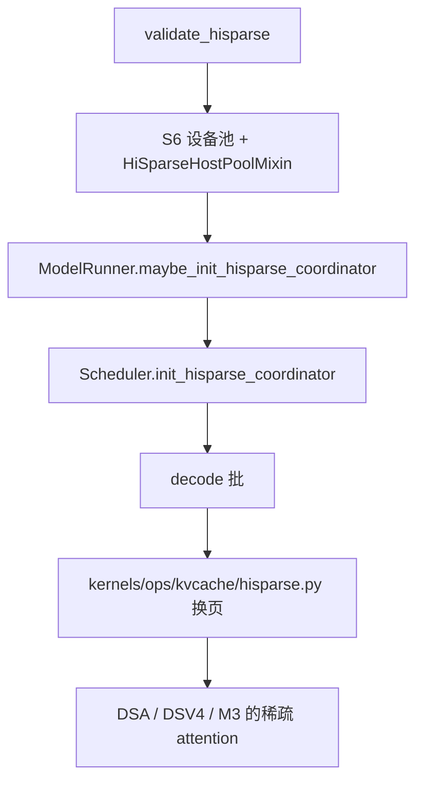
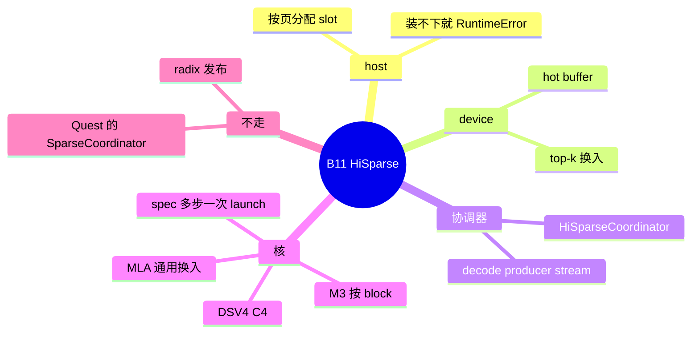

# HiSparse

对应 B11。树是 `297e54fd105e974cdf401e5b4d20253a22c16f90`。**源码路径推断，未实测**。本环境没有 host/device 换页的实跑记录。

## 场景与硬件

上下文长到设备 KV 放不下，但每个 decode 步只需要 indexer 选出的一小段页。HiSparse 把大部分 KV 留在 host，按 top-k 换进设备上的 hot buffer。面向的模型是 DSA、DeepSeek V4、MiniMax M3 sparse。

开关：`--enable-hisparse`。额外 JSON 是 `--hisparse-config`，别名 `--hierarchical-sparse-attention-extra-config`。

`validate_hisparse`（`arg_groups/hisparse_hook.py`，由 `overrides.py` 在解析末尾调用）把模型和平台收紧：

| 条件 | 源码行为 |
| --- | --- |
| 模型不是 DSA、DeepSeek V4、MiniMax M3 sparse | assert：`--enable-hisparse is only supported for DSA ... DeepSeek V4, and MiniMax M3 now.` |
| radix 仍开着 | `Hierarchical sparse attention currently requires --disable-radix-cache.` |
| mixed chunk | `--enable-hisparse does not support --enable-mixed-chunk yet.` |
| 投机 topk 不是 1 | `The minimal HiSparse spec integration supports linear speculation only; use --speculative-eagle-topk 1.` |
| `--speculative-adaptive` | 不支持 |
| KV dtype 不是 bf16 或 fp8_e4m3 | `HiSparse requires one of ('bfloat16', 'fp8_e4m3') KV cache dtypes` |
| DeepSeek V4.1 | `validate_deepseek_v41_features`：`DeepSeek-V4.1 does not support HiSparse yet` |
| PD decode radix | `--disaggregation-decode-enable-radix-cache is incompatible with --enable-hisparse` |
| beam search | `coordinator.validate_beam_request`：`Beam search is not supported with hisparse.` |
| `--dsv4-attn-backend trtllm` | 不支持 `enable_hisparse` |
| DSA 且 DCP | `deepseek_v2._dsa_dcp_overrides`：`DSA DCP does not support HiSparse or HiCache.` |
| ROCm + V4 + unified KV triton | `SGLANG_HACK_FLASHMLA_BACKEND=unified_kv_triton` 时直接 `ValueError` |

CUDA 上 DSA 子后端按 dtype，常量 `HISPARSE_CUDA_DSA_BACKENDS_BY_DTYPE`。默认函数 `_hisparse_default_backend`：HIP 用 `tilelang`；CUDA 且 fp8 用 `flashmla_kv`，否则 `flashmla_sparse`。ROCm 允许集合是 `tilelang` / `triton` / `aiter`（`HISPARSE_ROCM_DSA_BACKENDS`）。未知 dtype 回退到较大的三元组，再由 `validate_hisparse_dsa_backend` 报「本平台只支持这些 backend」。

`overrides._dsa_split_backend_resolution` 在 hisparse 分支里还有一条：CUDA + fp8 + 解析结果含 `tilelang` 时，`CUDA TileLang FP8 KV does not support HiSparse.`

M3 与 ROCm V4 在 `validate_hisparse` 里早退，跳过 DSA 那套 dtype/backend 表。M3 走 Triton sparse，核是 `load_blocks_to_device_buffer_mha`。

这些子后端名字和 [16-DSA-prefill核](16-DSA-prefill核.md) 的 `--dsa-prefill-backend` 重叠，但是两个字段。HiSparse 的默认写在 hisparse 分支，普通 DSA 的默认写在同一函数的另一分支。

## 在框架中的位置

和 [06-Quest](06-Quest.md) 分开。Quest 走 `algorithm=quest` 的 `SparseCoordinator`。HiSparse 走 `--enable-hisparse` 和 `HiSparseCoordinator`。`create_sparse_coordinator` 在本树没有生产调用点。

## 原理

设备上只留 hot buffer。indexer 或上一轮留下的 top-k 决定这一步要哪些 host 页。`mem_cache/pool_host/hisparse.py` 的 `HiSparseHostPoolMixin` 按页 `alloc_paged_token_slots`。host 池耗尽抛 `RuntimeError`。

`kernels/ops/kvcache/hisparse.py` 是设备池和 host 之间的搬运，不是 GEMM：

| 函数 | 做什么 |
| --- | --- |
| `load_cache_to_device_buffer_mla` | 通用 MLA 换入，可选 miss plan |
| `load_cache_to_device_buffer_dsv4_mla` | DSV4 的 packed C4 布局换入 |
| `load_blocks_to_device_buffer_mha` | MiniMax MHA，按 block 换 K/V |
| `copy_cache_planned_mla` | 共享 index 层重放 miss plan，只做 H2D |
| `transfer_cache_dsv4_mla` | C4 页之间搬运 |
| `load_cache_to_device_buffer_spec_mla` | 投机多步一次 launch，带 `HiSparseSpecState` |

因为 radix 被关掉，这些页不通过 `checkpoint` 变成别的请求能匹配的前缀。命中语义是「这条请求自己的 host 页 + 本步 top-k」，不是 B23 的跨请求前缀树。

## 过程

1. 解析末尾 `validate_hisparse`。hisparse 打开时 `_dsa_split_backend_resolution` 用 `_hisparse_default_backend` 填 DSA 子后端，再 `validate_hisparse_dsa_backend`。
2. KV 池建好后 `ModelRunner._init_post_memory_pool_components` 调 `maybe_init_hisparse_coordinator`。`parse_hisparse_config` 读 JSON。top-k 来自 `index_topk` 或 JSON 的 `top_k`。协调器拿 `req_to_token_pool`、`token_to_kv_pool_allocator`、`host_to_device_ratio`、`shared_index_layers`（`resolve_shared_index_layers`）和投机 draft token 数。
3. `Scheduler.init_hisparse_coordinator` 取同一个实例，`set_decode_producer_stream(forward_stream)`。
4. Decode 批在前向前由协调器按 top-k 发起换入。投机且 topk=1 时可以走 spec 核，一次搬多步。
5. Attention 读的是已经换进 hot buffer 的页。

## 调用栈

| 函数 | 做什么 | 角色 |
| --- | --- | --- |
| `validate_hisparse` | 模型、radix、mixed chunk、投机、dtype、子后端 | 启动门 |
| `_hisparse_default_backend` | 按 HIP / CUDA fp8 选默认子后端 | 平台默认 |
| `ModelRunner.maybe_init_hisparse_coordinator` | 构造 `HiSparseCoordinator` | 运行时对象 |
| `Scheduler.init_hisparse_coordinator` | 绑 decode 流 | 与前向流重叠换页 |
| `HiSparseHostPoolMixin.alloc_paged_token_slots` | host 页 | 容量 |
| `load_cache_to_device_buffer_*` | H2D 进 hot buffer | 本步可见 KV |
| 对应的 sparse attention forward | 只对换入的页做注意力 | 计算 |

## 与相邻特性

| ID | 关系 |
| --- | --- |
| B12 / B83 | DSA 子后端名字共用，旗标不同。HiSparse 有自己的允许表 |
| B14 | M3 早退，用 MHA block 核 |
| B23 | 必须 `--disable-radix-cache` |
| B26 | DCP 路径上 HiSparse 与 HiCache 一起被拒绝 |
| B64 | beam 协调器直接拒绝 |
| 投机 B01 | 只允许线性链，topk=1，禁止 adaptive |
| F197 | V4.1 拒绝表归模型篇。条件就是上面的那句 ValueError |

## 待核

- `hisparse_config` 里 `algorithm=quest` 是否还有活的生产路径。`create_sparse_coordinator` 无调用，倾向是未接线，见 Quest 页。
- DSV4 HiSparse 与 `trtllm`、unified KV、NPU 池的组合，`dsv4_memory_pool.py` 里还有 assert，本页没有逐条抄。
- host 换页的延迟和正确性没有实测。

返回 [本目录 README](README.md)。
