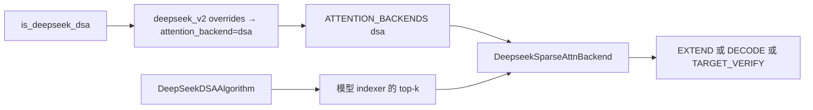
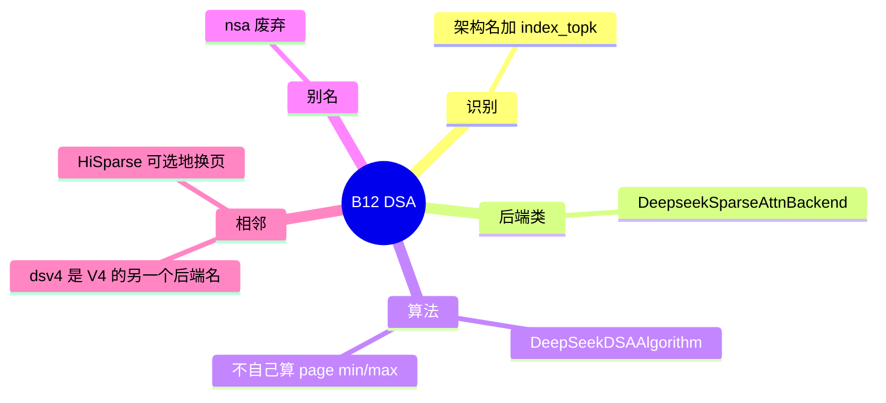

# DSA

对应 B12。树是 `297e54fd105e974cdf401e5b4d20253a22c16f90`。**源码路径推断，未实测**。

Prefill 核的旗标是 B83，按 CP 把层切开是 B84。HiSparse 换页是 B11。本页写「后端名叫 dsa」时前向和稀疏算法各做什么。

## 场景与硬件

DeepSeek 系在 MLA 上再加 indexer。Indexer 给出每个 query 的 top-k 页，attention 只读这些页。场景是长上下文、希望注意力随 top-k 而不是随全长增长。`nsa` 是废弃别名：`attention_registry._create_nsa_compat` 会 `warnings.warn`，叫用户改用 `dsa`。`ATTENTION_BACKEND_CHOICES` 里 `nsa` 标了 Deprecated。

谁被收成这个后端：`configs/model_config.is_deepseek_dsa` 要求架构名落在集合里，**并且** `_hf_attr(config, "index_topk") is not None`。强制赋值不在 `attention_hook.py`（该文件没有 `is_deepseek_dsa` 的匹配），而在 `model_overrides/deepseek_v2._deepseek_family_overrides`：`is_deepseek_dsa` 且用户没指定后端时写成 `dsa`。

DeepSeek V4 是另一条。`model_overrides/deepseek_v4._deepseek_v4_overrides` 把后端收成 `dsv4`，实现在 `deepseek_v4_backend.py`，不是 `dsa_backend.py`。V4 的稀疏 prefill 核见 B83 的 `dsv4_prefill_backend`。

硬件：`DeepseekSparseAttnBackend.__init__` 只 `assert self.use_dsa`，没有 SM 号断言。默认 prefill/decode 核在 `overrides._dsa_split_backend_resolution`，按 HIP、fp8、CUDA `major` 选（Blackwell fp8 可以走到 `trtllm`）。那是 B83 的选择逻辑，门在解析期，不在这个类的构造函数里。

HYV4 若走这套 family override，`--enable-prefill-cp` 或 `--dcp-size > 1` 会被拒绝。DSA 加 DCP 还不支持 HiSparse 和 HiCache。

## 在框架中的位置

`mem_cache/sparsity/factory.py` 里，DSA 算法配 `DSABackendAdaptor`。Quest 配 `FlashAttentionAdaptor`。两条 adaptor 不混用。

## 原理

`layers/attention/dsa_backend.py` 的类名是 `DeepseekSparseAttnBackend`。类没有顶层 docstring。类体注释描述 metadata 和 CUDA graph 行为：验证步和普通 decode 的长度不同，metadata 要按 `ForwardMode` 准备。

`DeepSeekDSAAlgorithm`（`mem_cache/sparsity/algorithms/deepseek_dsa.py`）的 docstring 说明它使用模型自带的 indexer top-k，覆盖父类那套「自己扫 K 建表示」的流程。`retrieve_topk` 要求 kwargs 里有 `indexer, forward_batch, x, q_lora, positions`。没有这些，就不是这条算法。

因此 DSA 的稀疏下标来自模型层里的 indexer 前向，不是 Quest 的 `page_k_min` / `page_k_max`。KV 池仍是 MLA 池。HiSparse 打开时，这些 top-k 再被用来从 host 换页，见 HiSparse 页。没开 HiSparse 时，top-k 直接索引设备上的页。

## 过程

1. 模型 override 在用户未指定后端时写入 `dsa`。
2. `_dsa_split_backend_resolution` 填 `dsa_prefill_backend` 和 `dsa_decode_backend`。hisparse 打开时改走 HiSparse 默认。
3. `attention_backend_setup._build_full_attention_backend_from_str` 用 `ATTENTION_BACKENDS["dsa"]` 构造 `DeepseekSparseAttnBackend(runner)`。
4. 前向：indexer 产 top-k，backend 按 top-k 组装 sparse metadata，再调对应 prefill 或 decode 核。
5. 投机验证若走 MTP index share，top-k 可以从 `SpecInput.dsa_topk_indices` 接力。这个字段定义在 `SpecInput` 上，EAGLE 族输入才会覆盖。见 [投机框架](../03-投机与MTP/00-框架.md)。

## 调用栈

| 函数 | 做什么 | 角色 |
| --- | --- | --- |
| `is_deepseek_dsa` | 架构名且 `index_topk` 非空 | 识别 |
| `_deepseek_family_overrides` | 未指定则后端改为 `dsa` | 模型默认 |
| `_dsa_split_backend_resolution` | 选 prefill/decode 核 | B83 |
| `_build_full_attention_backend_from_str` | 查表构造后端 | 注册表 |
| `DeepseekSparseAttnBackend` 的 forward | 按模式准备 metadata 并调核 | 注意力 |
| `DeepSeekDSAAlgorithm.retrieve_topk` | 把 indexer 的 top-k 交给稀疏路径 | 下标从哪来 |

## 与相邻特性

B15 的 Qwen QSA 也有 top-k，类是 `QwenSparseAttnBackend`，池可以是 `QSATokenToKVPool`。不要把 Qwen 的压缩 indexer 写成 DSA。B13 写这条边界。

GLM-5 / 5.1 / 5.2 的类 `GlmMoeDsaForCausalLM` 在 `index_topk` 非空时被 `is_deepseek_dsa` 算进来。产品名和类名的对应在模型清单 C.2，本页不展开年代表。

## 待核

`attention_hook.py` 没有强制 DSA。若还有别的文件在 hook 之后改后端，要以 `run_post_process_pass` 的最终 resolution 为准。NPU 上 DSA 模型是否改走 `ascend`，本页只确认 V4 的 `create_dsv4_backend` 有 NPU 类，DSA 类本身没有 NPU 分支断言。

返回 [本目录 README](README.md)。
