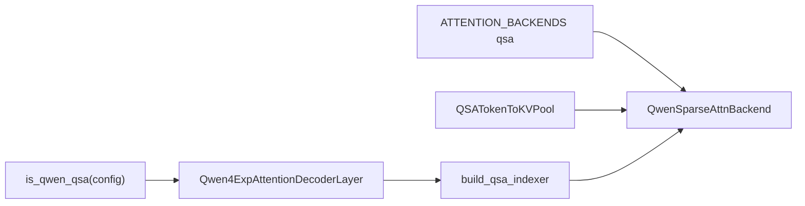
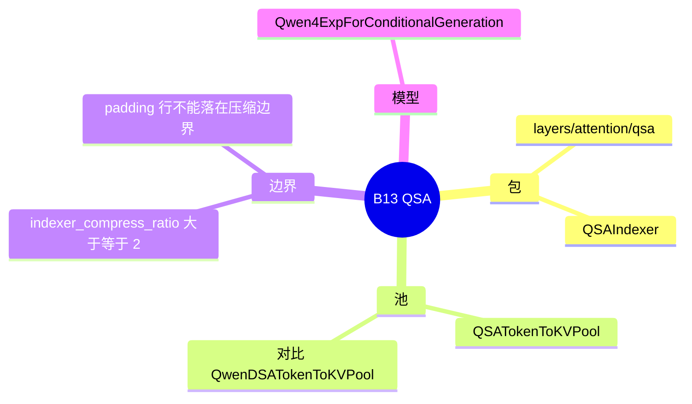

# QSA

对应 B13。树是 `297e54fd105e974cdf401e5b4d20253a22c16f90`。**源码路径推断，未实测**。

Qwen4-Exp 上 MTP 怎么复用 top-k，见 [05-Qwen稀疏](05-Qwen稀疏.md)。本页写后端名 `qsa`、池和压缩边界。

## 场景与硬件

Qwen 的 simple QSA：一层压缩 indexer，decode 时按稀疏下标读 KV，而不是每步全长注意力。注册名 `qsa` 对应 `QwenSparseAttnBackend`。

`--qsa-indexer-dtype fp8_e4m3` 在 `model_overrides/qwen4_exp` 里要求 `platform.is_cuda` 且（SM90 或 SM100）。其它 dtype 没有这条 SM 断言。

## 在框架中的位置

`qsa/__init__.py` 导出 `QSAIndexer`、`build_qsa_indexer`、`parse_qsa_profile`、`is_qwen_qsa`。池在 `mem_cache/qsa_kv_pool.py`：`QSATokenToKVPool` 继承 `HybridLinearKVPool`。同文件用文档对比 `QwenDSATokenToKVPool`，那是 tokenwise 的 Qwen3Next-DSA 池，和 Q4-Exp 的压缩 QSA 不是同一个类。

## 原理

压缩比 `indexer_compress_ratio >= 2` 时，若干 token 共享一个压缩槽。`qsa/config.py` 写明：padding 行不能落到压缩边界上，否则压缩槽会对齐错。`qsa_indexer.py` 和 `graph_metadata.py` 在压缩边界写 compressed slot。

这里的 boundary 是压缩窗口的边界，不是 `layers/layer_boundary` 那个包。Qwen sparse 后端类和 QSA indexer 在同一条栈上：模型层建 indexer，后端在 decode / 验证时消费 top-k。

## 过程

1. 用户或模型 override 把 `--attention-backend` 设成 `qsa`。Qwen4-Exp 的 override 还会处理 page size（压缩 QSA 注释里是 64）和 PLE 默认。
2. `_build_full_attention_backend_from_str` 构造 `QwenSparseAttnBackend`。
3. `Qwen4ExpAttentionDecoderLayer` 在 `is_qwen_qsa` 时 `build_qsa_indexer`。
4. 前向产出 top-k。MTP 验证时这些下标可以经 `QSAMTPSharedSparseIndices` 在 draft-extend 之间复用，见 Qwen 稀疏页。
5. KV 写入 `QSATokenToKVPool` 的槽。分配仍走 scheduler 的 `out_cache_loc`，池类型在建池时选定。

## 调用栈

| 函数 | 做什么 | 角色 |
| --- | --- | --- |
| `is_qwen_qsa` | 看 config 是不是 QSA | 层是否建 indexer |
| `build_qsa_indexer` | 压缩 indexer 模块 | top-k 的生产者 |
| `ATTENTION_BACKENDS["qsa"]` | 得到 `QwenSparseAttnBackend` | 注册 |
| `QSATokenToKVPool` | 混合线性池上的 QSA 槽 | 存储 |
| `resolve_qsa_sparse_backend` | 把 top-k 接到可打断的图 | 图路径 |

## 与相邻特性

B12 的 DSA 用 DeepSeek indexer，类名 `DeepseekSparseAttnBackend`。B15 是同一 Qwen 后端上的 MTP 约束（topk=1）。B81 的 PLE 是 Qwen4-Exp 的另一张 n-gram 表，和 QSA 的压缩 KV 不是一块存储。Qwen4-Exp override 还拒绝 `--enable-unified-memory`，以及 PD+PP+MORI 的一些组合，细节在该 override 文件。

## 待核

`Qwen3Next` 的 tokenwise DSA 池和 Q4-Exp 压缩池在 PD 元数据上怎么交换，disagg 注释是散的。本页只确认类名不同。

返回 [本目录 README](README.md)。
