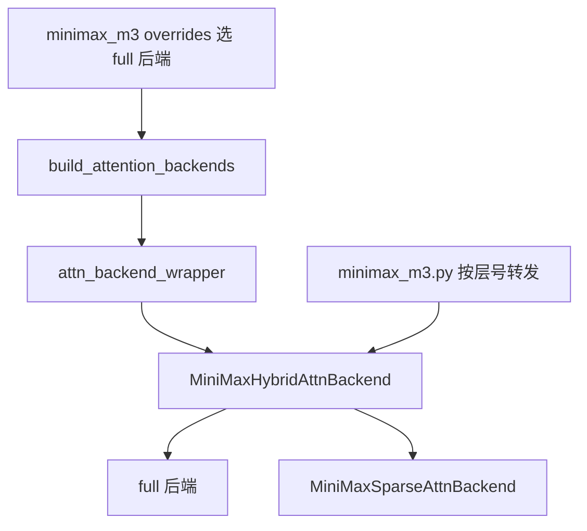
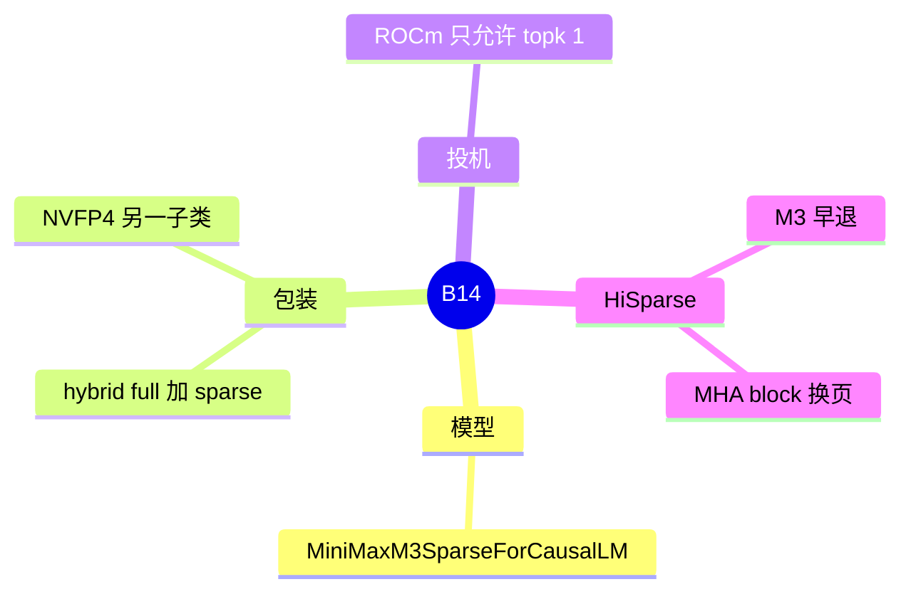

# MiniMax 稀疏

对应 B14。树是 `297e54fd105e974cdf401e5b4d20253a22c16f90`。**源码路径推断，未实测**。

## 场景与硬件

MiniMax-M3 的一层里，一部分层是稠密注意力，一部分层是稀疏注意力。服务端不靠用户再写一个 `--attention-backend minimax`。`attention_registry.attn_backend_wrapper` 看见 `is_minimax_sparse(hf_config)` 就包一层 `MiniMaxHybridAttnBackend`：基座是用户或 override 选出的 full 后端，稀疏层是 `MiniMaxSparseAttnBackend`，层号来自 `get_minimax_sparse_layer_ids`。NVFP4 native 栈则换成 `MiniMaxSparseNvfp4AttnBackend`。

`model_overrides/minimax_m3` 按平台选基座后端：Blackwell、SM100、SM90、HIP 分别倾向 fa3 / fa4 / trtllm_mha / triton。NVFP4 的投机只放行 Blackwell，非 Blackwell 拒绝 DSPARK / DFLASH 一类。M3.1 NVFP4 还拒绝 PP，以及非 static 的 ragged verify。

ROCm 上投机要求 `--speculative-eagle-topk 1`，报错：`MiniMax-M3 ROCm speculative attention requires a linear draft chain (--speculative-eagle-topk 1).` 这就是清单里说的「MTP verify 注释在该 backend 里」。

HiSparse 把 M3 算进允许的模型，换页核是 `load_blocks_to_device_buffer_mha`。见 [01-HiSparse](01-HiSparse.md)。

## 在框架中的位置

## 原理

稀疏层和稠密层共享同一次调度、同一套 `req_to_token`，但 KV 池可以是 `attn_backend.sparse.kv_pool`。模型文件 `models/minimax_m3.py` 按层 ID 把 forward 送到稀疏子后端。稠密层仍走基座后端（fa3、trtllm_mha 等）。

MSA 与 decode CUDA graph、投机同时打开时，backend 初始化里有失败路径。完整报错字符串在 `minimax_sparse_backend.py` 约 293 行之后，本页没有在运行时触发它，标待核。

## 过程

1. Override 按 SM / HIP / 量化选基座，并检查 NVFP4 与投机。
2. `build_attention_backends` 先建基座，wrapper 再包稀疏。
3. 前向按层号分流。
4. 若开 HiSparse，稀疏层的块从 host 换入后再算。
5. 投机验证走线性链。ROCm 上 topk>1 在 backend 初始化失败。

## 调用栈

| 函数 | 做什么 | 角色 |
| --- | --- | --- |
| `is_minimax_sparse` | 识别 M3 sparse config | 要不要包 |
| `attn_backend_wrapper` | 构造 hybrid 或 NVFP4 稀疏后端 | 注册之后的第二层 |
| `get_minimax_sparse_layer_ids` | 哪些层走稀疏 | 模型分流 |
| `MiniMaxSparseAttnBackend.__init__` | ROCm 投机 topk、图与投机的组合 | 启动失败点 |
| `MiniMaxM3SparseForCausalLM` 的层 forward | 按 ID 调用 `sparse` | 计算 |

## 与相邻特性

B11 允许 M3，但 M3 不走 DSA 的 dtype 表。B02 的 EAGLE topk>1 在 ROCm M3 上被这个 backend 拒绝。量化 NVFP4 的平台门在 override，不在 attention 注册表。

## 待核

MSA + decode CUDA graph + 投机的完整错误字符串未在本环境触发。M3 是否存在单独 CLI 旗标：搜索路径是模型 override 和 wrapper，没有看到独立的 `--attention-backend` 枚举值。

返回 [本目录 README](README.md)。
