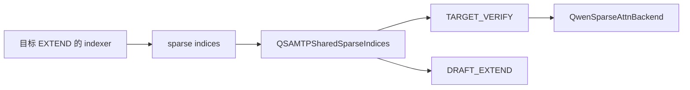
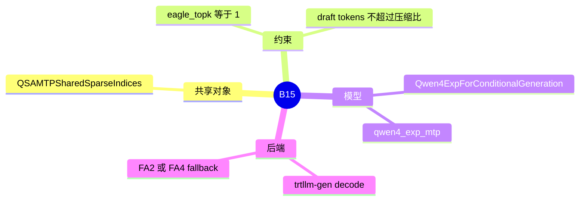

# Qwen 稀疏与 Qwen4-Exp MTP

对应 B15。树是 `297e54fd105e974cdf401e5b4d20253a22c16f90`。**源码路径推断，未实测**。

池和压缩边界在 [03-QSA](03-QSA.md)。本页写 MTP 验证时 top-k 怎么复用。

## 场景与硬件

Qwen4-Exp 用 QSA 做目标模型，再用 MTP / EAGLE 风格的草稿多猜几个 token。验证时每个草稿步如果各自跑一遍 indexer，top-k 的代价会盖过投机收益。`QSAMTPSharedSparseIndices` 让 draft-extend 的若干步共用同一组 sparse indices。

源码注释写明当前只支持 `speculative_eagle_topk=1`。`_require_chain_speculation` 的报错是 `Qwen QSA target verification supports only speculative_eagle_topk=1`。`qwen_sparse_attn_backend.py` 附近还有 `Qwen4-Exp QSA MTP currently supports speculative_eagle_topk=1`。草稿 token 数还不能超过压缩比。

硬件跟 QSA 页：fp8 indexer 要 CUDA SM90 或 SM100。SM100 上 Qwen4-Exp override 还会在 triton 和 `trtllm_mha` 之间选默认 attention，条件在 `qwen4_exp_overrides`。

CP 与 TP 组共享时，Qwen4-Exp 会关掉 prefill CUDA graph，并拒绝 waterfill。见 [07-并行切分](../07-并行切分/03-Prefill-CP.md) 的 B82。

## 在框架中的位置

## 原理

`QwenSparseAttnBackend` 的 decode 主路径是 trtllm-gen，不满足时回落到 FA2 或 FA4。验证输入仍是投机框架的 `TARGET_VERIFY`，但 attention 侧额外携带共享的 top-k，避免每步重算 indexer。

共享的前提是草稿链是线性的（topk=1）。树状草稿会在同一步产生多个分叉，一组 indices 对不上多条链，所以后端直接拒绝。

## 过程

1. 目标 prefill 或上一轮接受的 token 跑 indexer，得到 top-k。
2. 投机 worker 进入验证。backend 检查 topk 和 draft token 数。
3. `QSAMTPSharedSparseIndices` 把这组下标放进后续 draft-extend 步。
4. 每步 decode / 验证用同一组下标读 `QSATokenToKVPool`。
5. 接受长度确定后，下一轮若序列变了，再重新索引。共享的是「这一轮草稿窗口」，不是永远不刷新。

## 调用栈

| 函数 | 做什么 | 角色 |
| --- | --- | --- |
| `Qwen4ExpAttentionDecoderLayer` | 建 QSA indexer | top-k 生产者 |
| `_require_chain_speculation` | topk 必须为 1 | 验证门 |
| `QSAMTPSharedSparseIndices` | 跨 MTP 步保存 indices | 复用 |
| `QwenSparseAttnBackend` 的 verify / draft-extend | 用共享下标做稀疏注意力 | 计算 |
| `qwen4_exp_overrides` | page、PLE、SM100 默认后端 | 启动 |

## 与相邻特性

B13 是池和压缩。B02 是 EAGLE worker 的通用验证。这里的 topk=1 是 Qwen 后端再加的一层，和 HiSparse、MiniMax ROCm 的 topk=1 是各自的检查，不是同一个函数。B81 的 PLE offload 默认在 CUDA BF16 的 Qwen4-Exp 上打开，和稀疏 KV 并行存在。

## 待核

共享对象的生命周期是「一个验证窗口」还是「直到索引层号变化」，要以 `QSAMTPSharedSparseIndices` 的写入点为准。本页按注释和类名写复用，没有逐步跟赋值。

返回 [本目录 README](README.md)。
