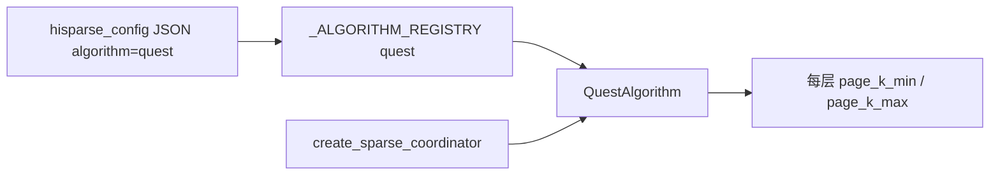
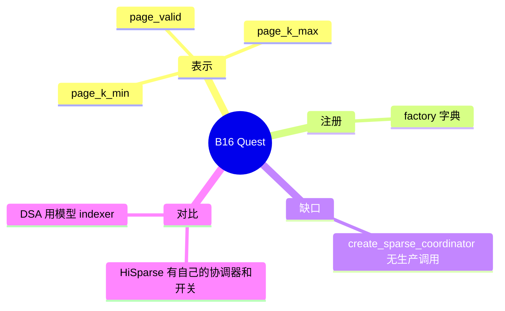

# Quest

对应 B16。树是 `297e54fd105e974cdf401e5b4d20253a22c16f90`。**源码路径推断，未实测**。

## 场景与硬件

Quest 用每一页 K 的最小值和最大值做上界，挑出可能重要的页，再只对那些页做注意力。它不依赖模型自带的 indexer。场景是「模型没有 DSA / QSA indexer，但仍想按页丢掉 KV」的插件算法。

没有单独的 CLI。算法名写在稀疏配置 JSON 的 `algorithm` 字段。解析函数和 HiSparse 的 extra config 共用 `_parse_sparse_config` / `hisparse_config` 这条入口。默认 algorithm 为空时，工厂不会自动变成 quest。

硬件：adaptor 选择要求能走 `fa3` 或 flash attention 那条 `FlashAttentionAdaptor`。没有单独的 SM 断言写在 `QuestAlgorithm` 类上。

## 在框架中的位置

## 原理

`quest_algorithm.py` 的 `QuestAlgorithm` 在 `_initialize_representation_pools` 里按层分配每页、每 head 维的 min/max。`_compute_page_representations` 从 `req_to_token` 和 `k_buffer` 扫过一页，更新包围盒。检索时用 query 和这些包围盒做上界，选出页，而不是调用 DeepSeek indexer。

`factory._create_backend_adaptor`：quest 走 `FlashAttentionAdaptor`，DSA 走 `DSABackendAdaptor`。

和 HiSparse 的差别在调用链，不在名字偶尔共用一个 JSON 解析器。HiSparse 的开关是 `--enable-hisparse`，对象是 `HiSparseCoordinator`，搬运在 `kernels/ops/kvcache/hisparse.py`。Quest 的对象是 `SparseCoordinator` 加上 `QuestAlgorithm`。

## 过程

按类的方法，若协调器被构造，过程应是：

1. 建池时为每层分配 min/max/valid。
2. KV 写入后扫页，更新包围盒。
3. 前向检索 top 页，把页下标交给 flash attention adaptor。

本树里 `create_sparse_coordinator` 没有生产调用点。因此上面三步是类被接上之后的路径，**当前启动链没有走到它**。把 `algorithm=quest` 写进 `--hisparse-config` 不会自动变成 HiSparse 的换页，也不会自动构造这个协调器。

## 调用栈

| 函数 | 做什么 | 角色 |
| --- | --- | --- |
| `_parse_sparse_config` | 从 JSON 读 `algorithm` | 配置 |
| `_ALGORITHM_REGISTRY["quest"]` | 指向 `QuestAlgorithm` | 注册 |
| `QuestAlgorithm._initialize_representation_pools` | 分配包围盒 | 状态 |
| `QuestAlgorithm._compute_page_representations` | 用 K 缓冲更新 min/max | 索引 |
| `create_sparse_coordinator` | 本应把算法和 adaptor 装到 runner | **无调用，待核** |

## 与相邻特性

B11 是另一条稀疏路径，并且会强制关掉 radix。Quest 的类本身没有这条强制。B12 的 `DeepSeekDSAAlgorithm` 覆盖父类流程，不维护 page min/max。

## 待核

v0.5.23 这棵树上 Quest 是否只剩算法类、尚未接到 `ModelRunner`。证据是全仓库没有 `create_sparse_coordinator` 的调用。若后续提交接上了，以调用点为准，本页的「未接线」就过时。

返回 [本目录 README](README.md)。
