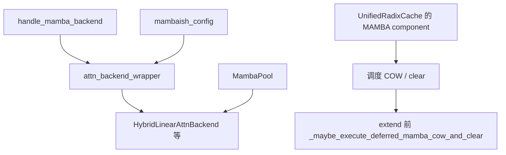
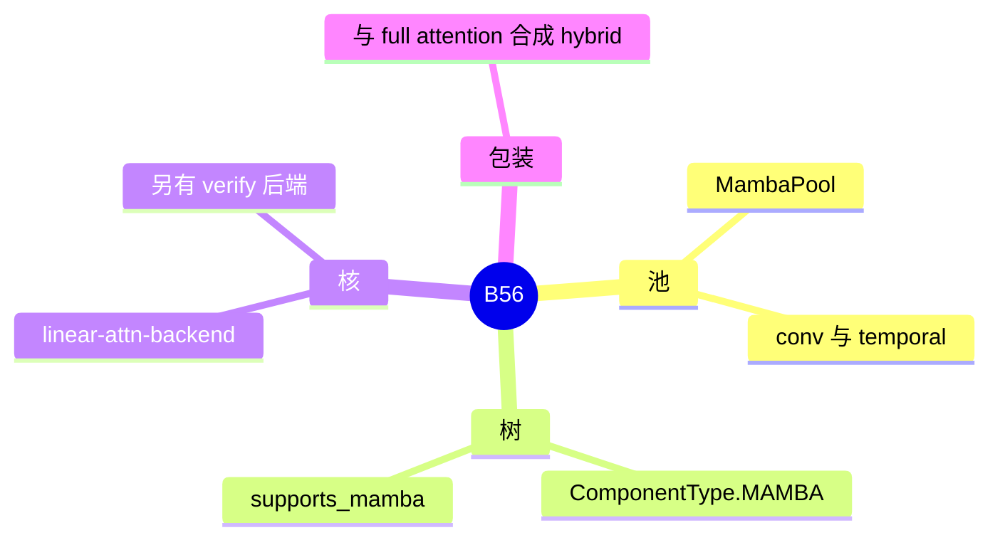

# Mamba 与线性注意力

对应 B56。树是 `297e54fd105e974cdf401e5b4d20253a22c16f90`。**源码路径推断，未实测**。

KDA、GDN、Lightning、short conv 各有一页。本页写它们共用的状态池、后端开关和 hybrid 包装。

## 场景与硬件

混合模型里一部分层是 softmax attention，一部分层是线性注意力或 Mamba。线性层的状态是卷积核加时间状态，长度不随上下文线性涨 KV。服务要为这些状态单独划池，并在 radix 上用 MAMBA component 做复制和驱逐。

`--linear-attn-backend` 的核选择 `LINEAR_ATTN_KERNEL_BACKEND_CHOICES`：`triton`，`cutedsl`，`flashinfer`，`flashkda`，`nvidia_kda`，`ptx_kda`，`helion`，`intel_xpu`。验证路径的字段 `linear_attn_verify_backend` 另外允许 `nv_cutedsl`。`nv_cutedsl` 不在上面这份核列表里，Kimi K3 的投机默认会把它写上，见 [08-KDA](08-KDA.md)。

`mamba_hook.handle_mamba_backend` 的设备门：

| 检查 | 条件 |
| --- | --- |
| stochastic rounding | `mamba_ssm_dtype` 为 float16，且 `get_platform().is_cuda` |
| triton + stochastic rounding | `is_sm100` |
| `mamba_backend=flashinfer` | 安装了 `flashinfer.mamba` |
| `mamba_cache_philox_rounds`、`mamba_max_states_per_path` | 数值校验，与 GPU 代数无关 |

`handle_int8_mamba_checkpoint` 拒绝 hierarchical cache、自定义 radix、LMCache。

## 在框架中的位置

`MambaPool` 在 `mem_cache/memory_pool.py`。`register_slot_state` 可以挂 PLE 一类 sibling。统一内存打开时，Mamba 是 `UnifiedKVPool` 的一块子池，见 [08-Unified-memory](../01-缓存/08-Unified-memory.md)。

调度篇写过：混合模型的 COW 和清槽可以推迟到前向流上。`ModelRunner._maybe_execute_deferred_mamba_cow_and_clear` 只在 extend、且不是 target verify、也不是 draft extend 时，于各层读池之前做。它消费的是调度期放进 `ForwardBatch` 的 `mamba_cow_*` / `mamba_clear_indices`。

## 原理

线性层的「KV」不是每 token 一页，而是固定大小的状态。前缀复用要复制状态（COW），分叉之后的 token 才能各写各的。这就是 MAMBA component 存在的原因。纯 radix 的 token 页复制覆盖不了这块状态。

`configs/hybrid_arch.py` 的 `mambaish_config` 把 Mamba2、KDA、GDN、Lightning 收成「需要 hybrid 包装」的集合。`attn_backend_wrapper` 据此在 full attention 旁边加线性后端。具体是哪一种线性，由下面几页的 config 谓词决定，不由 `--linear-attn-backend` 决定。那个旗标只选核。

## 过程

1. `handle_mamba_backend` 校验核和随机舍入。
2. 模型 config 命中 `mambaish_config` 时 wrapper 建 hybrid 后端。
3. `create_unified_radix_cache` 追加 `ComponentType.MAMBA`。`host_pool` retraction 禁止纯 SWA 和 Mamba 的组合，见缓存域总览。
4. 调度在 extend 前准备 COW / clear 下标。
5. 前向先执行推迟的 COW，再跑线性层核，状态写回 `MambaPool`。

## 调用栈

| 函数 | 做什么 | 角色 |
| --- | --- | --- |
| `handle_mamba_backend` | 核、dtype、SM100、flashinfer 是否可 import | 启动门 |
| `mambaish_config` | 这个模型要不要 hybrid | 识别 |
| `attn_backend_wrapper` | 把线性后端和 full 后端包在一起 | 注册之后 |
| `MambaPool` | conv + temporal 状态 | 存储 |
| `create_unified_radix_cache` | 追加 MAMBA component | 前缀复制 |
| `_maybe_execute_deferred_mamba_cow_and_clear` | 读状态前做 COW | 前向里唯一的缓存准备写 |

## 与相邻特性

Qwen3-Next 的类是 `Qwen3GatedDeltaNet`，走 GDN 页。Kimi Linear、`use_kda` 的 Bailing、GLM-5-Next 走 KDA 页。Bailing 在 `use_kda` 为假时走 Lightning。int8 Mamba checkpoint 与 HiCache 互斥。

## 待核

每个 hybrid 模型是否都注册了 `linear_attn_registry_result`。非 mambaish 的回退路径本页没有逐个模型点名。

返回 [本目录 README](README.md)。
