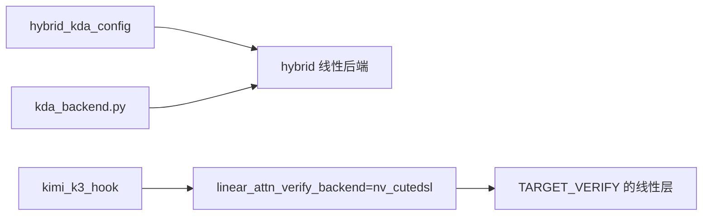
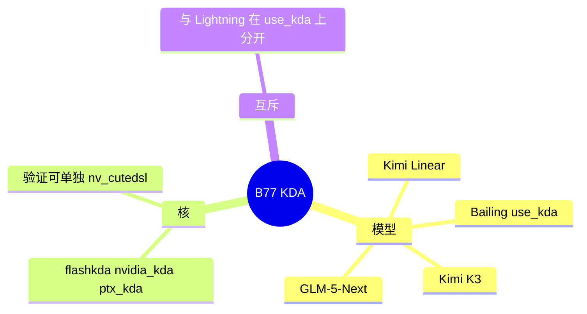

# KDA

对应 B77。树是 `297e54fd105e974cdf401e5b4d20253a22c16f90`。**源码路径推断，未实测**。

## 场景与硬件

KDA（Kimi Delta Attention 一类线性注意力）出现在 Kimi Linear、`BailingHybridConfig.use_kda` 为真的 Bailing hybrid，以及 GLM-5-Next 文本。状态池和核开关的总规则在 [07-Mamba与线性注意力](07-Mamba与线性注意力.md)。本页只写谁被识别成 KDA，以及验证核的默认。

识别函数在 `configs/hybrid_arch.py`：

| 函数 | 为真时 |
| --- | --- |
| `kimi_linear_config` | KimiLinear，或 Bailing 且 `use_kda`，或嵌套的 text config 命中 |
| `hybrid_kda_config` | `kimi_linear_config` 或 `glm5_next_config` |
| `hybrid_lightning_config` | Bailing 且 `use_kda` 为假，或 MiniCPM 的 lightning 层 |

`use_kda` 把 Bailing 从 Lightning 拨到 KDA。两边不会同时为真。

核名字 `flashkda` / `nvidia_kda` / `ptx_kda` 是 `--linear-attn-backend` 的选项，不是「加载 KDA 模型」的开关。模型结构来自 config。

`kimi_k3_hook.apply_kimi_k3_spec_backend_defaults` 在开了投机时把 `linear_attn_verify_backend` 收成 `nv_cutedsl`。注释写的是融合的 Kimi-K3 / DSPARK CuTeDSL 验证核。`apply_kimi_k3_linear_attn_defaults` 在 SM100、bf16 时把线性 decode 收成 triton。

## 在框架中的位置

## 原理

KDA 层不写每 token 的 K/V 页，写的是 `MambaPool` 里的状态。验证步可以用和 decode 不同的核：字段 `linear_attn_verify_backend` 在 `fields/exec_.py`。Kimi K3 把验证钉死到 `nv_cutedsl`，是为了和 DSPARK 的融合核对齐，不是把整个 `--linear-attn-backend` 改掉。

GLM-5.3-Flash 的类 `Glm5NextForConditionalGeneration` 同时被 DSA（`is_deepseek_dsa`）和 KDA（`glm5_next_config`）认领：softmax/DSA 层和 KDA 层在同一张 hybrid 里。CP-TP 组共享的白名单里有这个类，见并行切分页。

## 过程

1. config 谓词命中，wrapper 选择 `layers/attention/linear/kda_backend.py` 的后端。
2. Kimi K3 的 hook 在投机开启时改验证后端。
3. 调度仍走 MAMBA component 的 COW。
4. 验证前向用 `nv_cutedsl`（若被钉上），普通 decode 用 `--linear-attn-backend` 解析出的核。

## 调用栈

| 函数 | 做什么 | 角色 |
| --- | --- | --- |
| `hybrid_kda_config` | 判定 KDA hybrid | 识别 |
| `kda_backend` 的后端类 | 线性层前向 | 计算 |
| `apply_kimi_k3_spec_backend_defaults` | 验证核收成 `nv_cutedsl` | 仅 K3 投机 |
| `apply_kimi_k3_linear_attn_defaults` | SM100 bf16 的 decode 核默认 | 平台默认 |
| `MambaPool` | 状态 | 存储，见 B56 |

## 待核

`nv_cutedsl` 的核文件入口本页没有逐行打开。已知它不在 `LINEAR_ATTN_KERNEL_BACKEND_CHOICES`，而在 verify 字段的允许值里。非 K3 的 KDA 模型是否也会被钉成这个验证核：hook 名字是 kimi k3，GLM-5-Next 另有 `apply_glm5_next_spec_backend_defaults`，两边不要合成一个默认。

返回 [本目录 README](README.md)。
