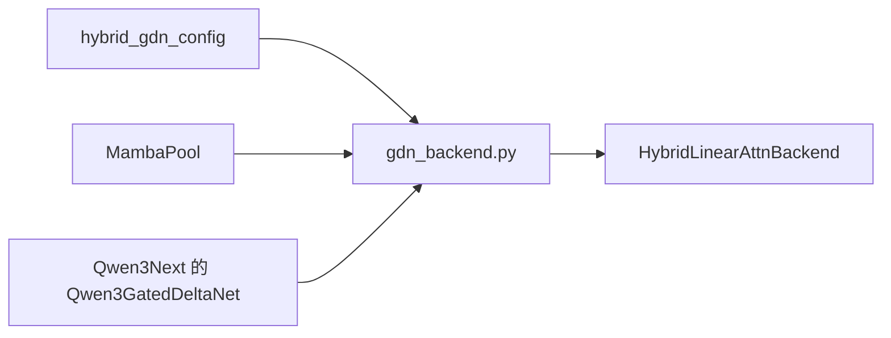
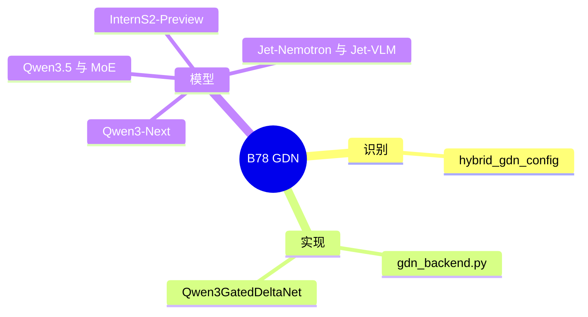

# GDN

对应 B78。树是 `297e54fd105e974cdf401e5b4d20253a22c16f90`。**源码路径推断，未实测**。

## 场景与硬件

Gated Delta Net 是另一类线性注意力。`hybrid_gdn_config` 覆盖 Qwen3-Next、Qwen3.5、Qwen3.5-MoE、InternS2-Preview、Jet-Nemotron、Jet-VLM。Qwen3-Next 的模块类名是 `Qwen3GatedDeltaNet`（`models/qwen3_next.py`）。状态池和 `--linear-attn-backend` 的规则在 [07-Mamba与线性注意力](07-Mamba与线性注意力.md)。

没有单独的「启用 GDN」旗标。核可以是 triton、cutedsl、flashinfer 等，和 KDA 共用那份 choices。KDA 专用的 `flashkda` / `nvidia_kda` / `ptx_kda` 不是 GDN 的结构开关。

源码没有在 `gdn_backend.py` 的识别函数上写 SM 白名单。SM 门若存在，在某个核的实现或 `handle_mamba_backend` 的 flashinfer / stochastic 分支里。

## 在框架中的位置

## 原理

GDN 层把门控和 delta 规则写进固定大小的状态。和 KDA 一样走 MAMBA component，这样前缀分叉时状态被复制而不是按 token 页共享。Qwen3-Next 的 MTP 类是 `Qwen3NextForCausalLMMTP`。验证步的线性层仍由 hybrid 后端派发，投机 worker 的选择在 [03-投机与MTP](../03-投机与MTP/00-框架.md)，不在本页改写。

## 过程

1. `hybrid_gdn_config` 为真，wrapper 挂上 `layers/attention/linear/gdn_backend.py`。
2. 建池时 `MambaPool` 或统一内存里的 Mamba 子池按层划状态。
3. 前向在 GDN 层读状态、写状态，softmax 层仍走 full attention 后端。
4. extend 前的 COW 由 B56 的推迟函数执行。

## 调用栈

| 函数 | 做什么 | 角色 |
| --- | --- | --- |
| `hybrid_gdn_config` | 识别 Qwen3-Next / Qwen3.5 / InternS2 / Jet | 结构 |
| `Qwen3GatedDeltaNet` | Qwen3-Next 的层模块 | 模型 |
| GDN 后端 forward | 状态递推 | 计算 |
| `attn_backend_wrapper` | 与 full attention 合成 | 一条 forward 里两种层 |

## 待核

Qwen3.5-MoE 的 MoE 层和 GDN 层如何交替，本页只确认类名在 `qwen3_5.py` 且 config 谓词包含该家族。override 文件 `model_overrides/qwen3_5.py` 的逐条规则没有摘进本页。

返回 [本目录 README](README.md)。
