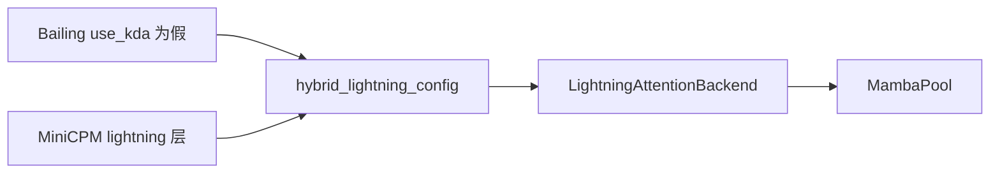
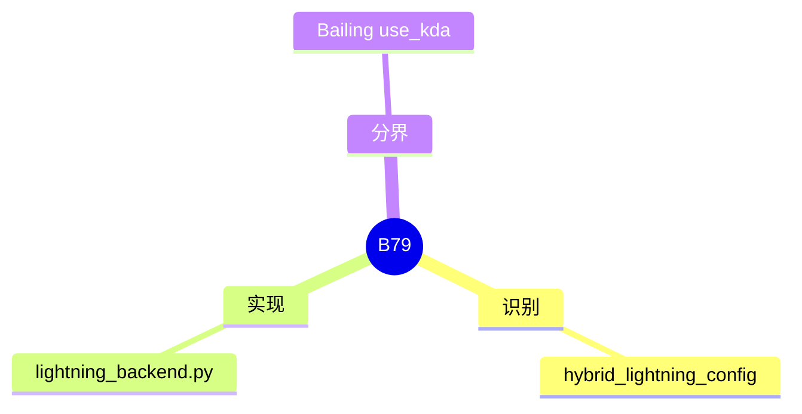

# Lightning attention

对应 B79。树是 `297e54fd105e974cdf401e5b4d20253a22c16f90`。**源码路径推断，未实测**。

## 场景与硬件

Lightning 是 Bailing hybrid 在 `use_kda` 为假时的线性层，也是 MiniCPM hybrid 里标成 lightning 的层。无单独 CLI。`hybrid_lightning_config` 为真就选 `LightningAttentionBackend`（`layers/attention/linear/lightning_backend.py`）。

和 KDA 的分界就是 `BailingHybridConfig.use_kda`。为真走 [08-KDA](08-KDA.md)，为假走本页。MiniCPM 不看这个布尔，而看 lightning 层的 config。

硬件门没有写在该 backend 的识别函数上。核仍可能受 B56 的 flashinfer / SM100 约束，如果用户把 `--linear-attn-backend` 选到那些核。

## 在框架中的位置

## 原理

Lightning 层同样把历史压进固定状态，而不是增长 KV。Hybrid 包装让同一条解码序列上，lightning 层和 softmax 层各写各的池。状态复用走 MAMBA component。

## 过程

1. config 谓词命中。
2. wrapper 挂上 `LightningAttentionBackend`。
3. 前向按层调用。状态的 COW 仍由调度期下标加 B56 的推迟执行完成。

## 调用栈

| 函数 | 做什么 | 角色 |
| --- | --- | --- |
| `hybrid_lightning_config` | Bailing 非 KDA，或 MiniCPM lightning | 识别 |
| `LightningAttentionBackend` | 该层前向 | 计算 |
| `MambaPool` | 状态槽 | 存储 |

## 待核

MiniCPM 哪些层号算 lightning，要以 `hybrid_lightning_config` 读取的 config 字段为准。本页没有把层号表抄出。

返回 [本目录 README](README.md)。
