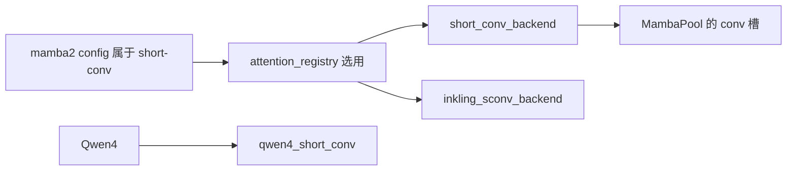
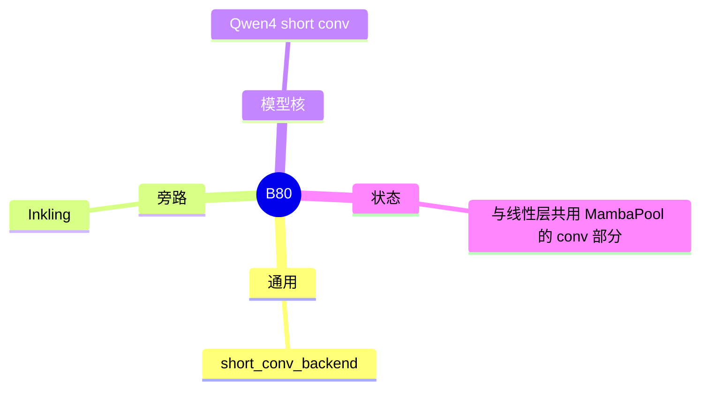

# Short conv

对应 B80。树是 `297e54fd105e974cdf401e5b4d20253a22c16f90`。**源码路径推断，未实测**。

## 场景与硬件

线性注意力旁边常常还有一条短卷积，卷积状态比 KV 小，但和 token 缓存一样要按请求分槽。无单独 CLI。`attention_registry.py` 在 mamba2 config 属于 short-conv 配置时选用这条后端。

实现：

| 路径 | 角色 |
| --- | --- |
| `linear/short_conv_backend.py` | 通用短卷积状态 |
| `inkling_sconv_backend.py` | Inkling 的旁路 |
| `kernels/ops/mamba/qwen4_short_conv.py` | Qwen4 的核 |

没有 GPU 代数断言写在「选用 short conv」这一判断上。Qwen4 核是否再检查 SM，要看该 kernel 文件的启动断言。本页标待核。

## 在框架中的位置

## 原理

短卷积在序列维上只看最近几个 token 的投影，状态长度是核宽而不是上下文长度。它挂在线性层旁边，所以池用 `MambaPool` 的 conv 状态，而不是再做一棵 radix。Qwen4 的融合核把这条卷积收进 `kernels/ops/mamba`，调用点仍是模型层，不是 `--attention-backend` 的一个新名字。

## 过程

1. `mamba2_config` 被判定为 short-conv 配置，registry 选用 short conv 后端。
2. 建池时 conv 槽和 temporal 槽一起划。
3. 前向先（或同时）更新短卷积状态，再进线性递推或 softmax 层。
4. Inkling 与 Qwen4 走各自的后端文件，不经过「再选一个 CLI」的步骤。

## 调用栈

| 函数 | 做什么 | 角色 |
| --- | --- | --- |
| `attention_registry` 里对 short-conv 配置的分支 | 选后端类 | 注册 |
| short conv 后端 forward | 更新 conv 状态 | 计算 |
| `qwen4_short_conv` 的核 | Qwen4 融合实现 | 模型专用 |
| `MambaPool` | 提供 conv 槽 | 存储 |

## 待核

Inkling 旁路在什么架构字符串下启用，本页只点到文件名。Qwen4 核与 QSA、PLE 是否必须同时存在，没有在启动 hook 里看到捆绑断言。

返回 [本目录 README](README.md)。
