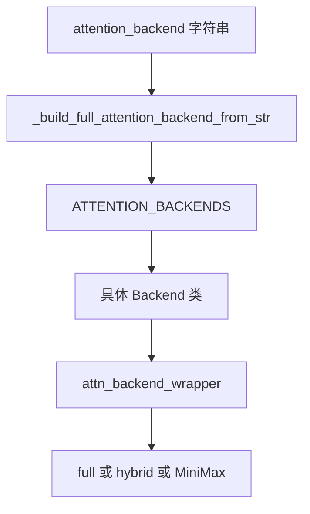
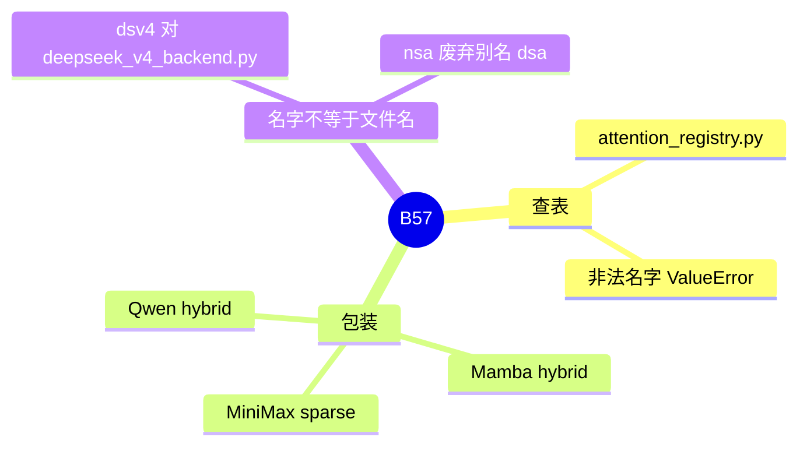

# Attention 后端目录

对应 B57。树是 `297e54fd105e974cdf401e5b4d20253a22c16f90`。**源码路径推断，未实测**。名单以 `ATTENTION_BACKEND_CHOICES` 为准。清单 B 节末尾已经抄过一遍，本页写选择函数和包装，不把每个核的算法重讲一遍。

## 场景与硬件

同一套调度和 KV 下标，可以换成不同的 attention 实现：可移植的 triton、NVIDIA 的 flashinfer / fa3 / fa4、MLA 专用的 flashmla / trtllm_mla、稀疏的 dsa / qsa / dsv4、Ascend、Intel XPU、AMD 的 aiter / wave。用户用 `--attention-backend` 指定。模型 override 可以在用户没写时填默认，见 DSA 和 V4。

平台默认不完全在这个 choices 列表里决定。CPU、HPU、NPU、XPU 的默认写在启动流水线的 `handle_*_backends`（F61）。本页的选择函数假设名字已经定稿。

## 在框架中的位置

## 原理

`attention_backend_setup._build_full_attention_backend_from_str` 用注册表取出类，再传入 `model_runner` 构造。名字不在表里就 `ValueError`。表在 `attention_registry.py`。文件名和 choice 不是一一对应，例如 `dsv4` 的实现文件是 `deepseek_v4_backend.py`。

包装发生在查表之后。`attn_backend_wrapper` 可以再套 `HybridLinearAttnBackend` 或 `MiniMaxHybridAttnBackend`。所以运行时对象不一定是表里那个类的裸实例。

五条对照，方便从字符串跳到类：

| 字符串 | 构造结果 |
| --- | --- |
| `dsa` | `DeepseekSparseAttnBackend` |
| `dsv4` | HIP：`DeepseekV4HipRadixBackend`。CUDA：`create_deepseek_v4_attn_backend`。NPU：`DeepseekV4AscendAttnBackend` |
| `qsa` | `QwenSparseAttnBackend` |
| `triton` | `TritonAttnBackend` |
| `flashinfer` | 普通 `FlashInferAttnBackend`。MLA 时 `FlashInferMLAAttnBackend` |

清单里的完整名单：`triton`，`torch_native`，`flex_attention`，`dsa`，`nsa`（废弃），`qsa`，`dsv4`，`compressed`（废弃），`fa3`，`fa4`，`flashinfer`，`llada2_cfg_flashinfer`，`flashmla`，`trtllm_mla`，`cutedsl_mla`，`tokenspeed_mla`（废弃），`trtllm_mha`，`hpc_ops`，`minicpm_flashattn`，`minicpm_flashinfer`，`aiter`，`wave`，`intel_amx`，`ascend`，`intel_xpu`。

`llada2_cfg_flashinfer` 是 dLLM 用的名字，循环在 [03-dLLM](../08-多模态扩散与dLLM/03-dLLM.md)。

## 过程

1. 解析期：用户值、模型 override、确定性推理、HiSparse、DSA 分核，依次把字符串定稿。
2. `ModelRunner` 建后端时调用 `_build_full_attention_backend_from_str`。
3. wrapper 按 config 再包一层。
4. 前向只调用最终对象。投机的草稿可以另有 `speculative_draft_attention_backend`，见 [10-草稿attention](../03-投机与MTP/10-草稿attention.md)。

## 调用栈

| 函数 | 做什么 | 角色 |
| --- | --- | --- |
| 模型 override / attention hook | 把字符串定稿 | 解析 |
| `_build_full_attention_backend_from_str` | 查表并构造 | 工厂 |
| `ATTENTION_BACKENDS[...]` | 类或工厂函数 | 注册表 |
| `attn_backend_wrapper` | hybrid / MiniMax / Qwen | 第二次包装 |
| 后端 `forward` | 按 `ForwardMode` 读 KV | 计算 |

## 待核

每个废弃别名（`nsa`、`compressed`、`tokenspeed_mla`）的警告是否都走 `warnings.warn`，本页只核对了 `nsa`。其余以 `attention_registry.py` 里对应 `_create_*_compat` 为准。

返回 [本目录 README](README.md)。
