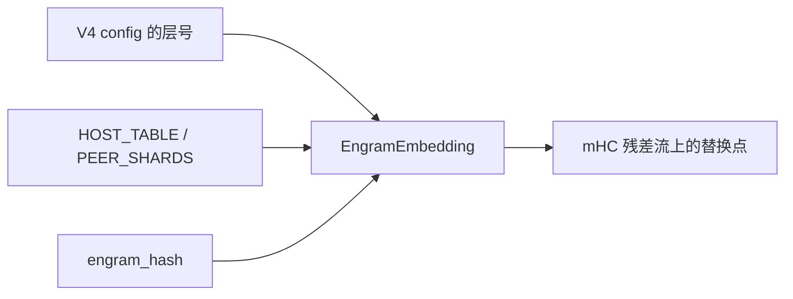
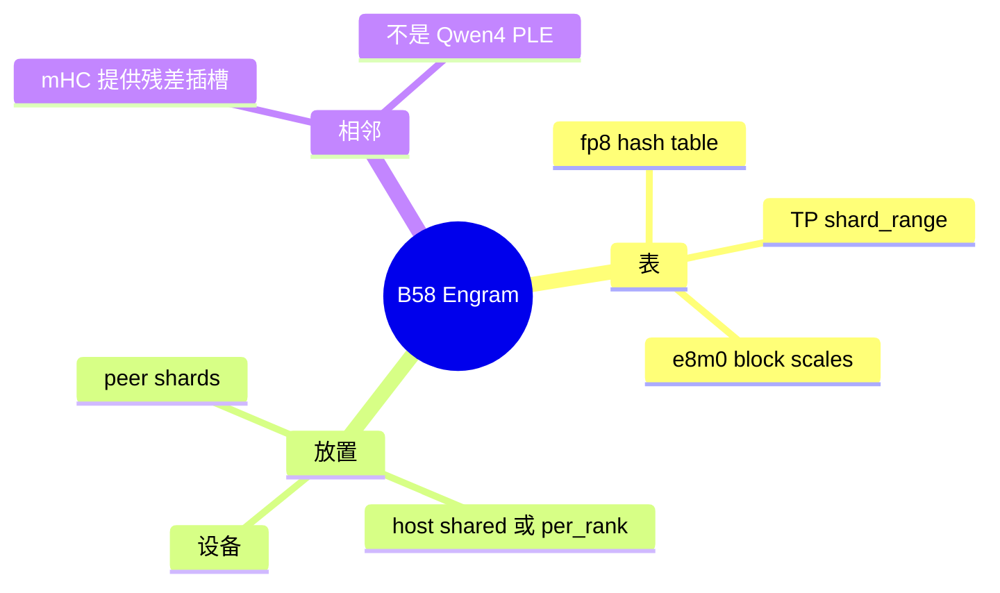

# Engram

对应 B58。树是 `297e54fd105e974cdf401e5b4d20253a22c16f90`。**源码路径推断，未实测**。

## 场景与硬件

DeepSeek V4 的 Engram 是加在超连接残差流上的 n-gram 哈希记忆，不是一张可开关的 attention 后端。层号来自模型 config，没有 CLI。模块 docstring（`layers/engram.py`）：gated n-gram hash memory added to the hc residual stream。哈希与 `kernels/ops/embeddings/engram_hash` 对齐。

环境变量（`environ.py`，无 CLI）：

| 变量 | 作用 |
| --- | --- |
| `SGLANG_ENABLE_DSV41_ENGRAM_HOST_TABLE` | 是否把表放在 host。默认 False |
| `SGLANG_DSV41_ENGRAM_HOST_TABLE_LAYOUT` | `shared` 或 `per_rank`。`_HostTable.__init__` 校验 |
| `SGLANG_OPT_DSV41_ENGRAM_PEER_SHARDS` | CUDA 且 TP>1 时可选设备 peer 分片 |

Peer 分片和 host 表同时开时，`tp_rank==0` 打 `_warn_host_table_ignored`，host 表被忽略。这是警告，不是 ValueError。

## 在框架中的位置

## 原理

`EngramEmbedding` 持有 fp8 哈希表和 e8m0 block scales，按 TP 的 `shard_range` 切。前向用 n-gram 哈希查表，把结果加进超连接残差，而不是加进 attention 的 KV。`deepseek_v4_mhc.py` 的文档把这个插入点说成：在 `ffn_hc -> attn_hc` 跨层处，Engram 或行选择可以替换残差 R（`with_residual` / `take_rows`）。mHC 本身见 [14-mHC](14-mHC.md)。

Qwen4 的 PLE 也是 n-gram 嵌入，文件是 `qwen4_exp_ple_table.py`，旗标是 `--ple-offload-*`。两张表不要合成一个特性。

## 过程

1. 加载 V4 权重时按 config 建 `EngramEmbedding`。
2. 若 host 表环境变量打开，且没有 peer shards 把它警告掉，表放在 host，布局按 `shared` 或 `per_rank`。
3. 层前向哈希当前 n-gram，查表，写入 mHC 残差。
4. 没有单独的调度分支。请求路径仍是普通 EXTEND / DECODE。

## 调用栈

| 函数 | 做什么 | 角色 |
| --- | --- | --- |
| `EngramEmbedding` | 持表并按 TP 分片 | 参数 |
| `_HostTable.__init__` | 校验布局字符串 | host 放置 |
| `_warn_host_table_ignored` | peer 与 host 同时开时警告 | 取舍 |
| `engram_hash` | 与表使用同一套哈希 | 下标 |
| mHC 层的残差替换 | 把查表结果加进 hc 流 | 接入点，见 B76 |

## 待核

哪些层号会被替换，模块文档有说明，本页没有逐层对 config。`SGLANG_ENABLE_DSV41_ENGRAM_HOST_TABLE` 在 V4 与 V4.1 上是否都生效，变量名写的是 DSV41。V4.0 checkpoint 是否读取它，标待核。

返回 [本目录 README](README.md)。
