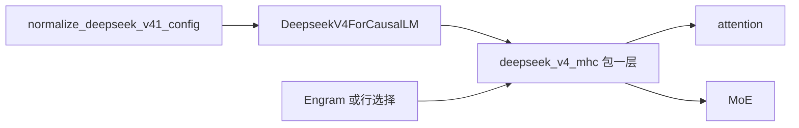
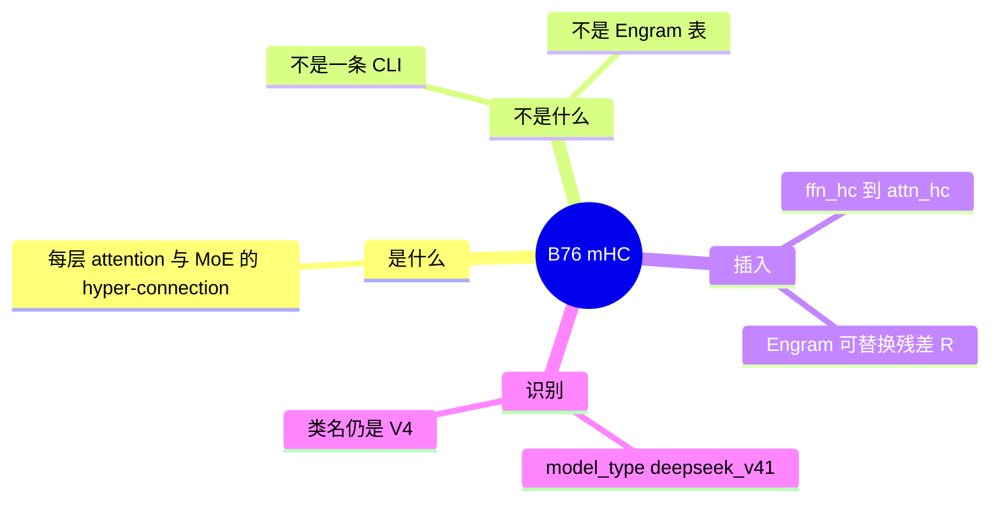

# mHC

对应 B76。树是 `297e54fd105e974cdf401e5b4d20253a22c16f90`。**源码路径推断，未实测**。

## 场景与硬件

DeepSeek V4.1 的多流残差。每一层 attention 和 MoE 外包一层 hyper-connection，而不是只加一条普通残差。无单独 CLI。config 字段 `hc_pre_from_prev_sublayer` 在 `configs/deepseek_v41.py`。运行时类仍是 `DeepseekV4ForCausalLM`：V4.1 的架构字符串在 `normalize_deepseek_v41_config` 里被改成 V4 的类名，`model_type` 写成 `deepseek_v41`。

没有 GPU 代数断言写在 `deepseek_v4_mhc.py` 的模块文档里。V4.1 其它特性的拒绝（HiSparse、PP、two-batch overlap、非 DSPARK 的投机）在 `validate_deepseek_v41_features`，那些是搭配限制，不是 mHC 层本身的设备门。

## 在框架中的位置

## 原理

`models/deepseek_v4_mhc.py` 的模块文档把 hyper-connection 定义成包在子层外面的多流残差。`deepseek_v4.py` 引用 `deepseek_v4_boundary` 把边界接进层。Engram（B58）是插进这条残差流的记忆表。mHC 决定流怎么合并，Engram 决定某一处加的向量从哪张表来。

清单写「与 Engram 的层替换关系见该文件文档，未逐层对」。本页保持这个边界：不声称每一层都有 Engram。

## 过程

1. 加载 config。V4.1 字符串被归一化，`model_type=deepseek_v41`。
2. 建层时用 mHC 模块包 attention 和 MoE。
3. `hc_pre_from_prev_sublayer` 决定前一子层的 hc 状态是否传入下一子层。
4. 前向沿 hc 流走。若该层 config 要求 Engram，再查 B58 的表。

## 调用栈

| 函数 | 做什么 | 角色 |
| --- | --- | --- |
| `normalize_deepseek_v41_config` | 架构字符串改成 V4 类，记下 `model_type` | 识别 V4.1 |
| `deepseek_v4_mhc` 的层包装 | attention / MoE 外的 hyper-connection | 残差结构 |
| `deepseek_v4_boundary` | 层边界 | `deepseek_v4.py` 的引用 |
| `validate_deepseek_v41_features` | 拒绝与 V4.1 不兼容的特性 | 搭配，不是 mHC 算法 |

## 待核

未逐层对照 Engram 替换了哪些 hc。`hc_pre_from_prev_sublayer` 的张量形状以 config 和模块文档为准，本页不抄权重布局。

返回 [本目录 README](README.md)。
