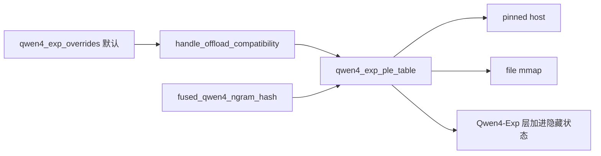
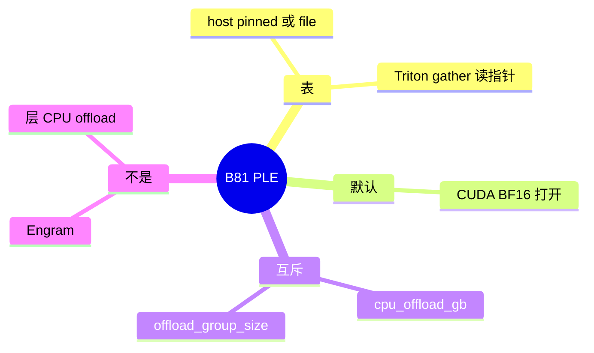

# Qwen4 PLE

对应 B81。树是 `297e54fd105e974cdf401e5b4d20253a22c16f90`。**源码路径推断，未实测**。

## 场景与硬件

Qwen4-Exp 有一张 n-gram 嵌入表（PLE）。表很大时可以卸到 host，前向用指针直接 gather，不必整表常驻显存。文件 `models/qwen4_exp_ple_table.py` 没有 `EntryClass`，它不是一条独立模型，而是 Qwen4-Exp 的一张表。核在 `kernels/ops/embeddings/qwen4_ngram.py` 的 `fused_qwen4_ngram_hash`。

旗标在 `ExecOffload`：

| 旗标 | 作用 |
| --- | --- |
| `--ple-offload-embedding` / `--no-ple-offload-embedding` | 开或关。help：BF16 的 Qwen4-Exp 在 CUDA 上默认开 |
| `--ple-offload-backend` | `pinned` 或 `file` |
| `--ple-offload-dir` | `file` 后端的目录 |

`qwen4_exp_overrides` 在 CUDA 且 bf16 时把 `ple_offload_embedding=True`。`file` 后端的 help 要求设备报告 `cudaDevAttrPageableMemoryAccessUsesHostPageTables`（注释提到 GB10 / DGX Spark 这一类能力）。检查点在 ple 表的运行时，不是启动时对所有 GPU 的一刀切。

`memory_hook.handle_offload_compatibility`：

- `--ple-offload-embedding` 不能和 `--cpu-offload-gb` 或 `--offload-group-size` 一起用。
- `--ple-offload-backend file` 要求 `--ple-offload-embedding`。

## 在框架中的位置

## 原理

`pinned` 用锁页内存。`file` 用 mmap。Triton gather 拿 host 指针读，避免先把整表拷回设备。哈希核 `fused_qwen4_ngram_hash` 把 token n-gram 变成表下标。结果加进 Qwen4-Exp 的隐藏状态，和 QSA 的稀疏 KV 是两条数据。

层 CPU offload（B89）会按组把模块 staging 回设备。若它碰到 PLE 表，会把刚卸下的表又搬回去，所以 hook 直接互斥。

## 过程

1. Override 在 CUDA BF16 上默认打开。
2. `handle_offload_compatibility` 跑两次（模型 override 前后，F38 与 F65）。
3. 建表时按 backend 放 pinned 或 mmap。
4. 前向哈希并 gather。`file` 路径在使用前看设备能力位。

## 调用栈

| 函数 | 做什么 | 角色 |
| --- | --- | --- |
| `qwen4_exp_overrides` | CUDA BF16 默认打开 | 默认 |
| `handle_offload_compatibility` | 与通用 CPU offload 互斥 | 启动门 |
| PLE 表构造 | `pinned` 或 `file` | 放置 |
| `fused_qwen4_ngram_hash` | n-gram 下标 | 查表 |
| Triton gather | 从 host 指针取行 | 不把整表留在设备 |

## 待核

设备能力位失败时是抛错还是回退到设备表，要以 `qwen4_exp_ple_table.py` 的运行时分支为准。本页只确认 help 和 hook 的互斥。

返回 [本目录 README](README.md)。
