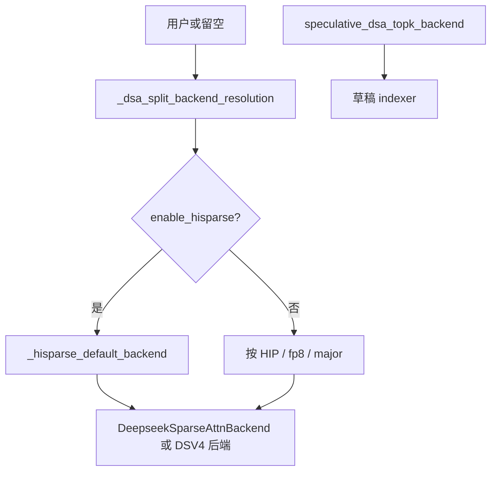
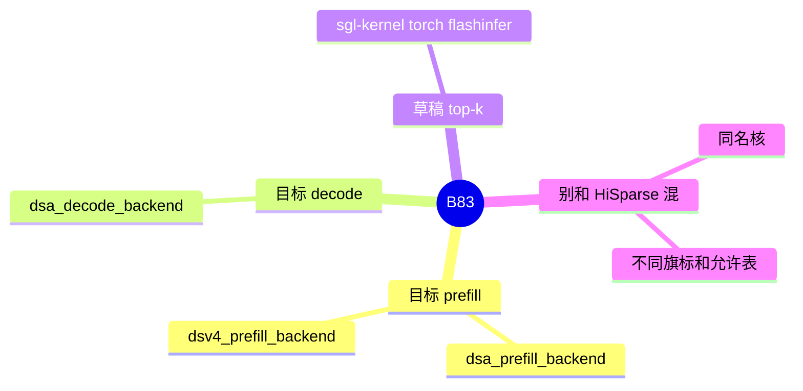

# DSA 与 DSV4 的 prefill 核

对应 B83。树是 `297e54fd105e974cdf401e5b4d20253a22c16f90`。**源码路径推断，未实测**。

## 场景与硬件

`--attention-backend dsa` 或 `dsv4` 只选定后端类。Prefill 里稀疏 MLA 还可以再换核：FlashMLA、FlashInfer sparse、Triton、TileLang、FA3、TRTLLM、Aiter、Intel XPU。Decode 核、草稿 indexer 的 top-k 实现也分开选。场景是同一模型在不同 GPU 上用不同的稀疏预填充核，而不改调度。

字段在 `fields/exec_.py` 与 `fields/spec.py`：

| 字段 | choices |
| --- | --- |
| `--dsa-prefill-backend` | `flashmla_sparse`，`flashmla_sparse_q8`，`flashmla_kv`，`flashmla_auto`，`flashinfer_sparse_mla`，`triton_sparse_mla`，`fa3`，`tilelang`，`triton`，`aiter`，`trtllm`，`intel_xpu` |
| `--dsv4-prefill-backend` | `auto`，`flashmla_sparse`，`flashmla_sparse_q8` |
| `--speculative-dsa-topk-backend` | `sgl-kernel`，`torch`，`flashinfer`。只给草稿 worker 的 indexer |

这些名字和 HiSparse 的子后端重叠，旗标不是同一个。HiSparse 的允许表更窄，默认函数是 `_hisparse_default_backend`。普通 DSA 的默认在 `overrides._dsa_split_backend_resolution` 的非 hisparse 分支，按 HIP、fp8、CUDA major 选。Blackwell fp8 可以默认到 `trtllm`。

HiSparse 加 `flashmla_sparse_q8` prefill 会在 `dsa_backend` 模块级校验里失败。CUDA fp8 加 tilelang 在 hisparse 分支被拒绝，见 [01-HiSparse](01-HiSparse.md)。

## 在框架中的位置

## 原理

后端类负责 metadata 和模式。核名字决定真正 launch 的稀疏 MLA。DSV4 的 prefill 只有三个取值，因为 V4 的打包布局只接 FlashMLA 这条族，外加 `auto`。草稿的 top-k 后端不影响目标模型的 prefill 核，它只替换草稿 worker 里 indexer 的实现。

## 过程

1. 用户指定或留空。
2. `_dsa_split_backend_resolution` 填预填充和 decode。hisparse 打开时改用 HiSparse 默认，再被 `validate_hisparse_dsa_backend` 过滤。
3. 后端 forward 在 EXTEND 时读 `dsa_prefill_backend` 或 `dsv4_prefill_backend`。
4. 草稿 worker 构建时读 `speculative_dsa_topk_backend`。

## 调用栈

| 函数 | 做什么 | 角色 |
| --- | --- | --- |
| `_dsa_split_backend_resolution` | 填核名字 | 解析 |
| `validate_hisparse_dsa_backend` | HiSparse 时收窄允许集 | 只在 B11 打开时 |
| `DeepseekSparseAttnBackend` forward | 按核名字 launch | 目标 prefill / decode |
| DSV4 后端 forward | 只认 B83 里那三个 prefill 值 | V4 |
| 草稿 indexer | `sgl-kernel` / `torch` / `flashinfer` | 与目标核独立 |

## 待核

`dsa_decode_backend` 的完整 choices 本页没有从字段定义再抄一份。已知它和 prefill 一起被 resolution 填写。DSV4 主 attention 还有 `dsv4_attn_backend`（`auto` / `flashmla` / `flashmla_mega` / `trtllm` 等），那是后端类内部的实现切换，和 `dsv4_prefill_backend` 并列，不要写成同一个旗标。

返回 [本目录 README](README.md)。
