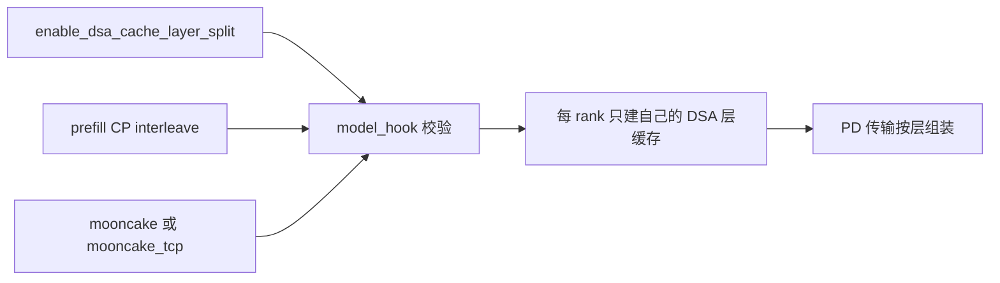
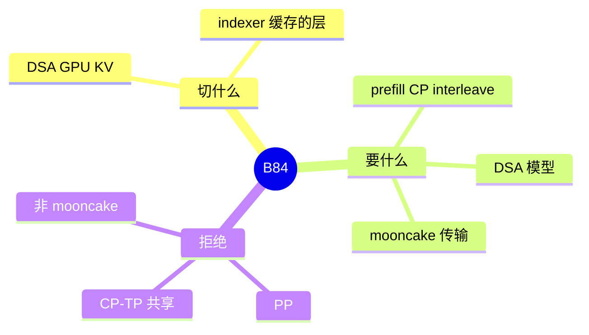

# DSA cache 按 CP 切层

对应 B84。树是 `297e54fd105e974cdf401e5b4d20253a22c16f90`。**源码路径推断，未实测**。

## 场景与硬件

Prefill 用上下文并行时，每个 rank 拿序列的一段 token。DSA 的 GPU KV 和 indexer 缓存如果整份复制，单卡容量被层数而不是被序列长度卡住。`--enable-dsa-cache-layer-split` 把这些层分到 CP rank 上，每张卡只留自己的层。

help（`fields/parallel.py`）：目前只写了 mooncake / mooncake_tcp。mori、nixl 记成后续。这是帮助文本里的范围，不是本页推断的路线图。

`model_hook` 里的拒绝：

| 条件 | 结果 |
| --- | --- |
| 模型不是 `is_deepseek_dsa` | 拒绝 |
| 不是 PD 的 prefill worker，也不是 decode worker | 拒绝 |
| 没有 `--enable-prefill-cp`，或 `cp_strategy` 不是 `interleave` | 拒绝 |
| 传输后端不是 mooncake / mooncake_tcp | 拒绝 |
| `pp_size>1` | 拒绝 |
| 同时 CP-TP 组共享 | `cp_tp_group_sharing_hook` 把它列进不兼容项 |

和 F205 的 CP-TP 共享互斥。共享要求 `attn_cp_size == tp_size` 并把 CP 组收成 TP 组。切层要求层分布在 CP rank 上。两件事对「组里有几份 KV」的假设相反。

## 在框架中的位置

## 原理

逻辑上模型仍有全部层。物理上每个 CP rank 的池只包含分配给它的层。注意力计算若需要其它层，要靠 CP 通信或在 PD 发送时按层拼回去。help 把传输限制在 mooncake，是因为发送侧要知道层条带，而不是因为 DSA 算法本身依赖 Mooncake。

这不是 B69 的 page interleave。B69 切的是页，本开关切的是层。也不是 B41 的 decode CP（`dcp_size`）。`dcp_size>1` 与 prefill CP 互斥，而本开关要求 prefill CP 开着。

## 过程

1. 解析期 `model_hook` 检查模型、角色、CP 策略、传输后端、PP。
2. 通过则池按层分片构建。
3. Prefill 每个 rank 只写自己的层。
4. 传到 decode 时按 mooncake 的层布局组装。decode worker 被允许持有这个旗标，以便接收侧知道布局。

## 调用栈

| 函数 | 做什么 | 角色 |
| --- | --- | --- |
| `model_hook` 中对该旗标的检查 | 模型、CP、传输、PP | 启动门 |
| `handle_context_parallelism` | prefill CP 必须先成立 | 组 |
| `cp_tp_group_sharing_hook` | 与组共享互斥 | 拒绝 F205 组合 |
| 池构建 | 按 rank 丢弃不属于自己的层 | 容量 |
| PD 发送 | mooncake 路径携带层条带 | 传输 |

## 待核

层到 rank 的具体取模公式本页没有从分配器源码逐行抽出。已知约束是 interleave CP。发送格式以 mooncake 连接器为准。

返回 [本目录 README](README.md)。
