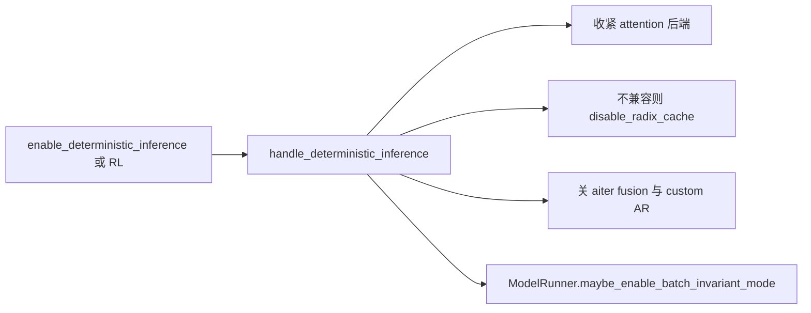
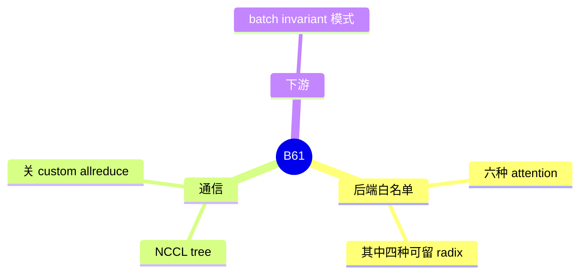

# 确定性推理

对应 B61。树是 `297e54fd105e974cdf401e5b4d20253a22c16f90`。**源码路径推断，未实测**。

Batch invariant 的算子替换在 [19-batch-invariant](19-batch-invariant.md)。

## 场景与硬件

同一批 token 希望跨请求边界、跨运行得到相同 logits。用于对齐、回归和 RL on-policy。开关 `--enable-deterministic-inference`。`handle_deterministic_inference` 也会在 `rl_on_policy_target` 置位时强制打开它。

它做的事：

| 动作 | 结果 |
| --- | --- |
| 采样后端 | `_deterministic_sampling_backend` |
| attention 后端 | 必须落在 `DETERMINISTIC_ATTENTION_BACKEND_CHOICES`：`ascend`，`fa3`，`fa4`，`flashinfer`，`intel_xpu`，`triton` |
| radix | 只有 `RADIX_SUPPORTED_DETERMINISTIC_ATTENTION_BACKEND` 能留着 radix：`ascend`，`fa3`，`fa4`，`triton`。`flashinfer` 和 `intel_xpu` 会把 radix 关掉 |
| Aiter allreduce fusion | 关掉 `enable_aiter_allreduce_fusion` |
| TP>1 且 CUDA | NCCL 用 tree，关 custom all-reduce，关 torch symmetric memory |

没有「必须某代 NVIDIA GPU」的单行断言。限制体现在后端名单和集合通信。

## 在框架中的位置

## 原理

非确定性来自原子加的顺序、split-K、以及某些 attention 实现对 batch 内别的序列的依赖。确定性模式把实现收成有固定归约顺序的那一组，并在 TP 上改用 tree all-reduce，避免 custom all-reduce 的非确定归约。Radix 的页复用若和某个 attention 实现的数值路径不一致，hook 选择直接关掉树，而不是保留树再容忍数值差。

## 过程

1. 解析期 `handle_deterministic_inference`。
2. 采样和 attention 被改写或校验。
3. radix 按子集决定去留。
4. `ModelRunner.maybe_enable_batch_invariant_mode` 在旗标为真时调用 `enable_batch_invariant_mode`，见下一页。

## 调用栈

| 函数 | 做什么 | 角色 |
| --- | --- | --- |
| `handle_deterministic_inference` | 后端、radix、集合通信 | 解析门 |
| `_deterministic_attention_backend` | 把 attention 收进白名单 | 核 |
| `_deterministic_sampling_backend` | 采样路径 | 与 F165 的采样后端衔接 |
| `maybe_enable_batch_invariant_mode` | 打开 B62 | 算子替换 |

## 与相邻特性

B17 的 attention DP 与确定性同时打开时，V4.1 的特征表里有 HIP + attention DP 的项。那是 V4.1 拒绝表的格子，不是本 hook 的通用拒绝。B92 的 Aiter 融合会被本页关掉。

## 待核

旗标拼写清单写过「待核」。本页按 hook 名和清单中的 `--enable-deterministic-inference` 使用。若字段 help 的连字符不同，以 `fields` 里的 `BooleanOptional` 为准。

返回 [本目录 README](README.md)。
