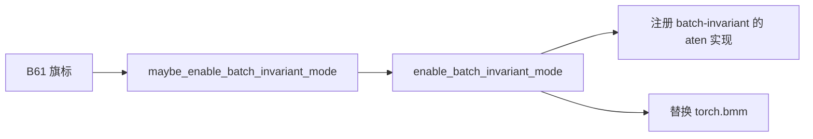
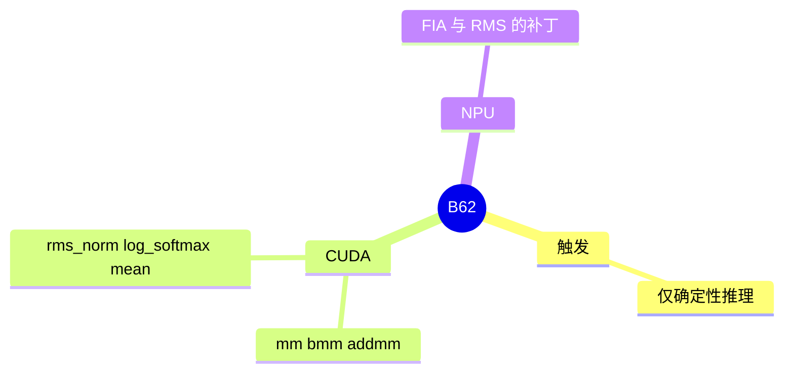

# Batch invariant

对应 B62。树是 `297e54fd105e974cdf401e5b4d20253a22c16f90`。**源码路径推断，未实测**。

## 场景与硬件

即便 attention 后端已经换成确定性实现，`aten::mm`、`bmm`、softmax、RMSNorm 仍可能因 batch 形状不同而走不同 kernel。Batch invariant 模式把这些算子换成与 batch 中其它行无关的实现。它由确定性推理打开，没有看到第二份独立 CLI。`ModelRunner.maybe_enable_batch_invariant_mode` 只在 `get_exec().deterministic.enable_deterministic_inference` 为真时调用 `enable_batch_invariant_mode()`。

KL 一致性测试用它来去掉「batch 形状引起的数值差」。测试方法不在本页展开。

## 在框架中的位置

## 原理

`enable_batch_invariant_mode` 注册 batch-invariant 的 `aten::mm`、`bmm`、`addmm`、`rms_norm`、`_log_softmax`、`mean` 等（CUDA），并 monkeypatch `torch.bmm`。NPU 另补 FIA 和 RMS。替换之后，一行的结果不依赖同 batch 里有没有别的行。代价是可能绕开更快的变长核。这个取舍写在实现的注释里，本页不给速度数字。

## 过程

1. B61 的 hook 把确定性旗标定稿。
2. `ModelRunner` 初始化时 `maybe_enable_batch_invariant_mode`。
3. 进程内后续的 mm / bmm / norm 走替换实现，直到进程退出。它是进程级开关，不是 per-forward 旗标。

## 调用栈

| 函数 | 做什么 | 角色 |
| --- | --- | --- |
| `handle_deterministic_inference` | 打开确定性旗标 | 前提 |
| `ModelRunner.maybe_enable_batch_invariant_mode` | 读旗标 | 唯一入口 |
| `enable_batch_invariant_mode` | 注册算子并替换 `torch.bmm` | 进程级 |

## 待核

替换列表是否还有 CUDA 以外的算子，本页按函数注释中的 CUDA 与 NPU 分支写。和自定义 all-reduce 的交互已在 B61 里关掉 custom AR，本页不重复那条通信路径。

返回 [本目录 README](README.md)。
