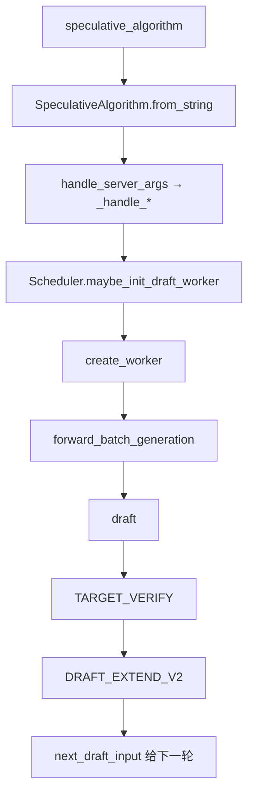
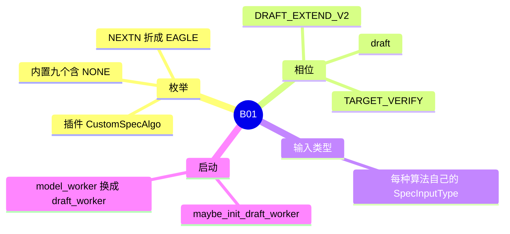

# 投机框架

对应 B01。树是 `297e54fd105e974cdf401e5b4d20253a22c16f90`。**源码路径推断，未实测**。

草稿 worker 在启动链上的位置是 F113，见 [06-模型加载](../../02-流程/01-启动/06-模型加载.md)。调度把 `model_worker` 换成 `draft_worker` 见 [05-前向与采样](../../02-流程/03-调度与推理/05-前向与采样.md)（F13、F162）。本页写算法枚举、V2 的两段 forward，以及每种算法的 `SpecInputType`。

## 场景与硬件

目标模型一步要验证多个草稿 token，从而在接受长度大于 1 时少跑几次完整 decode。算法由 `--speculative-algorithm` 选择。内置枚举（`spec_info.py` 的 `SpeculativeAlgorithm`）：`DFLASH`，`UNO`，`DSPARK`，`EAGLE`，`EAGLE3`，`FROZEN_KV_MTP`，`STANDALONE`，`NGRAM`，`NONE`。空字符串或 `None` 得到 `NONE`，不建草稿 worker。

全部内置算法走 V2 worker 和 V2 scheduler schema。overlap 关掉时，scheduler 同步驱动同一套 schema，不再有 V1 worker。插件用 `SpeculativeAlgorithm.register`。`supports_overlap=False` 的插件在 overlap 开着时直接 `ValueError`；overlap 关着时能跑，但会警告 V1 路径已删除。

平台门：

| 条件 | 行为 |
| --- | --- |
| CPU | `handle_speculative_decoding` 里 `_disable_overlap_schedule_for_cpu` 强制 `disable_overlap_schedule=True`。注释：Overlap schedule is not implemented for speculative decoding on CPU. |
| 树外平台 | `get_platform_worker_cls` 问 `current_platform.get_speculative_worker_cls`。有则替换内置 worker |
| 各算法自己的设备 | 见对应页。例如 UNO 仅 CUDA，DFLASH / DSPARK 要求 cuda、npu 或 xpu |

## 在框架中的位置

`ForwardMode.TARGET_VERIFY` 与 `DRAFT_EXTEND_V2` 定义在 `forward_batch_info.py`。`is_extend()` 包含 `TARGET_VERIFY`，以及可选的 `DRAFT_EXTEND_V2`。`is_cuda_graph()` 包含 `TARGET_VERIFY`。

## 原理

草稿在目标模型的分布之外多猜若干 token。验证用目标模型一次前向看这些位置的 logits，再按接受规则留下前缀。留下的 token 写进目标 KV。草稿自己的 KV 或隐状态要在 `DRAFT_EXTEND_V2` 里对齐到「真正被接受的那一段」，下一轮才能接着猜。

NGRAM 没有神经网络草稿，也没有 `DRAFT_EXTEND_V2`。它在 host 上查语料，直接进入 `TARGET_VERIFY`。其余算法的差别是草稿看什么：EAGLE 看目标隐状态，STANDALONE 看自己的嵌入，DFLASH / DSPARK 看块，FROZEN_KV_MTP 只读目标 KV，UNO 复用目标权重加 LoRA。

`SpecInput` 是这些相位的数据。`is_draft_input` / `is_verify_input` 让 attention 后端不必写死算法类名。字段还包括 `ragged_verify_layout`（只有 DSPARK 的 `supports_ragged_verify` 为真）、`num_tokens_per_req`（attention DP 用它缩放 `global_num_tokens`）、DSA 的 `dsa_topk_indices`、滑窗的 `window_kv_*`。

`SpecInputType` 的成员：`EAGLE_DRAFT`，`EAGLE_DRAFT_EXTEND`，`EAGLE_VERIFY`，`FROZEN_KV_MTP_DRAFT`，`FROZEN_KV_MTP_VERIFY`，`DFLASH_DRAFT`，`DFLASH_VERIFY`，`NGRAM_VERIFY`，`UNO_STATE`，`UNO_DRAFT`，`UNO_VERIFY`，`PP_SPEC_RELAY`。最后一种是 PP 各 stage 重建验证输入用的树，本身不做 forward。

## 过程

Overlap 打开时，EAGLE 族一轮的顺序（`EAGLEWorkerV2.forward_batch_generation`）是：

1. draft：多步草稿。
2. verify：`eagle_prepare_for_verify` 把模式设成 `TARGET_VERIFY`，目标 worker 做一次前向。
3. `on_publish`：验证结束处的 fence，放开 future 和语法屏障。
4. draft extend：`prepare_for_draft_extend` 把模式设成 `DRAFT_EXTEND_V2`。
5. 返回 `next_draft_input`，scheduler 下一轮把它放进 `batch.spec_info`。

非 overlap 仍用同样的 forward mode，只是 scheduler 同步等待。PP 的非末级可以只跑目标验证，草稿在末级。`Scheduler.run_batch` 有注释：FIXME: pp is not compatible with overlap。PP 在解析期已经强制关掉 overlap（F196）。

`create_dummy_verify_input` 按算法造 CUDA graph 预热用的验证输入，覆盖 EAGLE / standalone、dflash 族、ngram。

## 调用栈

EAGLE、overlap、decode 一轮：

| 函数 | 做什么 | 角色 |
| --- | --- | --- |
| `Scheduler.run_batch` | overlap 分支设置 `on_publish` 和 `grammar_barrier` | 调度 |
| `draft_worker.forward_batch_generation` | 整轮委托给算法 worker | 入口 |
| `EagleDraftWorker.draft` | `prepare_for_draft`，再跑 `speculative_num_steps-1` 步 | 草稿 |
| `EAGLEWorkerV2.verify` | `run_eagle_verify` | 准备验证 |
| `eagle_prepare_for_verify` | 模式改为 `TARGET_VERIFY` | 相位 |
| `TpModelWorker.forward_batch_generation` | 目标模型前向 | 验证计算 |
| `on_publish` | 用新的 `seq_lens` 放开 future | 与结果处理重叠 |
| `prepare_for_draft_extend` | 模式改为 `DRAFT_EXTEND_V2` | 对齐草稿 KV |

启动：

| 函数 | 做什么 | 角色 |
| --- | --- | --- |
| `handle_speculative_decoding` | 大写算法名、别名、块验证、radix 与 DP 协调的总门 | 解析 |
| `SpeculativeAlgorithm.handle_server_args` | 分到 `_handle_dflash` 等 | 每算法改写 |
| `Scheduler.maybe_init_draft_worker` | `create_worker` 并实例化。NGRAM 建 `ExternalCorpusManager`。PP 非末级跳过草稿 | F113 |
| `create_worker` | 算法到类。先看树外平台 | 工厂 |
| `build_draft_tp_worker` | 内层 `TpModelWorker(is_draft_worker=True)` | 草稿模型 |

## 横切约束

`handle_speculative_decoding` 与枚举方法里已经能确定的：

| 规则 | 谁 |
| --- | --- |
| `disaggregation_decode_enable_radix_cache` | 只允许算法是 None、DSPARK、EAGLE、EAGLE3 |
| `speculative_use_block_verification` | 只允许 EAGLE、EAGLE3、DFLASH、DSPARK，且 CUDA 或 ROCm |
| `SGLANG_ENABLE_DP_SPEC_PREFILL_COORDINATION` | 只允许单层 EAGLE、EAGLE3、DSPARK，禁止 `enable_multi_layer_eagle` |
| `supports_grammar_overlap` | EAGLE 族（含 FROZEN_KV_MTP，因为 `is_eagle()` 把它算进去）、STANDALONE、DFLASH 族。NGRAM 为假：草稿在 host，语法不能藏到 GPU draft 下面 |
| `supports_ragged_verify` | 仅 DSPARK |
| `has_draft_kv` | NGRAM 为假 |
| `carries_draft_hidden_states` | 仅 `is_eagle()`。STANDALONE 不算 |
| `supports_mixed_chunk` | EAGLE、EAGLE3、DFLASH、DSPARK |
| `read_ragged_verify_mode` | 每个算法的 `handle_server_args` 入口都调，避免指标路径才发现环境变量拼错 |

`spec_scale_global_num_tokens` 在 attention DP 下按 `num_tokens_per_req` 放大 token 计数。空 rank 仍要参加集体通信，见 F193。

## 待核

- `is_eagle()` 含 `FROZEN_KV_MTP`，注释 FIXME：等 scheduler 真正支持后再移出。
- `get_num_tokens_per_req_for_target_verify` 的 FIXME：forward mode 重构之后删掉。DSPARK 的草稿 worker 在这里返回 `num_draft_tokens - 1`。
- `SpecInputType` 注释：若各算法能共享结构，可以收掉这套枚举。
- 接受率、实际加速没有实测。

返回 [本目录 README](README.md)。
