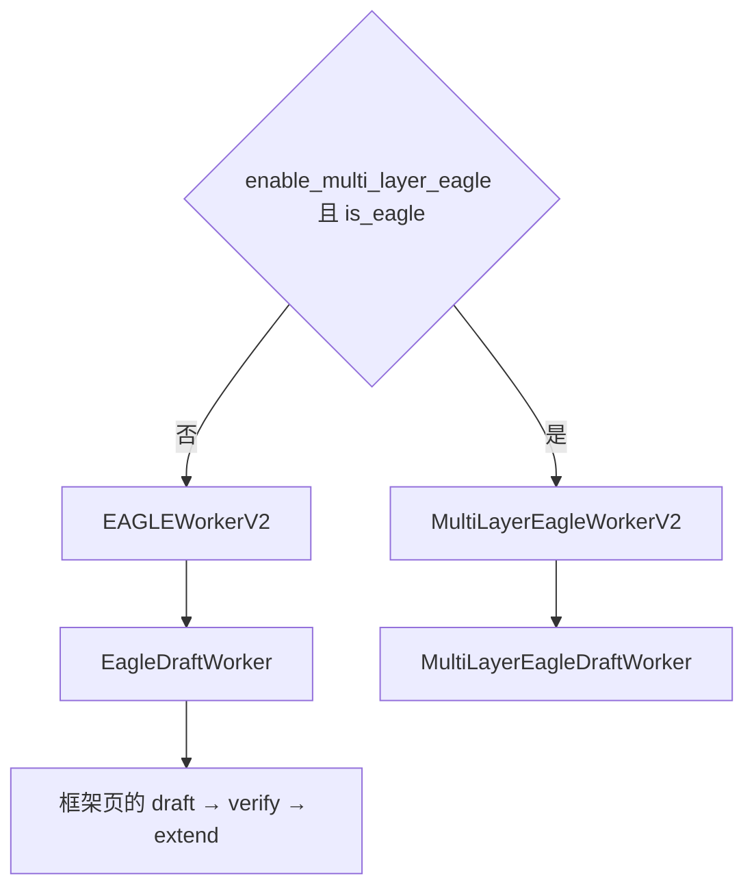
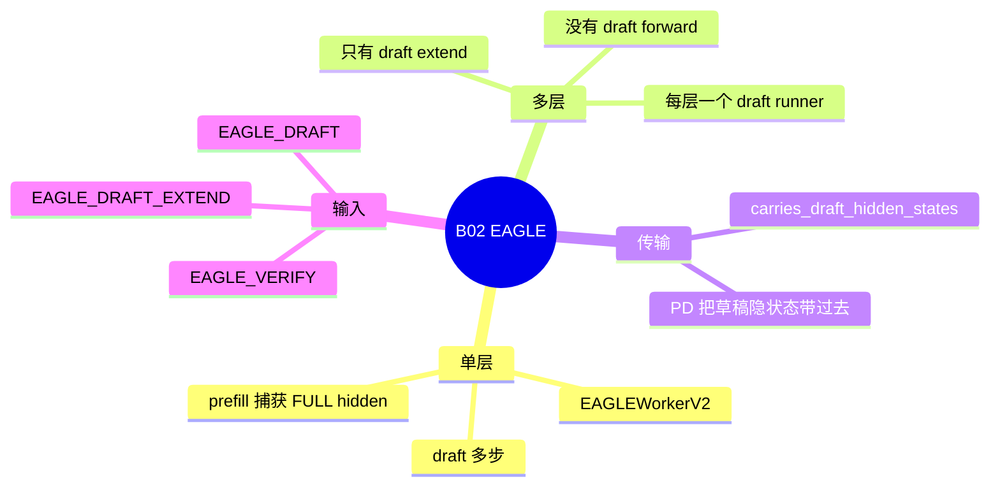

# EAGLE 与 EAGLE3

对应 B02。NEXTN 这个名字的折叠在 [02-NEXTN](02-NEXTN.md)（B03）。树是 `297e54fd105e974cdf401e5b4d20253a22c16f90`。**源码路径推断，未实测**。

## 场景与硬件

草稿模型不自己采样完整词表，而是读目标模型的隐状态，再预测接下来几个 token。EAGLE3 是同一 worker 上的另一算法名，`is_eagle3()` 只对 `EAGLE3` 为真，但 `is_eagle()` 两者都为真。典型是 Llama / Qwen 的 Eagle 头，以及被 NEXTN 折进来的 MTP 头。

`_handle_eagle_family` 的平台行为：

| 项 | 行为 |
| --- | --- |
| 树外平台 | `_check_oot_speculative_algorithm` |
| HIP | `_should_auto_enable_hip_rejection_sampling` 满足时默认开 `speculative_use_rejection_sampling` |
| 目标后端是 `trtllm_mha` 且 `speculative_eagle_topk>1` | `ValueError` |
| `eagle_topk>1` 且 `page_size>1` | 目标 `attention_backend` 必须是 `flashinfer`、`fa3` 或 `triton` |
| rejection sampling | 只允许解析之后的名字是 EAGLE 或 EAGLE3，且 `eagle_topk==1`。多层同样要求 topk=1 |
| `max_running_requests` | 默认 48 |
| `enable_mixed_chunk` | 处理函数会关掉。枚举的 `supports_mixed_chunk` 对 EAGLE/EAGLE3 为真，以处理函数的最终声明为准 |

默认步数在 `_auto_choose_speculative_params`。STANDALONE 是 `(3, 1, 4)`，EAGLE 的自动三元组以该函数的 EAGLE 分支为准，本页不凭记忆写死。

## 在框架中的位置

PP：只有最后一级建 `EagleDraftWorker`。前面的级 `_hosts_draft=False`。验证输入可以由 `PP_SPEC_RELAY` 重建。

## 原理

目标 prefill 用 `CaptureHiddenMode.FULL` 把隐状态留下来，draft extend 把它写成草稿 KV。Decode 时草稿每步消费上一目标步的隐状态。验证仍是目标模型的一次 `TARGET_VERIFY`。接受之后 `DRAFT_EXTEND_V2` 把草稿 KV 对齐到被接受的 token。

`carries_draft_hidden_states()` 为真，因为 `is_eagle()` 为真。PD 从 prefill 到 decode 的传输因此带上草稿隐状态。`build_disagg_draft_input` 对 eagle 调 `build_eagle_disagg_draft_input`。

多层：`create_worker` 在 `is_eagle()` 且 `enable_multi_layer_eagle` 时返回 `MultiLayerEagleWorkerV2`。类注释：Multi-layer eagle has no draft forward, only draft extend。它持有多层 draft runner，以及每层的 draft extend 后端。`last_shared_read_runner` 在 `last_draft_extend_staged` 时指目标 runner，否则指 draft runner。使用 `UnifiedDraftSWAKVPool` 时把 `draft_swa_window` 交给 scheduler 的 HiCache 规划。DP spec prefill coordination 禁止多层。

FROZEN_KV_MTP 也被 `is_eagle()` 算进来，但 `create_worker` 在多层判断之前已经返回 `FrozenKVMTPWorkerV2`，不会进多层类。见 [03-FROZEN-KV-MTP](03-FROZEN-KV-MTP.md)。

## 过程

1. `_handle_eagle_family` 填步数、topk、运行上限，并做后端检查。
2. `maybe_init_draft_worker` 建 `EAGLEWorkerV2` 或多层 worker。末级才有 draft。
3. Prefill：目标 FULL hidden，接着 draft extend 写草稿 KV。
4. Decode 一轮按框架页的五步。单层 `draft()` 是 `prepare_for_draft` 加 `speculative_num_steps-1` 次内层 forward。
5. 语法 overlap：`supports_grammar_overlap` 为真。验证内部推进语法 FSM，CPU 语法藏在 GPU draft 下面。调度篇的 grammar barrier 因此可以异步。

## 调用栈

单层 decode 的栈就是 [00-框架](00-框架.md) 那张表，worker 类是 `EAGLEWorkerV2`，草稿类是 `EagleDraftWorker`。多层把 `draft()` 换成各层的 draft extend runner，没有单独的多步 draft forward。

| 函数 | 做什么 | 角色 |
| --- | --- | --- |
| `_handle_eagle_family` | 步数、rejection、page、trtllm_mha | 解析 |
| `EAGLEWorkerV2.forward_batch_generation` | draft、verify、publish、extend | 一轮 |
| `eagle_prepare_for_verify` | `TARGET_VERIFY` | 相位 |
| `prepare_for_draft_extend` | `DRAFT_EXTEND_V2` | 相位 |
| `build_eagle_disagg_draft_input` | PD decode 侧的草稿输入 | 仅分离 |

## 与相邻特性

B03 的 NEXTN 在 `from_string` 之后就是本页的 EAGLE。B05 的 STANDALONE 继承验证骨架，但 prefill 捕获是 `NULL`，且不携带草稿隐状态。B91 的草稿 attention 可以和目标不同。`trtllm_mha` 出现在目标侧且 topk>1 时本页拒绝；出现在草稿侧时由 B91 的 DFLASH 规则处理，EAGLE 草稿走 `DRAFT_ATTENTION_BACKEND_CHOICES`。

## 待核

`_auto_choose_speculative_params` 对 EAGLE 的默认 `(steps, topk, draft_tokens)` 本页没有逐行抄。多层 draft extend 与 HiCache 的 `draft_swa_window` 只在使用 `UnifiedDraftSWAKVPool` 时出现。

返回 [本目录 README](README.md)。
