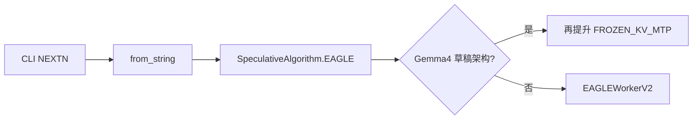
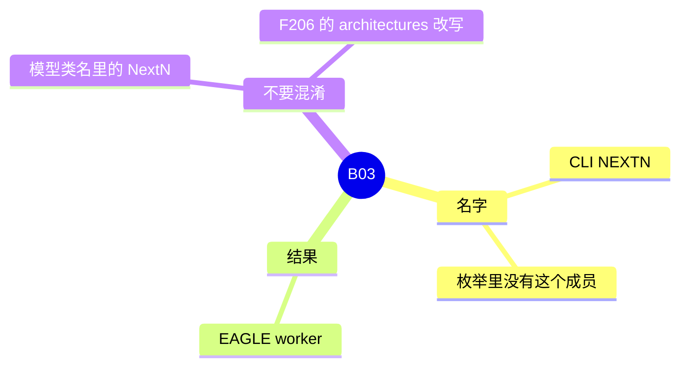

# NEXTN 别名

对应 B03。树是 `297e54fd105e974cdf401e5b4d20253a22c16f90`。**源码路径推断，未实测**。

## 场景与硬件

有的 checkpoint 把 MTP 头叫 NEXTN。服务命令写成 `--speculative-algorithm NEXTN` 时，不存在单独的 NextN worker。`spec_registry.py` 的 `_RESERVED_ALIASES = {NEXTN}`，`from_string("NEXTN")` 返回 `SpeculativeAlgorithm.EAGLE`。之后的行为全部是 [01-EAGLE](01-EAGLE.md)。

没有额外硬件门。插件不能再注册这个名字：`_reserved_names()` 是全部枚举成员加上这个别名。

Gemma4 的草稿架构会把已经折成 EAGLE 的名字再提升成 `FROZEN_KV_MTP`。`EAGLE3` 配 Gemma4 草稿则 `ValueError`，要求用户写 NEXTN 或 EAGLE。提升发生在 `_resolve_speculative_algorithm_alias`，不是 `from_string` 的第一跳。

## 在框架中的位置

## 原理

两件名字不同的事容易叠在一起。

1. **算法名 NEXTN。** 只在 `from_string` 里折成 EAGLE。Worker、验证输入类型都是 EAGLE 的 `EAGLE_VERIFY`。
2. **模型类名 `*NextN`。** `ModelConfig._config_draft_model` 在 `is_draft_model` 时把 `architectures[0]` 改成 NextN / MTP / DSpark 类，例如 `DeepseekV3ForCausalLMNextN`。这是 F206，用来加载草稿权重。类名改写发生与否，不取决于 CLI 是写了 NEXTN 还是 EAGLE。

DeepSeek V4.1 只放行 DSPARK，不放行这条折出来的 EAGLE。见 [08-DSPARK](08-DSPARK.md)。

## 过程

1. CLI 字符串转大写。
2. 枚举查找失败后命中 `_RESERVED_ALIASES`，返回 EAGLE。
3. `_resolve_speculative_algorithm_alias` 再看草稿架构。Gemma4 则改成 FROZEN_KV_MTP。
4. `create_worker` 按最终枚举建 worker。

## 调用栈

| 函数 | 做什么 | 角色 |
| --- | --- | --- |
| `SpeculativeAlgorithm.from_string` | NEXTN → EAGLE | 别名 |
| `_resolve_speculative_algorithm_alias` | Gemma4 再提升 | 第二次改名 |
| `register_algorithm` | 拒绝插件占用 NEXTN | 保留名 |
| `ModelConfig._config_draft_model` | 改草稿类名 | F206，与算法别名独立 |

## 待核

还有哪些草稿架构会走 Gemma4 那种二次提升，本页只确认了 Gemma4 这条 `ValueError` / 提升。其它架构以 `_resolve_speculative_algorithm_alias` 为准。

返回 [本目录 README](README.md)。
