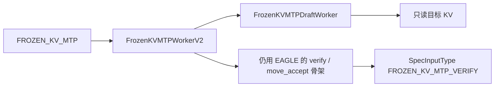
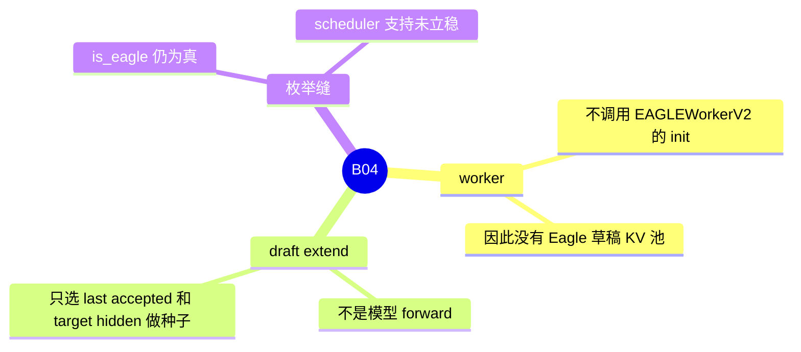

# FROZEN_KV_MTP

对应 B04。树是 `297e54fd105e974cdf401e5b4d20253a22c16f90`。**源码路径推断，未实测**。

## 场景与硬件

有的 MTP 头不维护自己的 KV，只读目标模型已经写好的 KV，再用目标隐状态做下一步的种子。Gemma4 的草稿架构会从 EAGLE / NEXTN 自动提升到这个算法，见 [02-NEXTN](02-NEXTN.md)。也可以直接写 `--speculative-algorithm FROZEN_KV_MTP`。

`_handle_frozen_kv_mtp`：`max_running_requests` 默认 48，`enable_mixed_chunk=False`。没有单独的 GPU 代数断言。Rejection sampling 不支持，因为 `_handle_eagle_family` 只对 EAGLE / EAGLE3 打开它，而本算法走自己的 `_handle_frozen_kv_mtp`。

## 在框架中的位置

## 原理

模块文档：frozen draft reads the target KV cache read-only and owns no KV pool。`FrozenKVMTPWorkerV2` 不调用 `EAGLEWorkerV2.__init__`，避免建出 Eagle 的草稿 KV 池。`SpecInputType` 用 `FROZEN_KV_MTP_DRAFT` 和 `FROZEN_KV_MTP_VERIFY`，attention 后端可以把它和 EAGLE 的验证输入分开。

验证和接受长度的搬移仍复用 EAGLE V2 的骨架。类文档这么写。所以 `is_eagle()` 把本算法算进去，语法 overlap、若干 eagle 分支会走到。注释同时写了 FIXME：等 scheduler 真正立住支持后再从 `is_eagle()` 移除。清单的开放问题就是这条 FIXME。

Draft extend 不做模型前向，只选择最后被接受的 token 和目标隐状态当作下一轮种子。这和 EAGLE 的 `DRAFT_EXTEND_V2` 写草稿 KV 不同。

## 过程

1. 别名提升或 CLI 得到本枚举。
2. `_handle_frozen_kv_mtp` 关 mixed chunk，设运行上限。
3. `create_worker` 在 eagle 多层判断之前返回 `FrozenKVMTPWorkerV2`。
4. Decode：草稿只读目标 KV 来提议。验证走目标 `TARGET_VERIFY`。Extend 只更新种子。

## 调用栈

| 函数 | 做什么 | 角色 |
| --- | --- | --- |
| `_handle_frozen_kv_mtp` | 运行上限、关 mixed chunk | 解析 |
| `FrozenKVMTPWorkerV2` | 自建状态，不建 Eagle KV 池 | worker |
| `FrozenKVMTPDraftWorker` | 只读目标 KV | 草稿 |
| EAGLE V2 的 verify / move_accept | 接受长度 | 复用的骨架 |
| `is_eagle` | 对本算法返回真 | 已知的缝 |

## 待核

FIXME 所说的「scheduler 支持未立稳」具体缺哪一步，注释没有列出清单。本页不把 `is_eagle()` 为真解释成调度器已经完整支持。运行时是否能跑通一轮，未实测。

返回 [本目录 README](README.md)。
