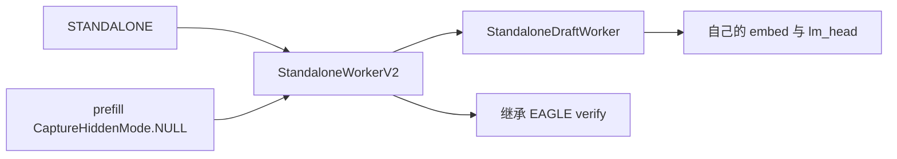
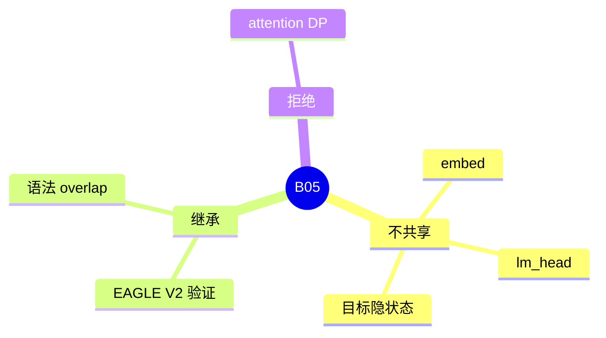

# STANDALONE

对应 B05。树是 `297e54fd105e974cdf401e5b4d20253a22c16f90`。**源码路径推断，未实测**。

## 场景与硬件

草稿是另一套完整权重，不读目标隐状态，也不共享目标的嵌入和 lm_head。用来接一个独立的小模型做草稿。验证路径继承 EAGLE V2，所以接受规则和 `TARGET_VERIFY` 的形状与 EAGLE 相同。

`_handle_eagle_family` 也会处理它，并在算法是 STANDALONE 且 attention DP 打开时 `ValueError`：standalone speculative decoding does not support dp attention。Rejection sampling 不支持，因为枚举名不是 EAGLE / EAGLE3。

`_auto_choose_speculative_params` 给 STANDALONE 的默认是 `(3, 1, 4)`，即 steps、topk、draft tokens。`max_running_requests` 的 48 来自同一处理函数。

## 在框架中的位置

## 原理

`StandaloneWorkerV2` 继承 `EAGLEWorkerV2`，`init_lm_head` 的覆盖注释是 prevent sharing。`carries_draft_hidden_states()` 看的是 `is_eagle()`。STANDALONE 不是 EAGLE 枚举成员，所以 PD 传输不带草稿隐状态。Prefill 的目标捕获是 `CaptureHiddenMode.NULL`，EAGLE 则是 `FULL`。

`need_topk()` 对 eagle 和 standalone 都为真。`has_draft_kv()` 为真。语法 overlap 为真，因为 `supports_grammar_overlap` 显式包含 standalone，注释写 STANDALONE 继承 EAGLE V2 的 verify，包括 barrier。

## 过程

1. `_handle_eagle_family` 做和 EAGLE 相同的步数自动选择，再加 DP 拒绝。
2. `create_worker` 的 `is_standalone()` 分支返回 `StandaloneWorkerV2`，不看 `enable_multi_layer_eagle`。
3. Prefill 不捕获目标隐状态。草稿用自己的 token 嵌入写自己的 KV。
4. Decode 的验证和 draft extend 走父类骨架，输入类型仍可能落在 EAGLE 的验证结构上。注意力若要区分，应看算法而不是只看 `SpecInputType`。本页没有看到单独的 `STANDALONE_VERIFY` 枚举值。

## 调用栈

| 函数 | 做什么 | 角色 |
| --- | --- | --- |
| `_handle_eagle_family` | 参数，以及 STANDALONE+DP 的 ValueError | 解析 |
| `StandaloneWorkerV2` | 继承验证，换掉共享的头 | worker |
| `StandaloneDraftWorker` | 独立草稿前向 | 草稿 |
| `init_lm_head` | 禁止共享 lm_head | 权重边界 |
| 父类 `verify` | `TARGET_VERIFY` | 与 EAGLE 相同的接受 |

## 待核

验证输入的 `spec_input_type` 是否完全复用 `EAGLE_VERIFY`。枚举列表里没有 STANDALONE 前缀的成员。若 attention 后端用 `is_eagle()` 决定要不要读草稿隐状态，STANDALONE 不会被算进去，这是对的；若有代码用「验证类型是 EAGLE_VERIFY 就去读隐状态」，则要再对一次。标待核。

返回 [本目录 README](README.md)。
