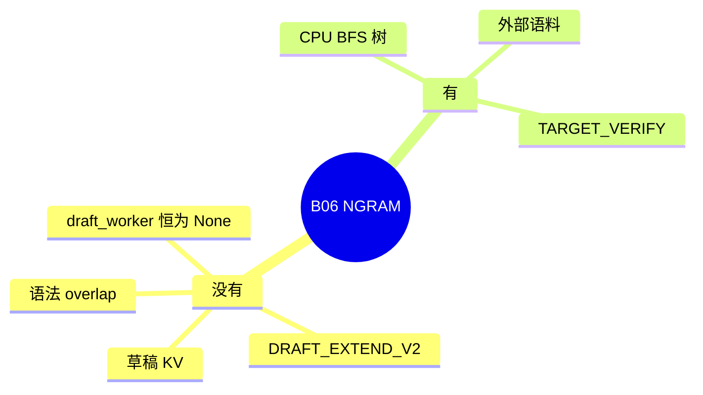

# NGRAM

对应 B06。树是 `297e54fd105e974cdf401e5b4d20253a22c16f90`。**源码路径推断，未实测**。

外部语料的 HTTP 在 [05-外部语料](../09-其它/05-外部语料.md)（B65）。

## 场景与硬件

不加载神经网络草稿。用已生成 token 的 n-gram 在 CPU 上做 BFS，提出一棵候选，再交给目标模型一次验证。适合重复性强的文本，以及可以热更新的外部语料。

`_handle_ngram`：

| 项 | 行为 |
| --- | --- |
| 设备 | 必须是 cuda、cpu 或 xpu |
| attention DP | `ValueError` |
| mixed chunk | 强制关闭 |
| `speculative_num_draft_tokens` | 默认 12 |
| `speculative_eagle_topk` | 从 `speculative_ngram_max_bfs_breadth` 抄过来 |
| `page_size>1` 且 topk>1 | 只允许 flashinfer |
| 外部语料 | 路径 `speculative_ngram_external_corpus_path`，另有预算检查 |

`has_draft_kv()` 为假。`supports_grammar_overlap` 为假：草稿是 host 查找，没有 GPU draft 相位可用来掩盖语法 CPU。`SpecInputType` 只有 `NGRAM_VERIFY`。

## 在框架中的位置

`NGRAMWorker.draft_worker` 恒为 `None`。`maybe_init_draft_worker` 仍会建 `ExternalCorpusManager`，供运行时 `POST /add_external_corpus`。

## 原理

候选树只活在验证 mask 里。因为没有草稿 KV，decode 分配不必按 topk 做页对齐，见 `has_draft_kv` 的注释和 `get_alloc_len_per_decode`。接受规则复用 `eagle_sample`，所以采样侧和 EAGLE 共用一段代码，模型侧没有草稿模块。

`_prepare_for_speculative_decoding` 的注释提到 DP attention 要等后续支持落地。处理函数现在直接拒绝 DP，两边一致：还不能用。

## 过程

1. `_handle_ngram` 检查设备、DP、语料预算，写入默认宽度。
2. `create_worker` 返回 `NGRAMWorker`。
3. Decode：`_prepare_draft_tokens` 从语料 `batch_get`，建成验证树，模式设为 `TARGET_VERIFY`。
4. 目标前向，`eagle_sample` 接受前缀。
5. `_update_ngram_corpus` 把新 token 写回语料。

## 调用栈

| 函数 | 做什么 | 角色 |
| --- | --- | --- |
| `_handle_ngram` | 设备、默认 12、BFS 宽度、DP 拒绝 | 解析 |
| `NGRAMWorker.forward_batch_generation` | 一轮：准备、验证、更新语料 | 入口 |
| `_prepare_for_speculative_decoding` | 语料查找，设 `TARGET_VERIFY` | 草稿相位在 CPU |
| `target_worker.forward_batch_generation(..., is_verify=True)` | 目标验证 | 计算 |
| `eagle_sample` | 接受 | 与 EAGLE 共用 |
| `_update_ngram_corpus` | 插入新 n-gram | 语料 |

## 待核

`_update_ngram_corpus` 的 FIXME：extend 是否插入缓存。DP attention 的注释与当前 `ValueError` 哪一个会先被改掉，未定。

返回 [本目录 README](README.md)。
