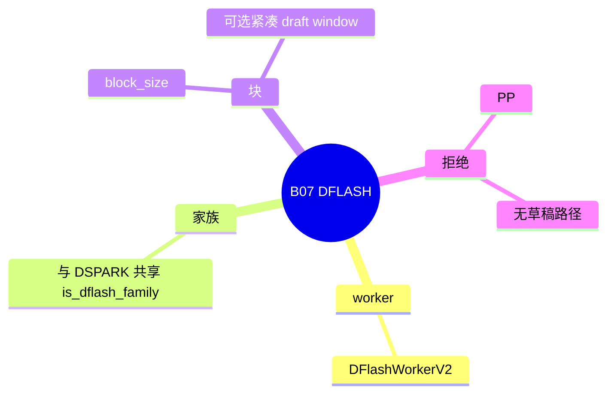

# DFLASH

对应 B07。树是 `297e54fd105e974cdf401e5b4d20253a22c16f90`。**源码路径推断，未实测**。

草稿 attention 后端的 `trtllm_mha` 拒绝在 [10-草稿attention](10-草稿attention.md)。

## 场景与硬件

DFLASH 用一块草稿模型，一次提出一个 block 的 token（mask token 加草稿前向），目标模型再验证这个窗口。它和 DSPARK 同属 `is_dflash_family()`，共享一部分 `DFlashDraftInputV2` / `DFlashVerifyInput`。`SpecInputType` 是 `DFLASH_DRAFT` 和 `DFLASH_VERIFY`。

`_handle_dflash`：

| 项 | 行为 |
| --- | --- |
| 平台 | cuda、npu、xpu，或树外平台声明 `supports_speculative_algorithm` |
| 草稿路径 | 必须有 `--speculative-draft-model-path` |
| 步数和 topk | 强制 `speculative_num_steps=1`，`speculative_eagle_topk=1` |
| 宽度 | `speculative_num_draft_tokens` 与 `speculative_dflash_block_size` 对齐 |
| `pp_size!=1` | `ValueError` |
| attention DP 且不是 NPU | 要求 `--enable-dp-lm-head`。禁止 `attn_cp_size!=1`。禁止 `SGLANG_ENABLE_DP_SPEC_PREFILL_COORDINATION` |
| 运行上限 | 48 |
| `--speculative-draft-window-size` | 对 DFLASH 有效。小于 block size 则 `ValueError` |

Worker 文档：Drives both overlap and non-overlap scheduling, same as EAGLE。

## 在框架中的位置

## 原理

草稿不是逐步自回归猜一个 token，而是按块填充。验证窗口的长度等于块。可选的 `speculative_draft_window_size` 把草稿 KV 收成更短的滑窗，但不能短于块大小。

Prefill 捕获目标的 FULL hidden，再把 prompt 物化进草稿 KV。注释要求这条物化对 radix 安全：前缀页已经在树上时，不能把草稿 KV 写错位置。

`supports_mixed_chunk`、`supports_grammar_overlap`、`supports_target_verify_for_draft` 对 dflash 族为真。`supports_prefill_shared_read_done` 也为真：DSPARK 的注释说草稿 KV 注入在目标 prefill 之后，但写位置在目标前向之前就算好。DFLASH 被算进同一族。

PD 传输走 `build_dflash_disagg_draft_input`。

## 过程

1. `_handle_dflash` 对齐块大小，解析草稿 attention，见 B91。
2. `create_worker` 返回 `DFlashWorkerV2`。
3. Prefill：目标 FULL，再物化草稿 KV。
4. Decode：一块草稿前向，然后目标验证该窗口，接受前缀。
5. 若设置了 draft window，草稿 KV 按窗口裁剪。

## 调用栈

| 函数 | 做什么 | 角色 |
| --- | --- | --- |
| `_handle_dflash` | 平台、PP、DP lm head、块大小 | 解析 |
| `_resolve_dflash_draft_attention_backend` | 草稿核，含 trtllm_mha 的层类型检查 | B91 |
| `DFlashWorkerV2.forward_batch_generation` | 块草稿 + 验证 | 一轮 |
| `build_dflash_disagg_draft_input` | PD 的草稿输入 | 分离 |

## 待核

块内 mask 的具体形状以 `dflash_info_v2.py` 为准，本页没有逐字段抄。和 DSPARK 共享的数据结构里，哪些字段 DFLASH 不用，标待核。

返回 [本目录 README](README.md)。
