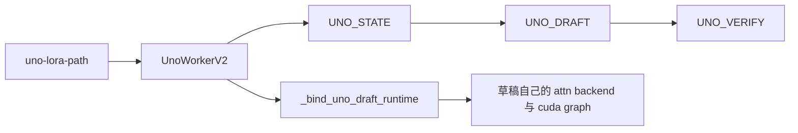
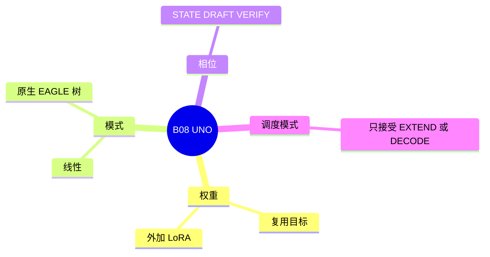

# UNO

对应 B08。树是 `297e54fd105e974cdf401e5b4d20253a22c16f90`。**源码路径推断，未实测**。

## 场景与硬件

单模型投机：不加载 `--speculative-draft-model-path`，在目标权重上加 `--uno-lora-path`，用线性链或原生 EAGLE 式的树做草稿。`SpecInputType` 有三份：`UNO_STATE`，`UNO_DRAFT`，`UNO_VERIFY`。

`_handle_uno` 把平台和并行收得很窄：

| 项 | 要求 |
| --- | --- |
| 设备 | 仅 CUDA |
| attention | FA3 的 prefill 和 decode |
| 并行 | `tp_size=1`，`pp_size=1` |
| 禁止 | attention DP、CP、公开的多 LoRA、确定性推理、strict thinking、rejection sampling、PD mux |
| tree 模式额外 | two-batch overlap 禁止。Q 与 K 容量：Q≤128，Q×K≤2048 |
| mixed chunk | 关闭 |

## 在框架中的位置

## 原理

`UnoWorkerV2` 的文档：Single-model UNO worker with linear and native-EAGLE tree decode。Tree 模式用私有的 draft attention 后端，并在 `_bind_uno_draft_runtime` 里交换 CUDA graph。这样草稿核不会污染目标模型的图。

`forward_batch_generation` 只接受 `EXTEND` 或 `DECODE`。它不走框架页里 `TARGET_VERIFY` / `DRAFT_EXTEND_V2` 那套枚举路径，相位写在 `UNO_*` 输入里。Attention 后端应看 `SpecInput.is_draft_input` / `is_verify_input`，那两个谓词已经包含 `UNO_DRAFT` 和 `UNO_VERIFY`。

## 过程

1. `_handle_uno` 校验 Q/K、设备、并行和一串禁配。
2. `create_worker` 返回 `UnoWorkerV2`。
3. 加载 LoRA 到目标权重上的草稿分支。
4. EXTEND 建立 `UNO_STATE`。DECODE 在线性或树模式之间跑 draft 和 verify。
5. Tree 模式在草稿前向前后绑定私有 runtime。

## 调用栈

| 函数 | 做什么 | 角色 |
| --- | --- | --- |
| `_handle_uno` | CUDA、FA3、TP=PP=1、禁配 | 解析 |
| `UnoWorkerV2.forward_batch_generation` | 只接 EXTEND / DECODE | 入口 |
| `_bind_uno_draft_runtime` | 换草稿 attention 和 CUDA graph | tree 模式 |
| `UNO_STATE` / `UNO_DRAFT` / `UNO_VERIFY` | 三个相位的输入 | 与 EAGLE 的类型分开 |

## 待核

线性模式和树模式的切换条件以 `uno_worker_v2.py` 的分支为准。本页确认了容量上限和禁配列表，没有逐步跟 LoRA 权重如何绑到哪一层。

返回 [本目录 README](README.md)。
