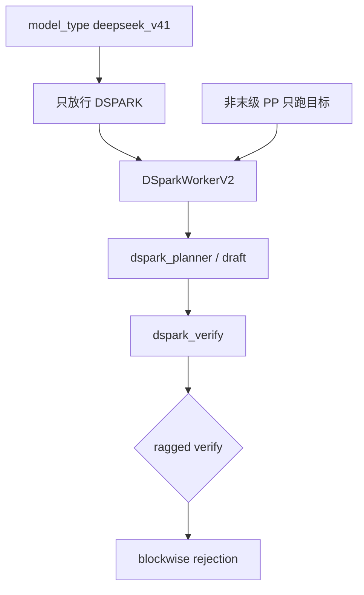
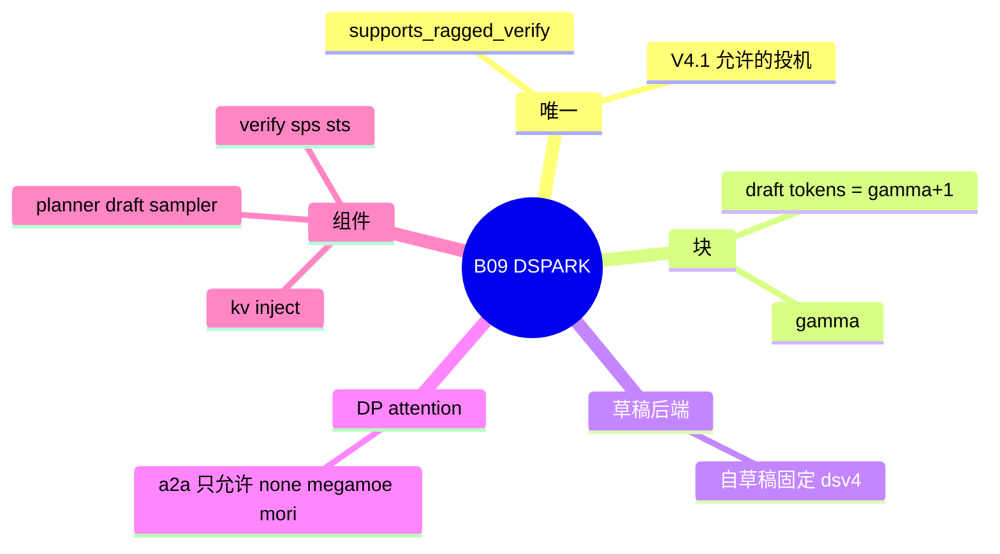

# DSPARK

对应 B09。树是 `297e54fd105e974cdf401e5b4d20253a22c16f90`。**源码路径推断，未实测**。本环境没有 DeepSeek V4 多卡或 DeepEP 的实跑记录。

## 场景与硬件

DSPARK 是 DeepSeek V4 上的块状草稿。V4.1（`model_type == deepseek_v41`）在 `validate_deepseek_v41_features` 里拒绝「不是 DSPARK 的投机」：`str(speculative_algorithm).upper() != "DSPARK"` 即 `ValueError`，文案是 speculative decoding other than DSpark。同一函数还拒绝 HiSparse、unified KV triton、two-batch overlap、`pp_size>1`。DSpark 再加 PD 时还要求 static verify、mooncake 或 nixl 传输、DCP=1、decode CP=1（函数约 355–382 行）。

`_handle_dspark` 的平台是 cuda、npu 或 xpu。草稿路径可以省略：从目标 checkpoint 自带的 `dspark/` 子目录自动解析。`speculative_num_draft_tokens = gamma + 1`，`speculative_dspark_block_size` 是 gamma。`steps` 和 `topk` 强制为 1。运行上限 48。

DeepSeek-V4 自己当草稿时，attention 后端固定成 `DSV4_DRAFT_ATTENTION_BACKEND = "dsv4"`（`dspark_config.py`）。这个名字不在 `DRAFT_ATTENTION_BACKEND_CHOICES` 里，是构建时的显式覆盖。

Attention DP 且不是 NPU 时，MoE all-to-all 只能是下面三个，原文在 `_handle_dspark`：

```text
DSpark with dp attention supports moe_a2a_backend 'none'
(built-in TP MoE), 'megamoe', or 'mori'
```

`none` 是内置 TP MoE，`megamoe` 和 `mori` 是白名单里的 a2a。DeepEP 不在这三项里。非 NPU 且（`moe_a2a_backend != none` 或开了 DP spec prefill coordination）时，还要求环境变量 `SGLANG_RAGGED_VERIFY_MODE=static`。

Worker 初始化：MoE 草稿加 attention DP 且 `attn_tp>1` 则 `ValueError`。PP 仅当 `disaggregation_mode == prefill` 时允许 `pp_size!=1`。`validation_hook.check_pipeline_parallel_compat` 复述了同一句：Pipeline parallel DSPARK requires disaggregation-mode=prefill，并且 `SGLANG_ENABLE_PP_SPEC` 不支持这条 PD prefill。

## 在框架中的位置





`dspark_components/` 把规划、草稿、采样、验证、KV 注入、可观测拆开。`DSparkWorkerV2` 的文档：非末级 PP 只跑目标，草稿在末级。

## 原理

验证可以是等长窗口，也可以是 ragged：每条请求的验证长度不同。`supports_ragged_verify()` 只对 DSPARK 返回真。`RaggedVerifyLayout` 挂在 `SpecInput` 上，decode CUDA graph 用 token-bucket 键区分这些图。模式由 `read_ragged_verify_mode()` 读取，启动时就校验，避免拖到指标上报。

`get_num_tokens_per_req_for_target_verify` 在 DSPARK 且 `is_draft_worker` 时返回 `num_draft_tokens - 1`。目标验证仍用完整的 draft token 数。这个差是 FIXME 所说的 forward mode 特例。

`dspark_verify.py` 做块状拒绝。贪婪路径可以走融合 argmax。SPS / STS 表在 `static` ragged 模式下被警告成 no-op。

`supports_prefill_shared_read_done` 对 dflash 族为真。DSPARK 的注释：草稿 KV 注入在目标 prefill 之后发生，但写位置在目标前向之前就算好。

## 过程

1. `validate_deepseek_v41_features` 在 V4.1 上淘汰其它算法。
2. `_handle_dspark` 解析草稿路径、gamma、DP+MoE 白名单、ragged 模式。
3. `create_worker` 返回 `DSparkWorkerV2`。自草稿的 attention 覆盖为 `dsv4`。
4. Prefill：末级准备草稿 KV 注入。
5. Decode：planner 定块，draft 提议，verify 按 ragged 或等长窗口做拒绝采样，接受前缀写回。
6. PD 用 `build_dspark_disagg_draft_input`。

## 调用栈

| 函数 | 做什么 | 角色 |
| --- | --- | --- |
| `validate_deepseek_v41_features` | V4.1 只留 DSPARK，并检查 PD 附加条件 | 模型门 |
| `_handle_dspark` | 路径、gamma、a2a 白名单、ragged | 解析 |
| `DSparkWorkerV2` | 末级草稿，非末级只目标 | worker |
| `dspark_planner` / `dspark_draft` | 块提案 | 草稿 |
| `dspark_verify` | 块状拒绝，ragged 窗口 | 验证 |
| `read_ragged_verify_mode` | 读环境变量 | 图的键 |
| `build_dspark_disagg_draft_input` | PD 草稿输入 | 分离 |

## 与相邻特性

B19 的 DeepEP 不在 DP attention 的 a2a 白名单里。要用 DeepEP 做 V4 专家通信，就不能同时开 attention DP 加 DSPARK，除非跑在 NPU（白名单判断被 `_is_npu` 跳过）。B20 的 mori 在白名单里。B11 的 HiSparse 被 V4.1 拒绝，和 DSPARK 不能一起出现在 V4.1 上。

## 待核

SPS / STS 在 static ragged 下的 no-op 是否影响正确性，注释把它当成警告而不是错误。接受率未实测。NPU 跳过 a2a 白名单之后实际允许哪些后端，以 `_handle_dspark` 的 `_is_npu` 分支为准，本页没有把 NPU 允许集列成另一张表。

返回 [本目录 README](README.md)。
