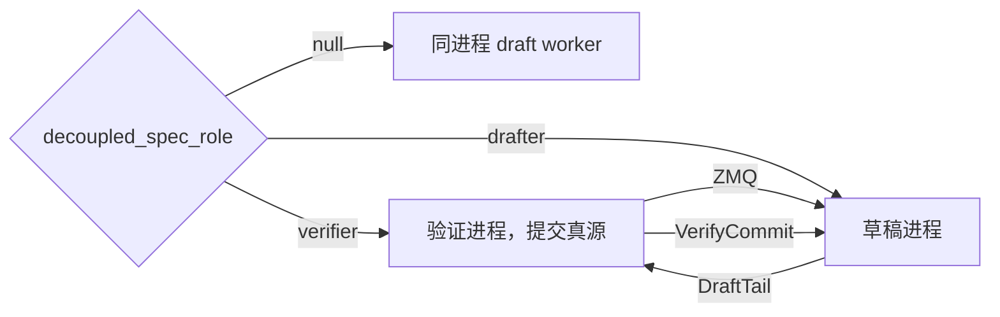
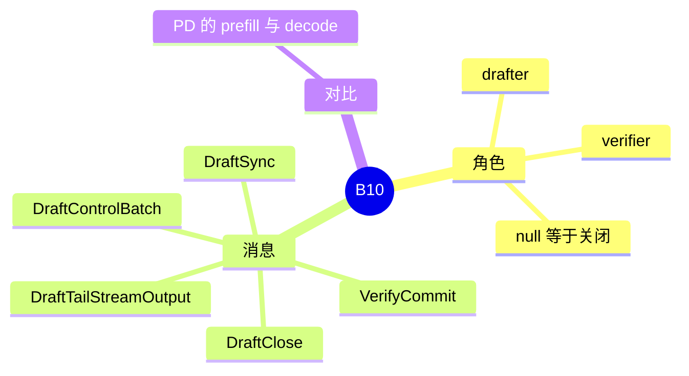

# 解耦投机

对应 B10。树是 `297e54fd105e974cdf401e5b4d20253a22c16f90`。**源码路径推断，未实测**。

## 场景与硬件

把「出草稿」和「验证」拆成两个进程，用 ZMQ IPC 网格连接。字段在 `fields/disagg.py`：`decoupled_spec_role` 取 `null`、`verifier`、`drafter`，另有 `decoupled_spec_rank`。`null` 表示不启用，草稿和验证仍在同一个 scheduler 进程里，走前面各页的 worker。

这和 PD 的 prefill / decode 不是同一对角色。PD 拆的是 KV 算在哪一台。解耦投机拆的是草稿进程和验证进程。一台机器可以只做 verifier 或只做 drafter。

源码没有写 GPU 型号限制。和 Mooncake PD 路径互斥：`pd_disaggregation_hook` 把 `decoupled_spec_role != "null"` 列进 PD mooncake 不支持的组合。

`spec_trace_dir`（`fields/spec.py`）可以写解耦轨迹。

## 在框架中的位置

## 原理

`decoupled_spec_io.py` 定义消息和 `DecoupledSpecIpcConfig`。Verifier 是已经提交 token 的真源。Drafter 先把前缀对齐到 verifier 提交过的 token，再吐出尾部草稿。`VerifyCommit` 把接受结果送回草稿侧，草稿据此裁剪自己的状态。

`ServerArgs` / `PortArgs` 在角色不是 `null` 时要求 bind、connect 和 rank，用来组这张 IPC 网格。注释：currently connected by a ZMQ IPC mesh。

## 过程

1. 两个进程分别以 verifier 和 drafter 启动，rank 配对。
2. 请求进入 verifier。需要草稿时发控制批。
3. Drafter 对齐前缀，流式吐出尾 token（`DraftTailStreamOutput`）。
4. Verifier 用目标模型验证，`VerifyCommit` 回传。
5. 结束用 `DraftClose`。

## 调用栈

| 函数 | 做什么 | 角色 |
| --- | --- | --- |
| `decoupled_spec_role` 字段 | 选择进程角色 | 配置 |
| `PortArgs` 构建 | 角色非 null 时要求地址和 rank | 启动 |
| `DecoupledSpecIpcConfig` | ZMQ 端点 | 传输 |
| `DraftSync` / `VerifyCommit` / `DraftTailStreamOutput` | 前缀、提交、尾部草稿 | 协议 |
| `pd_disaggregation_hook` | Mooncake PD 拒绝非 null 角色 | 互斥 |

## 待核

`VerifyCommit` 的 TODO：对端数据错误应隔离，而不是让 TokenSync 线程崩溃。注释还提到 phase 5.c verifier 降级 all-reduce。这些都还没完成，本页不把它们写成已有行为。

返回 [本目录 README](README.md)。
