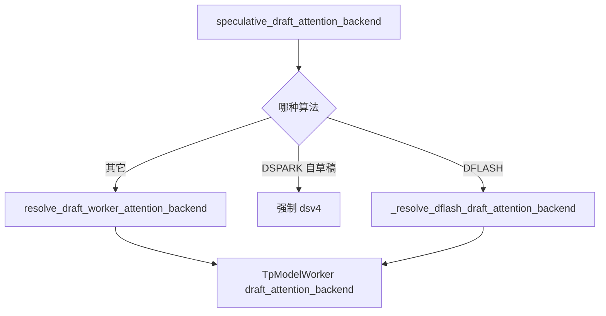
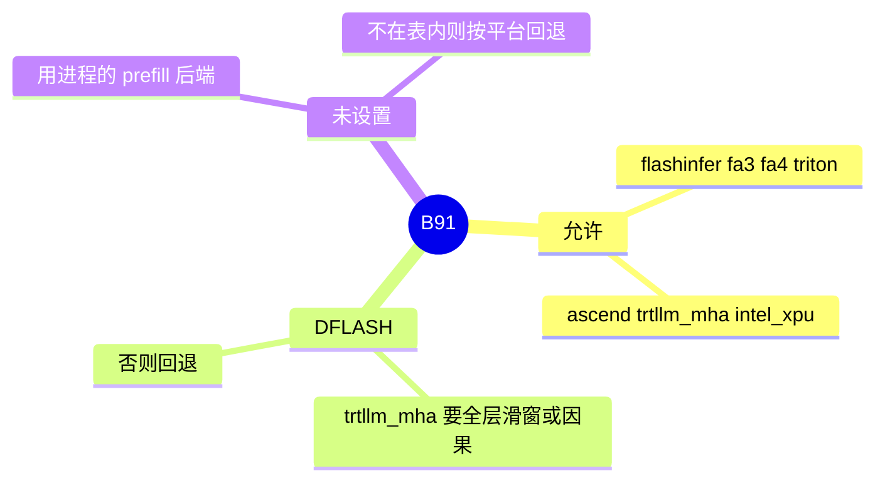

# 草稿 attention 后端

对应 B91。树是 `297e54fd105e974cdf401e5b4d20253a22c16f90`。**源码路径推断，未实测**。

## 场景与硬件

草稿模型可以比目标模型小，也可以用不同的 attention 实现。字段 `speculative_draft_attention_backend`，help：Attention backend for speculative decoding drafting。CLI 没有 `choices=`，合法集合在 `DRAFT_ATTENTION_BACKEND_CHOICES`：`flashinfer`，`fa3`，`fa4`，`triton`，`ascend`，`trtllm_mha`，`intel_xpu`。

注释：`trtllm_mha` 给 decode-only 的 dense-MQA 草稿。DFLASH 会在层类型不满足时更早拒绝。

DSPARK 的 V4 自草稿不走这张表，覆盖为 `dsv4`。见 [08-DSPARK](08-DSPARK.md)。

目标侧的 `trtllm_mha` 加 EAGLE `topk>1` 在 `_handle_eagle_family` 被拒绝。那是目标后端，不是本字段。

## 在框架中的位置

## 原理

草稿的 CUDA graph 和核可以与目标不同，所以 worker 构建时把后端名字单独传进 `TpModelWorker(is_draft_worker=True, draft_attention_backend=...)`。目标验证仍用目标的 prefill 或 decode 后端，由 `speculative_attention_mode`（`prefill` 或 `decode`）在 `hybrid_attn_backend.py` 路由。两个字段不要合成一个。

`resolve_draft_worker_attention_backend`：用户没设就用进程的 prefill 后端。名字不在 choices 里则警告，并按平台回退（XPU 或 HIP 到 triton，否则 flashinfer）。

DFLASH 的 `_resolve_dflash_draft_attention_backend` 读草稿 HF config 和 `get_dflash_layer_types`。`trtllm_mha` 仅当全部层是 sliding attention，或草稿 `is_causal=True`。否则回退。日志：DFLASH only enables 'trtllm_mha' when all layers use sliding attention or the draft is explicitly causal。树外平台可以保留原默认。树内 CUDA SM100 可以改成 fa4。最后 `declare_resolution` 写回字段。函数有 FIXME：不要直接改 server args，把解析结果传给 draft worker。

## 过程

1. 算法处理函数运行。DFLASH 走专用解析，其它走通用解析，DSPARK 自草稿覆盖。
2. `build_draft_tp_worker` 把名字传给草稿 `TpModelWorker`。
3. 草稿前向用这份后端。目标 `TARGET_VERIFY` 不用它。

## 调用栈

| 函数 | 做什么 | 角色 |
| --- | --- | --- |
| `resolve_draft_worker_attention_backend` | 缺省和非法名字的回退 | 通用 |
| `_resolve_dflash_draft_attention_backend` | DFLASH 的层类型门 | 专用 |
| `DSV4_DRAFT_ATTENTION_BACKEND` | 自草稿固定 `dsv4` | DSPARK |
| `build_draft_tp_worker` | 把后端交给草稿 worker | 启动 |
| `hybrid_attn_backend` 的 speculative attention mode | 目标验证选 prefill 或 decode 后端 | 目标侧，不是本字段 |

## 待核

旗标的连字符清单写过待核。字段名是 `speculative_draft_attention_backend`，help 已见。argparse 的 dest 与连字符按 `fields/spec.py` 的声明。FIXME 所说的「不要覆写 server args」仍然是当前实现。

返回 [本目录 README](README.md)。
