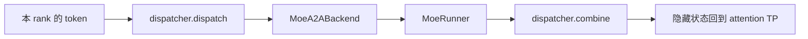
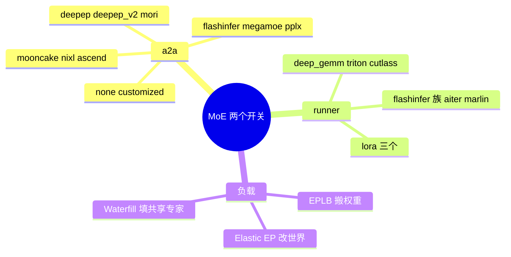

# MoE 与 DeepEP 域总览

本域覆盖 B19–B22、B43–B47、B94。树是 `297e54fd105e974cdf401e5b4d20253a22c16f90`。**源码路径推断，未实测**。本环境没有 DeepEP 或多机专家并行的实跑记录。

专家并行作为轴是 D08，通信原语落在本域。清单的边界：DeepEP、mori、MegaMOE 不另算一条并行轴。轴的定义在 [04-分布式/04-专家并行](../../04-分布式/04-专家并行.md)（含 F201）。

## 场景与硬件

| 场景 | 前提 | 页 |
| --- | --- | --- |
| 专家不在本卡，token 要 all-to-all | `--moe-a2a-backend deepep` 或 `deepep_v2`。v2 只允许 `deep_gemm` runner，并关掉 prefill 图 | [01-DeepEP](01-DeepEP.md) |
| AMD 上的专家 all-to-all | `--moe-a2a-backend mori`。`SGLANG_MORI_EP_V2` 默认真 | [02-mori](02-mori.md) |
| Mooncake、NIXL、Ascend、FlashInfer、MegaMOE、PPLX | 同一个 `--moe-a2a-backend` 枚举 | [03-其它a2a](03-其它a2a.md) |
| 专家落在本卡之后的 GEMM | `--moe-runner-backend`，与 a2a 是两套枚举 | [04-GEMM-runner](04-GEMM-runner.md) |
| 共享专家用更窄的 TP | Kimi-K3，且 a2a 落在允许集合 | [05-Shared-experts-TP](05-Shared-experts-TP.md) |
| 固定世界上把专家权重搬走 | `enable_eplb`，一般要求 `ep_size>1` | [06-EPLB](06-EPLB.md) |
| 运行中改变专家世界 | HTTP `/scale_elastic_ep`。扩容走 mooncake，加入条件里有 nixl | [07-Elastic-EP](07-Elastic-EP.md) |
| 用权重预取代替 token all-to-all | `--dwdp-size` 必须等于 `tp_size`。关投机、关 CUDA graph | [08-DWDP](08-DWDP.md) |
| GGUF 专家包，单卡 eager | `--load-format expert_pack`。DeepSeek-V4-Flash 与一份 Kimi GGUF | [09-Expert-pack](09-Expert-pack.md) |
| 共享专家当成多出来的一路 routed | `--enable-waterfill`。help 写 DeepEP 与 MegaMOE，DeepSeek-V3/R1 且 EP≥2 | [10-Waterfill](10-Waterfill.md) |

## 在框架中的位置

一次 MoE 前向的角色：dispatcher 决定 token 去哪张卡，runner 在卡上做专家 GEMM，combine 把结果送回。`--moe-a2a-backend none` 时 dispatcher 是 `StandardDispatcher`，专家按 TP 切在本卡，没有 all-to-all。

## 和投机、注意力

DSPARK 加 attention DP 时，a2a 只允许 `none`、`megamoe`、`mori`，见 [08-DSPARK](../03-投机与MTP/08-DSPARK.md)。DeepEP 不在这三项里。DWDP 会把 a2a 收成 `none`，并把 `attn_dp_size` 设成 `dwdp_size`。

返回 [本目录 README](README.md)。
