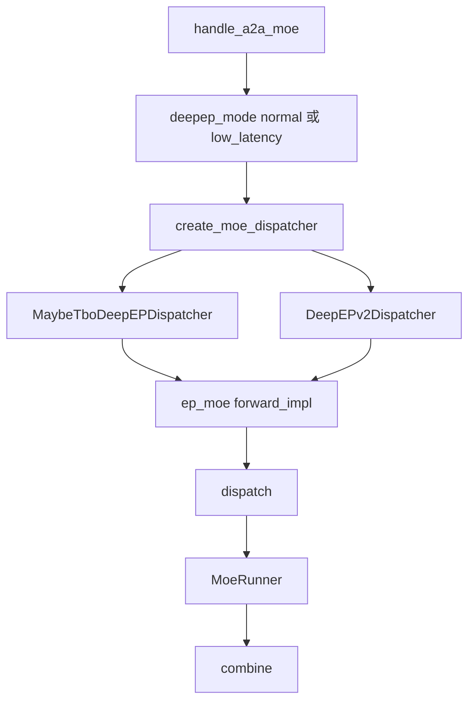
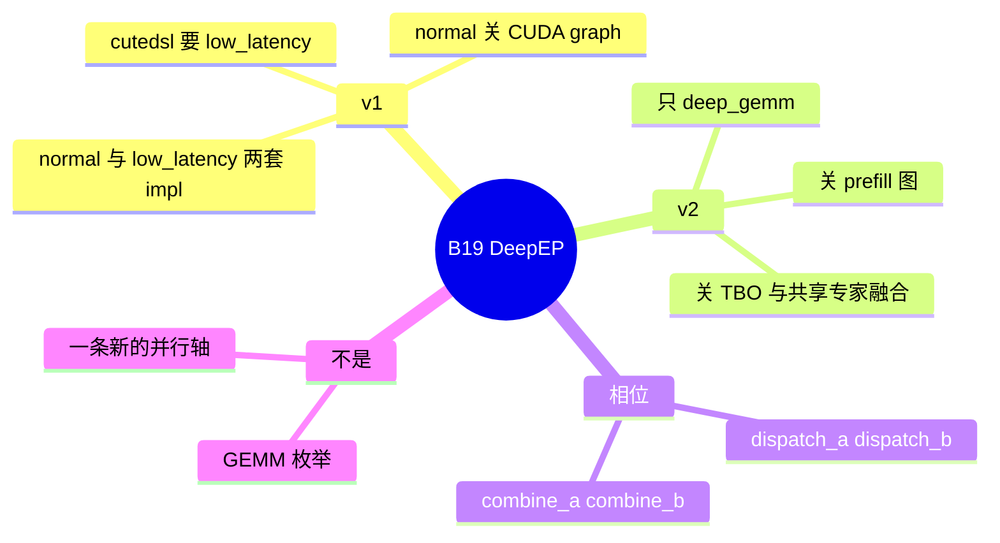

# DeepEP

对应 B19。树是 `297e54fd105e974cdf401e5b4d20253a22c16f90`。**源码路径推断，未实测**。本环境没有 DeepEP 的实跑记录。

## 场景与硬件

MoE 的专家分在多张卡上。每个 token 的 top-k 专家可能不在本卡。DeepEP 用 all-to-all 把 token 送到专家所在的 rank，专家 GEMM 之后再 combine 回来。它不是 GEMM 实现。GEMM 由 `--moe-runner-backend` 选择，见 [04-GEMM-runner](04-GEMM-runner.md)。

`--moe-a2a-backend` 取 `deepep` 或 `deepep_v2`。二者是枚举的两个成员，一次进程只能有一个值。

`deepep_mode`（`DeepEPMode`，默认 `auto`）三个值：

| 模式 | `resolve(is_extend_in_batch)` |
| --- | --- |
| `normal` | 始终 normal |
| `low_latency` | 始终 low latency |
| `auto` | batch 里有 extend 则 normal，否则 low latency |

`enable_normal()` / `enable_low_latency()` 对 `auto` 和对应该名字的模式都为真。v2 另有 `deepep_v2_mode`，hook 写明它不跟 `deepep_mode` 走。

`moe_hook.handle_a2a_moe` 对 v1（`deepep`）：

- `deepep_mode == normal`：警告，并把 CUDA graph 两个相位收成 `Backend.DISABLED`。
- runner 是 `flashinfer_cutedsl`：必须 low latency。normal 则 `ValueError`。

对 v2（`deepep_v2`）：

| 条件 | 报错要点 |
| --- | --- |
| runner 不是 `deep_gemm`（`auto` 会被收成 `deep_gemm`） | DeepEP v2 MoE currently supports only `--moe-runner-backend deep_gemm` |
| `enable_two_batch_overlap` 或 `enable_single_batch_overlap` | DeepEP v2 MoE has not implemented the TBO/SBO overlap hooks yet |
| `enforce_shared_experts_fusion` | DeepEP v2 MoE has not validated fused shared experts yet |

v2 关掉 prefill CUDA graph。日志说 decode 图留在 masked decode 路径上。`MoeRunner.__init__` 再查一次：v2 且 runner 不是 deep_gemm 则 `ValueError`。

`moe_hook` 没有「ROCm 禁止 deepep」的断言。`token_dispatcher/deepep.py` 在使用时 import `deep_ep`（NPU 走 `zbal` adaptor）。导入失败会推迟到第一次前向。同文件 `_use_aiter = SGLANG_USE_AITER and is_hip()`，HIP 上可以叠 Aiter，不是启动即拒绝。

Elastic EP 的图重捕获检查 `device == "cuda"`，那是扩缩容路径，不是每条 DeepEP 前向的门。

## 在框架中的位置

## 原理

`create_moe_dispatcher`（`fused_moe_triton/layer.py`）里，`deepep`、`mooncake`、`mori`、`nixl`、`pplx` 都包进 `MaybeTboDeepEPDispatcher`。`deepep_v2` 用 `DeepEPv2Dispatcher`。EP 层 `ep_moe/layer.py` 的 `forward_impl` 顺序是 `dispatcher.dispatch`，runner，`dispatcher.combine`。

v1 的 `DeepEPDispatcher.dispatch` / `combine` 委托给 `_DeepEPDispatcherImplNormal` 或 `_DeepEPDispatcherImplLowLatency`，内部再分成 `dispatch_a` / `dispatch_b` 和 `combine_a` / `combine_b`，以便和计算重叠。v2 的类在 `token_dispatcher/deepep_v2.py`，不复用这两套 impl 的模式开关。

Normal 面向有 extend 的批（prefill 或混合），缓冲区按 token 数变化。Low latency 面向纯 decode，用固定、较小的缓冲换延迟。`auto` 按本批有没有 extend 切换。因为 normal 会关图，一条服务如果经常 prefill，DeepEP v1 的 CUDA graph 会停着。

## 过程

1. 解析期选定 `deepep` 或 `deepep_v2`，并按上表改 runner 和图。
2. 建层时 `create_moe_dispatcher`。
3. 每个 MoE 层：gate 得到 top-k，dispatch 把 token 送到专家 rank。
4. `MoeRunner` 用 deep_gemm 或其它允许的 runner 做专家计算。v2 只能 deep_gemm。
5. combine 把专家输出按 token 加回，回到 attention 的 TP 组。

## 调用栈

| 函数 | 做什么 | 角色 |
| --- | --- | --- |
| `handle_a2a_moe` | v1 关图或强制 low latency；v2 锁 runner 并拒绝 TBO | 解析 |
| `DeepEPMode.resolve` | `auto` 按有没有 extend 选择 | 每批 |
| `create_moe_dispatcher` | v1 包 TBO dispatcher，v2 用 v2 类 | 工厂 |
| `forward_impl` | dispatch、runner、combine | 层 |
| `DeepEPDispatcher.dispatch` / `combine` | 转到 normal 或 low latency impl | v1 通信 |
| `DeepEPv2Dispatcher` | v2 的 all-to-all | v2 通信 |
| `MoeRunner.__init__` | v2 再断言 deep_gemm | 第二道门 |

## 与相邻特性

| ID | 关系 |
| --- | --- |
| B22 | runner 是 GEMM。v2 把它锁成 `deep_gemm` |
| B30 | v2 没有 TBO/SBO hook |
| B20 | mori 走同一个 `MaybeTboDeepEPDispatcher` 工厂分支，模式处理不同 |
| B94 | waterfill 的 help 写明支持 DeepEP。v2 却拒绝共享专家融合，而 waterfill 会隐含打开融合。这两个开关叠在一起时以 hook 的拒绝为准 |
| B09 | attention DP + DSPARK 的白名单没有 deepep |
| D08 | 并行度 `ep_size` 在分布式篇。本页是通信实现 |

## 待核

`deepep_v2_mode` 的取值和 `deepep_mode` 的三值是否同名，本页只确认 hook 说两者独立。首次 import `deep_ep` 失败时的报错文本未在本环境触发。Waterfill 与 v2 的融合拒绝是否在 waterfill 自己的校验里再报一次，见 [10-Waterfill](10-Waterfill.md)。

返回 [本目录 README](README.md)。
