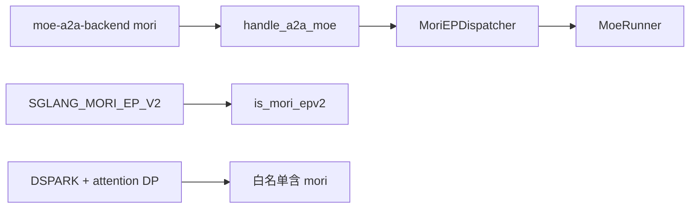
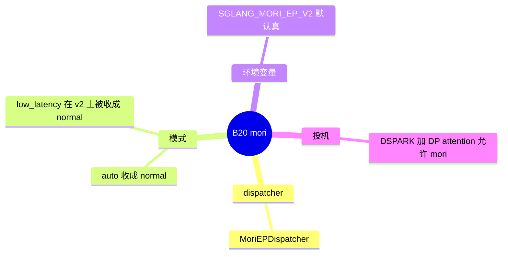

# mori

对应 B20。树是 `297e54fd105e974cdf401e5b4d20253a22c16f90`。**源码路径推断，未实测**。

## 场景与硬件

AMD 路线上的专家 all-to-all。`--moe-a2a-backend mori`，枚举 `MoeA2ABackend.MORI`。实现类 `MoriEPDispatcher`（`token_dispatcher/moriep.py`）。工厂把它和 DeepEP 一起放进 `MaybeTboDeepEPDispatcher` 的分支。

`is_mori_epv2()`：`is_mori()` 且 `envs.SGLANG_MORI_EP_V2`。`environ.py` 里这个变量默认 True。`_resolve_mori_ep_v2` 允许显式 `true` 在功能未支持时仍强制 v2。

`handle_a2a_moe` 对 mori：`deepep_mode` 若是 `auto` 则收成 `normal`。EPv2 且用户写了 `low_latency` 时，警告并收成 `normal`。

没有看到「非 HIP 则拒绝 mori」的启动断言。库不可用会在 dispatcher 第一次使用时暴露。本页不把「只在 AMD 上能跑通」写成断言，只把源码的模式改写和 DSPARK 白名单写下来。

缓存后端注册名 `mori` 指向 `UMBPStore`，是另一套开关，见 [05-存储后端](../01-缓存/05-存储后端.md)。

## 在框架中的位置

## 原理

mori 占用 DeepEP 那条 dispatcher 包装，这样 TBO 的外壳可以复用，但内部所有到专家的传输是 `MoriEPDispatcher`。模式被钉在 normal，是因为 v2 / low latency 的缓冲假设在 mori 上没有单独实现。DSPARK 加 attention DP 的白名单把 mori 和 `none`、`megamoe` 放在一起，DeepEP 不在其中。原文见 [08-DSPARK](../03-投机与MTP/08-DSPARK.md)。

## 过程

1. 解析期确认后端是 mori，按环境变量决定是不是 EPv2，并把 `deepep_mode` 收成 normal。
2. `create_moe_dispatcher` 建 `MoriEPDispatcher`。
3. MoE 前向仍是 dispatch、runner、combine。
4. 若同时 DSPARK 和 attention DP，白名单通过，再叠加 ragged static 的要求（a2a 不是 `none` 时）。

## 调用栈

| 函数 | 做什么 | 角色 |
| --- | --- | --- |
| `handle_a2a_moe` | mori 的模式收成 normal | 解析 |
| `_resolve_mori_ep_v2` | 读 `SGLANG_MORI_EP_V2` | v1 / v2 |
| `is_mori_epv2` | 后端是 mori 且变量为真 | 查询 |
| `MoriEPDispatcher` | all-to-all | 通信 |
| `_handle_dspark` | DP attention 时允许 mori | 投机白名单 |

## 待核

强制 EPv2 时「未支持功能」具体指哪些，以 `_resolve_mori_ep_v2` 的警告文本为准。本页没有在 ROCm 机器上导入 mori 库。

返回 [本目录 README](README.md)。
