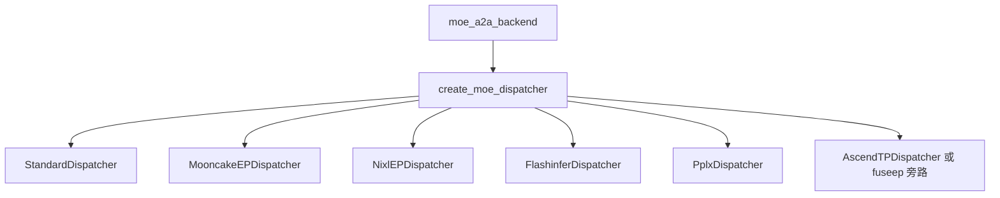
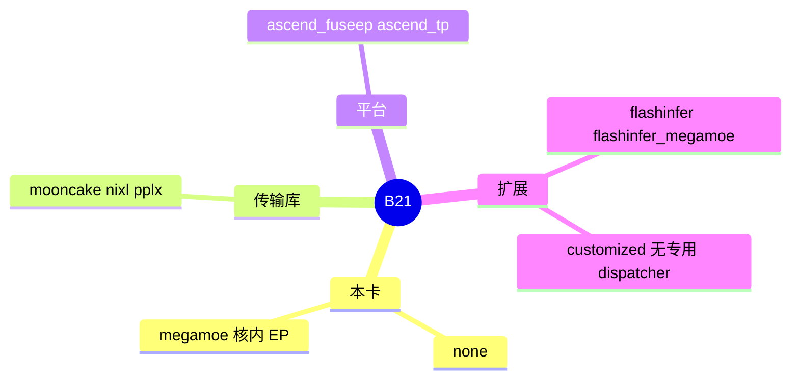

# 其它 MoE all-to-all

对应 B21。树是 `297e54fd105e974cdf401e5b4d20253a22c16f90`。**源码路径推断，未实测**。

DeepEP 与 mori 已单独成页。这里是同一个 `MoeA2ABackend` 枚举里的其余成员。GEMM 不在本页。

## 场景与硬件

专家并行或跨卡 MoE 需要把 token 送到专家所在的位置。不同集群用不同的传输：有的复用 PD 的 Mooncake 或 NIXL，有的在 Ascend 上融合，有的把 all-to-all 收进 MegaMOE 核。选择仍是 `--moe-a2a-backend` 的一个字符串。

`handle_a2a_moe` 按这个字符串改 runner、图和模式。下面每个后端只写源码里能定位的类和一条启动约束。没有写设备断言的，不补充「必须某代 GPU」。

## 在框架中的位置

## 各后端

### none

`StandardDispatcher`（`token_dispatcher/standard.py`）。专家按张量并行留在本卡，不做 all-to-all。NPU 上 `none` 也可能建 `AscendTPDispatcher`。DSPARK 加 attention DP 时，`none` 是白名单里的「内置 TP MoE」。

### mooncake

`MooncakeEPDispatcher`（`token_dispatcher/mooncake.py`）。和 HiCache 的 `MooncakeStore`、PD 的 mooncake 传输是三套配置，共用库名。Elastic EP 的运行时扩容要求 `elastic_ep_backend==mooncake`，见 [07-Elastic-EP](07-Elastic-EP.md)。

### nixl

`NixlEPDispatcher`（`token_dispatcher/nixl.py`）。`moe_a2a_backend == nixl` 时分布式初始化建全局 TCPStore（F109）。Elastic EP 的 scale 路径要求 a2a 是 nixl。EPLB 在 NIXL 上做重平衡时有 barrier。

### ascend_fuseep

不走通用 dispatcher 的计算路径。`forward_fuseep` 是 NPU 融合实现。层上仍会建一个 no-op 的 `StandardDispatcher`（`layer.py` 的注释）。共享专家 TP 的允许集合包含它。

### ascend_tp

`AscendTPDispatcher`（`token_dispatcher/ascend_tp.py`）。`moe_hook` 在 NPU 上可能把 `ascend_tp` 改写成 `none`。改写之后通信语义以 hook 的声明为准。

### flashinfer

`FlashinferDispatcher`（`token_dispatcher/flashinfer.py`）。all-to-all 由 FlashInfer 的 MoE 通信完成，runner 仍单独选。

### megamoe

EP 在核内部。dispatcher 是 `StandardDispatcher` 透传。模型侧逻辑在 `mega_moe.py`。CLI 的 runner 字符串 `"megamoe"` 不是 `MoeRunnerBackend` 的同名成员；a2a 为 megamoe 时 runner 被收成 `flashinfer_megamoe`。DSPARK 加 attention DP 的白名单包含这个名字。

### pplx

`PplxDispatcher`（`token_dispatcher/pplx.py`）。要求 `deepep_mode` 是 low latency 或 auto，runner 是 `deep_gemm`。工厂分支和 DeepEP 一样包了 `MaybeTboDeepEPDispatcher`。

### flashinfer_megamoe

与 megamoe 类似，加上 FlashInfer megamoe runner。`handle_a2a_moe` 有单独的分支。

### customized

枚举里有这个名字。`create_moe_dispatcher` 没有专用类。permute / fused hook 走 `moe_runner/base.py` 的池。`forward_batch_info` 把它当成需要 padding 的 a2a。真正的通信由插件注册的 fused op 提供。

## 过程

1. `--moe-a2a-backend` 定稿。`ascend_tp` 可能被改成 `none`。
2. `handle_a2a_moe` 改 runner、模式、图。
3. `create_moe_dispatcher` 按上表建类。
4. 层前向 `dispatch` → runner → `combine`。`none` 和 megamoe 的 dispatch 是透传，通信在别的地方发生或不发生。

## 调用栈

| 函数 | 做什么 | 角色 |
| --- | --- | --- |
| `MoeA2ABackend` | 枚举全部后端名 | 配置 |
| `handle_a2a_moe` | 按名字改 runner 和图 | 解析 |
| `create_moe_dispatcher` | 名字到类 | 工厂 |
| 各 `*Dispatcher.dispatch` / `combine` | 传输或透传 | 通信 |
| `FusedOpPool.get_fused_func` | 用 a2a 名和 runner 名一起查融合实现 | 核 |

## 待核

`customized` 在没有插件注册 fused op 时前向会在哪一步失败，本页没有触发。`ascend_tp` 改写成 `none` 的条件行以 `moe_hook.py` 为准。

返回 [本目录 README](README.md)。
