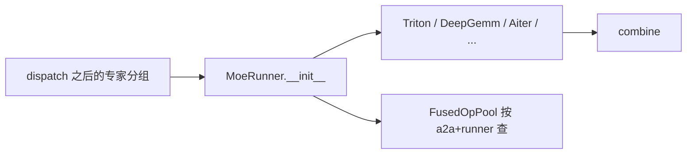
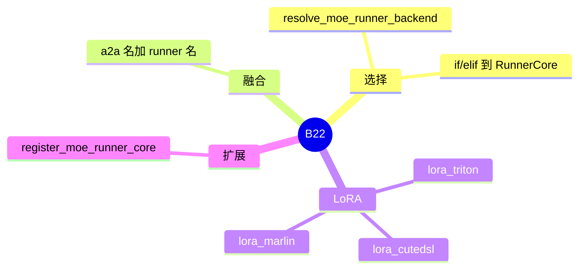

# MoE GEMM runner

对应 B22。树是 `297e54fd105e974cdf401e5b4d20253a22c16f90`。**源码路径推断，未实测**。

## 场景与硬件

Token 已经按专家分组（本卡 TP，或 all-to-all 之后）。Runner 选择用哪套核做专家矩阵乘：DeepGEMM、Triton、CUTLASS、Marlin、Aiter、各种 FlashInfer，以及带 LoRA 的三个。开关是 `--moe-runner-backend`，与 `--moe-a2a-backend` 分开。

`MOE_RUNNER_BACKEND_CHOICES`：`auto`，`deep_gemm`，`triton`，`triton_kernel`，`flashinfer_trtllm`，`experimental_sgl_trtllm`，`flashinfer_trtllm_routed`，`flashinfer_cutlass`，`flashinfer_mxfp4`，`flashinfer_cutedsl`，`flashinfer_megamoe`，`cutlass`，`aiter`，`marlin`，`humming`，`experimental_sgl_marlin`，`lora_cutedsl`，`lora_triton`，`lora_marlin`，`hpc_ops`，`megamoe`，`intel_xpu`。

`MoeRunnerBackend` 枚举还有 `ascend`，choices 里的字符串 `"megamoe"` 不是枚举成员 `MEGAMOE`。a2a 为 megamoe 时，runner 被收成 `flashinfer_megamoe`。

硬件门散落在各核和 `handle_a2a_moe`，不是 runner 枚举上的一张总表。已知的硬绑定：DeepEP v2 只能 `deep_gemm`；`flashinfer_cutedsl` 配 DeepEP v1 时要 low latency；PPLX 要 `deep_gemm`。

## 在框架中的位置

## 原理

`MoeRunner.__init__`（`moe_runner/runner.py`）先 `resolve_moe_runner_backend()`，再按谓词选 `TritonRunnerCore`、`DeepGemmRunnerCore`、`AiterRunnerCore` 等。FlashInfer、CUTLASS、megamoe 常常 `runner_core=None`，改从 `FusedOpPool.get_fused_func(a2a_backend_name, runner_backend_name)` 拿融合函数。因此同一个 runner 名配不同 a2a，可以是不同的核。

`auto` 不是「运行时每步再选」。解析期或构造期把它收成具体名字。DeepEP v2 把 auto 收成 `deep_gemm`。

LoRA 三个 runner 在 MoE 层上做低秩增量，和 [01-LoRA](../09-其它/01-LoRA.md) 的 `LoRAManager` 是同一特性在专家 GEMM 上的核，不是另一套适配器生命周期。

## 过程

1. `--moe-runner-backend` 与 a2a 一起进入 `handle_a2a_moe`。不兼容的组合在这里改写或抛错。
2. 建 MoE 层时构造 `MoeRunner`。
3. 前向在 dispatch 之后调用 runner 或 fused op。
4. 输出进入 combine。

## 调用栈

| 函数 | 做什么 | 角色 |
| --- | --- | --- |
| `handle_a2a_moe` | 按 a2a 收紧 runner | 解析 |
| `resolve_moe_runner_backend` | `auto` 变具体名 | 定稿 |
| `MoeRunner.__init__` | 选 RunnerCore 或 fused | 工厂 |
| `FusedOpPool.get_fused_func` | 二元组查核 | 融合 |
| `register_moe_runner_core` | 插件加核心 | 扩展 |

## 待核

每个 runner 的最低 SM 或 ROCm 版本没有从核文件逐个摘出。展开某一核时打开对应 `*RunnerCore`，不要从 choices 字符串推断代数。

返回 [本目录 README](README.md)。
