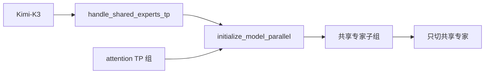
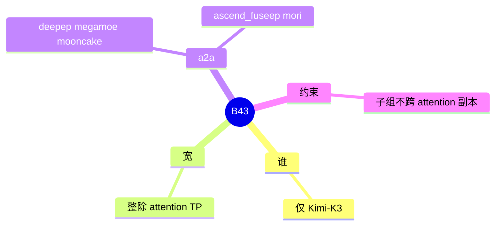

# Shared experts TP

对应 B43。树是 `297e54fd105e974cdf401e5b4d20253a22c16f90`。**源码路径推断，未实测**。

## 场景与硬件

部分 MoE 除了 routed experts，还有每层都执行的共享专家。共享专家的计算量小、每张卡都要，可以用比 attention TP 更窄的一组卡来切它。字段 `shared_experts_tp_size`。`handle_shared_experts_tp` 只对 Kimi-K3 生效。宽度必须是正数，且整除 attention TP。a2a 必须在 `{deepep, megamoe, mooncake, ascend_fuseep, mori}`。

子组不能跨 attention 副本。这句话在 `distributed/parallel_state.py` 的 `initialize_model_parallel` 文档字符串里，不在 hook 函数自己的 docstring：`shared_experts_tp_size`: optional shared-expert TP width. Must divide attention TP; subgroups never cross attention replicas.

没有单独的 GPU 代数门。

## 在框架中的位置

## 原理

Routed experts 的并行度是 `ep_size` 或 TP。共享专家如果跟着最宽的 TP 走，每步 all-reduce 的组过大。单独的 TP 子组只覆盖共享专家的 GEMM。文档要求子组落在一个 attention 副本内部，这样共享专家的 all-reduce 不会把两个 attention DP 副本的激活加在一起。

## 过程

1. 模型是 Kimi-K3 且字段为正。
2. Hook 检查整除和 a2a 集合。
3. `initialize_model_parallel` 读 `shared_experts_tp_size`，在 attention TP 内建子组。
4. 共享专家前向用这个子组，routed 专家仍走 dispatcher。

## 调用栈

| 函数 | 做什么 | 角色 |
| --- | --- | --- |
| `handle_shared_experts_tp` | Kimi-K3、整除、a2a 集合 | 解析 |
| `initialize_model_parallel` | 建子组，文档写明不跨副本 | 进程组 |
| 共享专家 GEMM | 使用该子组的 all-reduce | 计算 |

## 待核

非 Kimi-K3 的模型若 config 里也有共享专家，本 hook 直接返回，那些模型的共享专家仍跟 attention TP。是否另有模型 override 设置这个字段，本页没有逐个 override 搜完。

返回 [本目录 README](README.md)。
