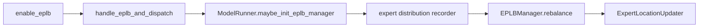
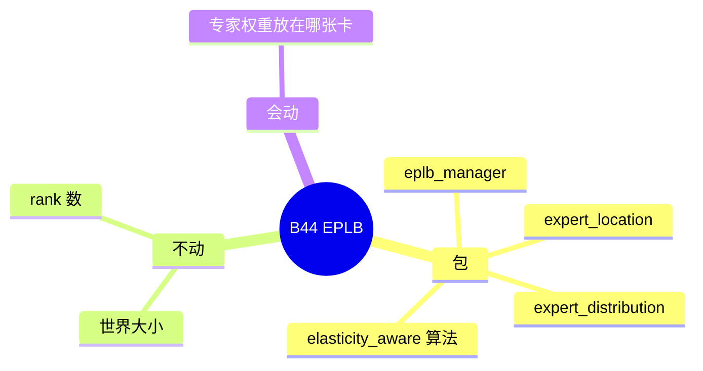

# EPLB

对应 B44。树是 `297e54fd105e974cdf401e5b4d20253a22c16f90`。**源码路径推断，未实测**。

## 场景与硬件

专家并行的世界大小不变，但有的专家更热。EPLB 按统计把专家权重复制或换到更空的 rank，避免热点卡打满。开关 `enable_eplb`。`handle_eplb_and_dispatch`：打开时若 `ep_size<=1` 且 `ep_join_mode` 不是 `scale`，则不成立。`scale` 是弹性加入之前的占位，见 [07-Elastic-EP](07-Elastic-EP.md)。

`expert_distribution_recorder_mode` 在打开 EPLB 时自动收成 `stat`。`ep_dispatch_algorithm` 的默认在 dynamic 和 static 之间，由 a2a 决定。

没有 GPU 代数断言写在 `maybe_init_eplb_manager` 上。草稿 worker 不建 EPLB。

## 在框架中的位置

## 原理

`EPLBManager.rebalance` 用分布记录决定新的 `ExpertLocation`，再由 `ExpertLocationUpdater` 搬权重。世界拓扑不变，所以不需要重造进程组。Elastic EP 改的是有多少 rank。两者会衔接：弹性扩容之后 `has_scaled` 为真时，EPLB 做一次 scale 后的重平衡，NIXL 上还有 barrier。那是「世界刚变完，马上按新世界摆专家」，不是同一次操作。

包内算法包括 `elasticity_aware` 和 hierarchical 变体。Elastic EP 的 hook 把 `enable_eplb` 和这些算法绑在一起。

## 过程

1. `handle_eplb_and_dispatch` 检查 `ep_size`，打开统计记录，定 dispatch 算法。
2. `ModelRunner.maybe_init_eplb_manager` 在 `get_exec().moe.enable_eplb` 且不是草稿时构造 `EPLBManager`。
3. 运行中记录每专家 token 数。
4. `rebalance` 计算新位置并更新权重。后续层的 dispatcher 按新位置发 token。

## 调用栈

| 函数 | 做什么 | 角色 |
| --- | --- | --- |
| `handle_eplb_and_dispatch` | `ep_size`、recorder、dispatch 算法 | 解析 |
| `maybe_init_eplb_manager` | 建 `EPLBManager` | 启动 |
| 分布记录器 | 统计 token | 输入 |
| `EPLBManager.rebalance` | 算新位置 | 决策 |
| `ExpertLocationUpdater` | 搬权重 | 执行 |

## 待核

重平衡的触发是定时还是阈值，以 `eplb_manager.py` 的循环为准。本页没有把间隔常数抄出。和 waterfill 同时打开时谁先改 top-k，见 waterfill 页的 Kimi 注释。

返回 [本目录 README](README.md)。
