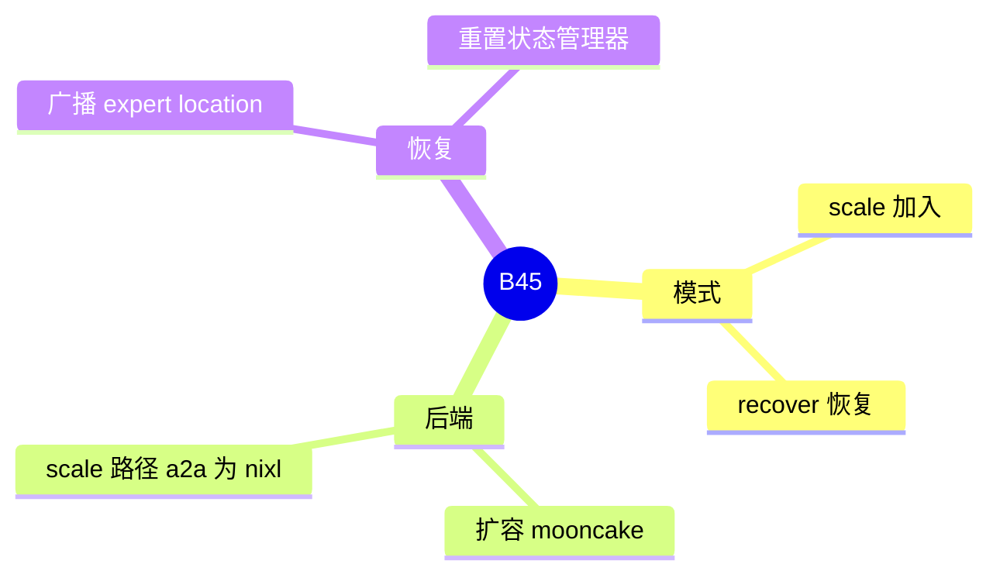

# Elastic EP

对应 B45。树是 `297e54fd105e974cdf401e5b4d20253a22c16f90`。**源码路径推断，未实测**。

## 场景与硬件

服务已经在跑，要增加或恢复专家并行的 rank，而不是重启进程。HTTP `POST /scale_elastic_ep`（`entrypoints/elastic_ep.py`，由 `http_server.py` include）。字段 `elastic_ep_backend`、`ep_join_mode`（`scale` 或 `recover`）、`elastic_ep_initial_size`、`ep_join_rank_offset`、`max_ep_size`。

`handle_elastic_ep` 把 `enable_eplb` 绑到 `elasticity_aware` 或 hierarchical 算法。扩容断言包括：`pp_size==1`，运行时扩容的 `elastic_ep_backend==mooncake`，scale 路径的 `moe_a2a_backend==nixl`，`ep_size==tp_size`，attention DP 加 dp lm head，`attn_cp_size==1`，decode 图是 `full` 或 `disabled`，prefill 图关闭。`--use-ray` 在这条 hook 里被拒绝。

图重捕获之后的恢复检查 `device == "cuda"`（`post_capture_elastic_ep_recover` 所在路径）。非 CUDA 的恢复不以本页的 CUDA 分支为准。

## 在框架中的位置

## 原理

Elastic EP 改的是进程组里有多少 rank。EPLB 在组大小固定时搬权重。扩容完成后必须重捕获 decode CUDA graph，因为 all-to-all 的参与者和缓冲大小变了。`ModelRunner.post_capture_elastic_ep_recover` 调用 `join_process_groups`，广播专家位置元数据，并重置 `ElasticEPStateManager`。

`ep_join_mode=scale` 允许 EPLB 在 `ep_size<=1` 时先打开，为即将加入的 rank 留算法状态。这是 [06-EPLB](06-EPLB.md) 里那条例外。

## 过程

1. 启动时 hook 检查并行、图、a2a、Ray。
2. 控制面 POST `/scale_elastic_ep`。路由在 `elastic_ep_backend` 打开时可用。
3. 新 rank 加入，状态管理器标记 `has_scaled`。
4. 重捕获图。
5. `post_capture_elastic_ep_recover` 对齐位置。EPLB 再按新世界重平衡。

## 调用栈

| 函数 | 做什么 | 角色 |
| --- | --- | --- |
| `handle_elastic_ep` | 绑 EPLB 算法，检查 PP、图、nixl、Ray | 解析 |
| `/scale_elastic_ep` | HTTP 入口 | 控制面 |
| `tokenizer_manager.scale_elastic_ep` | 发到调度器 | 转发 |
| `post_capture_elastic_ep_recover` | `join_process_groups`，广播位置，重置状态 | 图之后 |
| `EPLBManager.rebalance` | 新世界上摆专家 | 衔接 B44 |

## 待核

mooncake 与 nixl 在同一次扩容里各负责哪一段（成员发现 vs token 传输），以 `handle_elastic_ep` 的注释和 `elastic_ep.py` 为准。本页按断言的字面写：运行时扩容的 backend 是 mooncake，scale 路径的 a2a 是 nixl。没有实跑。

返回 [本目录 README](README.md)。
