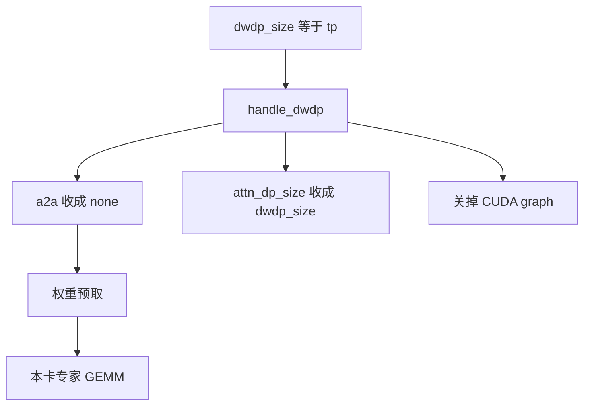
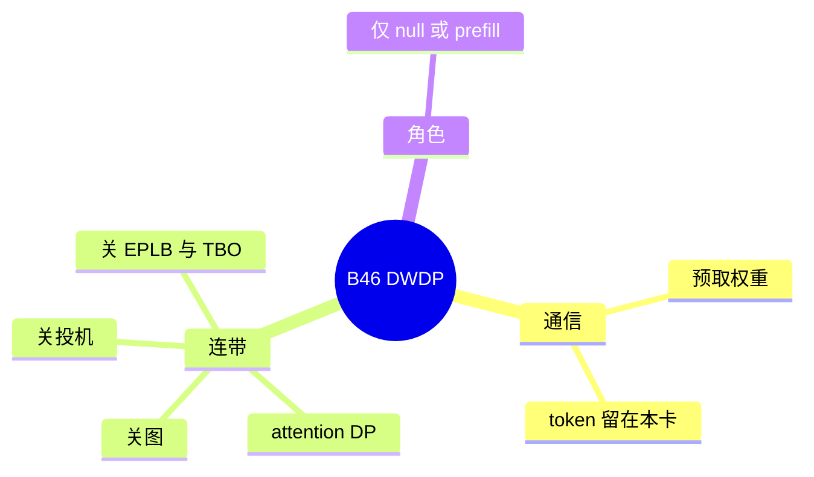

# DWDP

对应 B46。树是 `297e54fd105e974cdf401e5b4d20253a22c16f90`。**源码路径推断，未实测**。

## 场景与硬件

专家权重可以预取到每张卡，token 不必 all-to-all。代价是权重按 `dwdp_size` 份复制或分片，通信从 token 换成权重。旗标 `--dwdp-size`（`fields/parallel.py`）。help：必须等于 `tp_size`；分离模式只能是 `null` 或 `prefill`。

`handle_dwdp` 在 `dwdp_size<=1` 时直接返回。否则断言：

| 断言 | 含义 |
| --- | --- |
| `dwdp_size == tp_size` | 宽度等于 TP |
| 没有投机 | 草稿与权重预取的调度叠在一起未做 |
| `pp_size==1` | 不与流水并行同开 |
| 没有 two-batch overlap | |
| 没有 EPLB | 权重位置不由 EPLB 再搬 |

然后它声明：`attn_dp_size=dwdp_size`，`dp_size=1`，`ep_size=dwdp_size`，`moe_a2a_backend=none`，`disable_cuda_graph=True`，以及 `SGLANG_SCHEDULER_SKIP_ALL_GATHER=True`。Pipeline 把这个 hook 放在 `handle_cuda_graph_config` 和 `handle_data_parallelism` 之前，这样后面的 hook 看见的是已经改过的 attention DP 和图。

实现在 `layers/moe/dwdp/`。没有单独的 GPU 代数断言。

## 在框架中的位置

## 原理

普通 EP 把 token 送到权重所在的卡。DWDP 把接下来要用的专家权重送到 token 所在的卡。a2a 因此必须是 `none`，否则 token 还会被 DeepEP 再送一次。Attention DP 被设成同样的宽度，是因为每一份权重副本对应一组独立的 attention 调度，请求不要在副本之间切头。`dp_size` 保持 1，所以这不是 [模型副本 DP](../07-并行切分/02-模型副本DP.md) 的整模复制。

关 CUDA graph 是因为预取改变了权重地址，捕获时的地址不能复用。关投机是 hook 的断言，不是运行时尝试失败。

## 过程

1. `--dwdp-size` 大于 1。
2. `handle_dwdp` 做完断言和声明。
3. 后续 attention DP 与 CUDA graph hook 看见新值。
4. 前向在 MoE 之前按 `layers/moe/dwdp/` 把权重复制到本卡，再走 `none` dispatcher 的本地 GEMM。

## 调用栈

| 函数 | 做什么 | 角色 |
| --- | --- | --- |
| `handle_dwdp` | 宽度、禁投机、禁图、a2a=none、改 attn_dp | 解析，且早于图和 DP hook |
| `layers/moe/dwdp/` | 权重预取 | 运行时 |
| `StandardDispatcher` | a2a 已是 none | 本地专家 |
| `handle_data_parallelism` | 消费被改过的 `attn_dp_size` | 后续 |

## 待核

预取的步长和与哪一层重叠，以 `dwdp` 包内的调度注释为准。本页确认了 hook 的断言列表，没有逐步跟预取 kernel。

返回 [本目录 README](README.md)。
