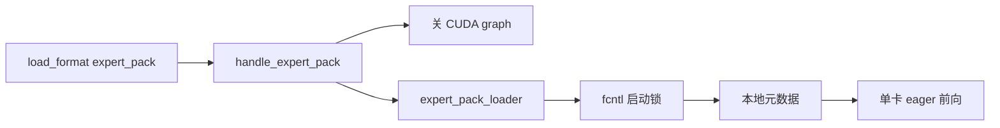
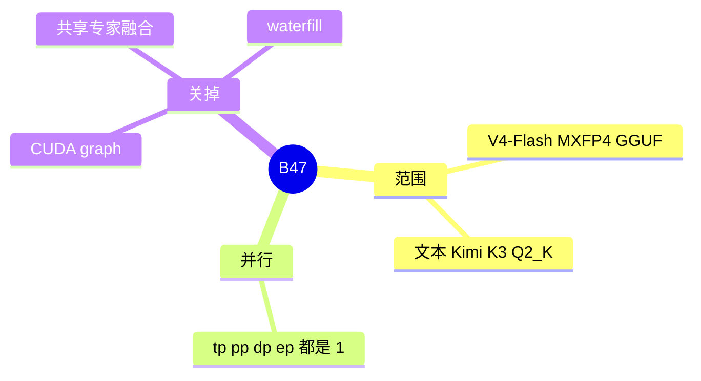

# Expert pack

对应 B47。树是 `297e54fd105e974cdf401e5b4d20253a22c16f90`。**源码路径推断，未实测**。

权重格式的总表在 [04-权重格式](../05-量化与图优化/04-权重格式.md)（B35）。本页写专家包这一支。

## 场景与硬件

DeepSeek-V4-Flash 的 MXFP4 GGUF 和一份 Kimi K3 的 Q2_K GGUF 把专家打成包，而不是标准 HF 分片。`--load-format expert_pack` 把包换成运行时能读的本地元数据，并锁住 eager。`LOAD_FORMAT_CHOICES` 的注释点名这两份：DeepSeek-V4-Flash-0731（Unsloth）和 KIMI-K3 Q2_K（Blackfrost）。`expert_pack_loader.py` 的模块文档写 deepseek-v4-flash 和 text-only kimi-k3，多模态 Kimi K3 不在范围内。

`handle_expert_pack`：所有并行尺寸必须是 1。拒绝 waterfill、共享专家融合、显式 CUDA graph。声明 `disable_cuda_graph=True` 和 `disable_shared_experts_fusion=True`。

Eager 锁在 `expert_pack_runtime.py`：准备 GGUF 时对 `{pack}.startup.lock` 或 `deepseek-v4-startup.lock` 做 `fcntl.flock`。这是同机多进程不要同时改包的文件锁，不是 GPU 锁。

## 在框架中的位置

## 原理

包里的专家布局和普通 loader 的张量名不一致。loader 先在磁盘上准备元数据，再按 eager 模块读。CUDA graph 捕获要求权重地址稳定且与图内的专家调度一致，这条准备路径不提供那个保证，所以 hook 直接关图，而不是捕获失败后再退。

Waterfill 会把共享专家算进 routed 的 top-k。专家包的加载明确关掉共享专家融合，因此也拒绝 waterfill。

## 过程

1. `load_format` 是 `expert_pack`。
2. Hook 检查并行度为 1，关图、关融合、拒 waterfill。
3. Loader 拿文件锁，把 GGUF 包准备成元数据。
4. 模型按 eager 启动。前向不走 DeepEP，因为并行度是 1，a2a 没有跨卡对象。

## 调用栈

| 函数 | 做什么 | 角色 |
| --- | --- | --- |
| `handle_expert_pack` | 并行度、图、融合、waterfill | 解析 |
| `expert_pack_loader` | 读 V4-Flash 或文本 Kimi K3 的包 | 加载 |
| `prepare_raw_*` | `fcntl.flock` | 同机互斥 |
| `get_model_loader` | `load_format` 选到这个 loader | B35 的总入口 |

## 待核

锁文件名在 DeepSeek 与 Kimi 上是否总是那两个字符串，以 `expert_pack_runtime.py` 的分支为准。本页按模块里出现的文件名写。

返回 [本目录 README](README.md)。
