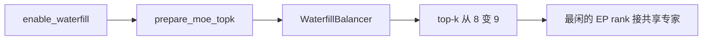
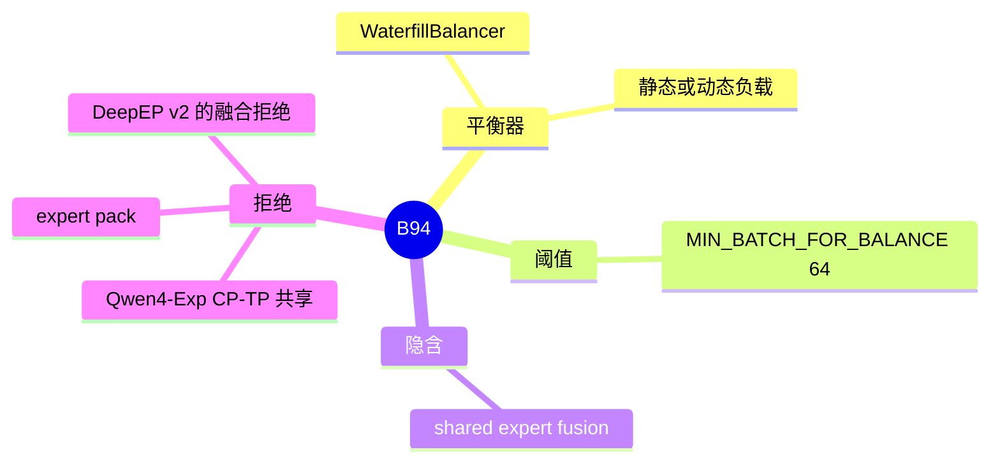

# Waterfill

对应 B94。树是 `297e54fd105e974cdf401e5b4d20253a22c16f90`。**源码路径推断，未实测**。

## 场景与硬件

共享专家和 routed 专家如果分两段算，共享专家会在某些 rank 上变成固定开销，而 routed 的热点在别的 rank。Waterfill 把融合之后的共享专家当成多出来的一路 routed expert，派到当前最闲的 EP rank。`--enable-waterfill` 的 help：DeepEP 与 MegaMOE；隐含打开 shared-expert fusion；写明支持 DeepSeek-V3/R1 且 EP≥2。生产上 DeepEP decode 要用 `auto` 或 `low_latency`，CUDA graph 才能留下。

`expert_pack_hook` 拒绝它。Qwen4-Exp 的 CP-TP 组共享把 `enable-waterfill` 放进不支持列表，报错 `--enable-waterfill is not supported with CP-TP group sharing.`

DeepEP v2 的 hook 拒绝 `enforce_shared_experts_fusion`。Waterfill 又隐含打开融合。两个开关同时指向 v2 时，以 `handle_a2a_moe` 的 `ValueError` 为准，waterfill 不会绕过那条拒绝。

## 在框架中的位置

## 原理

`layers/moe/waterfill.py` 的模块文档：共享专家变成额外的 routed 槽，topk 从 8 变成 9。静态负载可以用 `SGLANG_DISABLE_STATIC_WATERFILL` 关掉。动态路径用 `moe_expert_parallel_all_reduce` 汇总各 rank 的负载，再把这一路派给最闲的 rank。批太小（低于 `MIN_BATCH_FOR_BALANCE=64`）时不做动态平衡。

`model_executor/model_runner_components/moe_ep_setup.py` 的 `prepare_moe_topk` 在 `enable_waterfill` 时把 `WaterfillBalancer` 挂到 `TopK` 或 `HashTopK`。Kimi K3 的注释写这个 balancer 会改 top-k 之后的路由。

## 过程

1. 解析期打开旗标。expert pack 或 Qwen4 CP-TP 共享则失败。DeepEP v2 加融合在 a2a hook 失败。
2. `prepare_moe_topk` 挂上 balancer。
3. 每批 gate 之后，balancer 插入共享专家这一路，并按负载选 rank。
4. dispatcher 按新的 top-k 发送。共享专家不再单独走一条与 routed 无关的融合核，除非融合本身被别的开关关掉。

## 调用栈

| 函数 | 做什么 | 角色 |
| --- | --- | --- |
| `prepare_moe_topk` | 构造并挂上 `WaterfillBalancer` | 启动 |
| `WaterfillBalancer` | 8 路变 9 路，选最闲 rank | 路由 |
| `moe_expert_parallel_all_reduce` | 动态负载的汇总 | 仅动态 |
| `handle_expert_pack` | 拒绝 waterfill | 互斥 |
| `cp_tp_group_sharing_hook` | Qwen4-Exp 拒绝 | 互斥 |
| `handle_a2a_moe` | v2 拒绝共享专家融合 | 与隐含融合冲突 |

## 待核

help 点名的 DeepSeek-V3/R1 以外，Kimi K3 的注释也提到 balancer。其它 MoE 是否仅仅因为旗标打开就会挂上 balancer，以 `prepare_moe_topk` 的模型判断为准。静态与动态的切换除了环境变量之外有没有 CLI，本页只看到 `SGLANG_DISABLE_STATIC_WATERFILL`。

返回 [本目录 README](README.md)。
