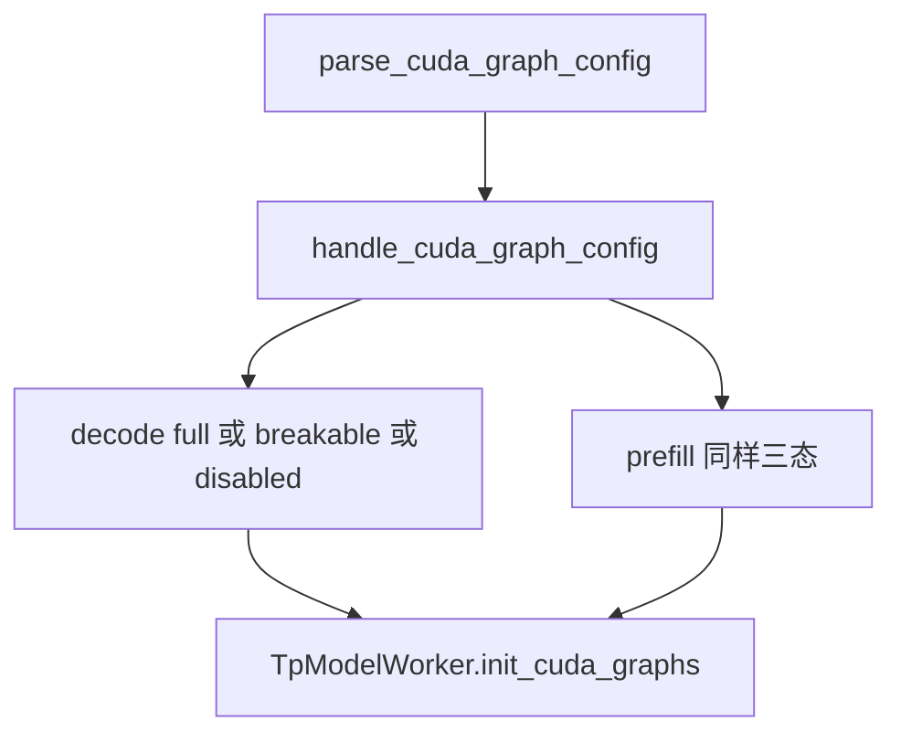
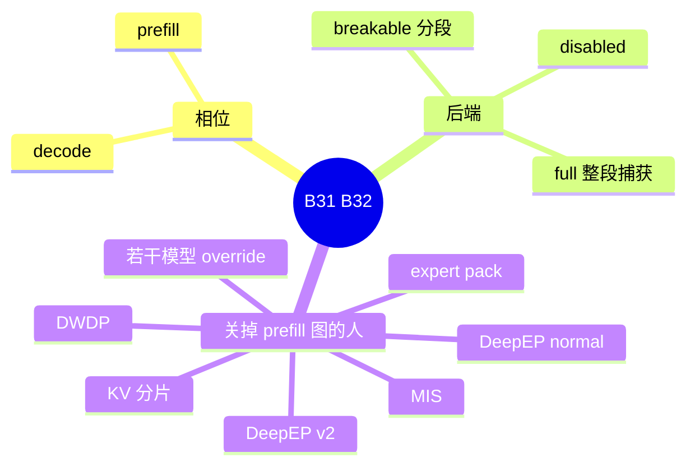

# CUDA graph 与 breakable 图

对应 B31、B32。树是 `297e54fd105e974cdf401e5b4d20253a22c16f90`。**源码路径推断，未实测**。

图在启动链上的位置是 F116、F117、F195，见 [06-模型加载](../../02-流程/01-启动/06-模型加载.md)。本页写相位和谁把它关掉。

## 场景与硬件

Decode 的形状反复出现时，把一次前向捕获成 CUDA graph，后面按批大小重放。Prefill 的块大小若落在捕获表里，也可以捕获。`--disable-cuda-graph` 已废弃，现行字段是 `cuda_graph_backend_decode` 与 `cuda_graph_backend_prefill`，取值 `full`、`breakable`、`disabled`（`cuda_graph_config.py`）。旧名 `tc_piecewise` 已移除。

捕获发生在 CUDA 上。其它平台的「图」不走这条 hook 的 CUDA 捕获。XPU 默认关 decode 图，除非已经被锁住（F61）。HIP 上 UNO 等路径会关图，那是算法页的断言，不是本 hook 的默认。

## 在框架中的位置

## 原理

`full` 把整段前向收成一张图。`breakable` 在层边界断开，便于编译和分段重放。注释写明 breakable 路径里没有 torch.compile。`debug_cuda_graph` 用来在这些断点上调试。和 `enable_torch_compile` 的互斥见下一页：`disable_cuda_graph_padding` 与 torch.compile 不能同时开。

DeepEP v1 的 normal 模式把两个相位都收成 disabled。v2 只关 prefill，decode 留在 masked 路径。DWDP、expert pack、KV 分片、MIS 各自在自己的 hook 里关图。关的方式常常是改 `cuda_graph_config` 的 backend，而不是再写一个废弃的布尔。

## 过程

1. `handle_cuda_graph_config` 在投机和 DWDP 之后跑，这样那些 hook 先改配置。
2. `TpModelWorker.init_cuda_graphs` 按相位捕获。
3. 计划了 post-capture KV 时，捕获之后用剩余显存改池（F195）。`enable_memory_saver` 会让 `post_capture_kv_sizing_planned` 返回假。
4. 重放时按批大小选已捕获的桶。

## 调用栈

| 函数 | 做什么 | 角色 |
| --- | --- | --- |
| `parse_cuda_graph_config` | 字符串到 `Backend` | 解析 |
| `handle_cuda_graph_config` | 两个相位定稿 | 启动门 |
| `TpModelWorker.init_cuda_graphs` | 捕获 | F116 |
| `is_in_tc_piecewise_cuda_graph` | 旧 piecewise 查询。现行分段是 `BREAKABLE` | 运行时判断 |
| 各特性 hook | 把某一相位改成 `DISABLED` | 互斥 |

## 待核

`is_in_tc_piecewise_cuda_graph` 是否仍被 breakable 路径置位。函数还在 `runner_backend_utils/tc_piecewise_cuda_graph.py`，配置枚举已经去掉 `tc_piecewise`。两者的对应标待核。

返回 [本目录 README](README.md)。
