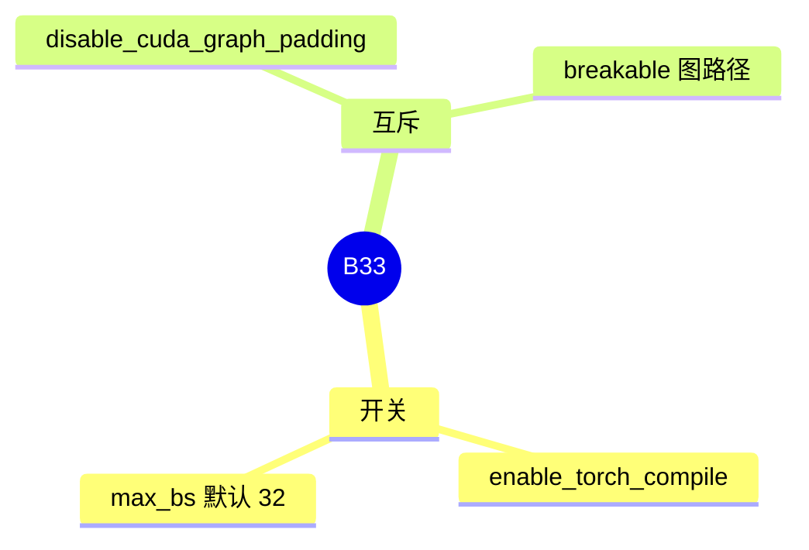

# torch.compile

对应 B33。树是 `297e54fd105e974cdf401e5b4d20253a22c16f90`。**源码路径推断，未实测**。

## 场景与硬件

试验性地用 `torch.compile` 编译整模，而不是捕获 CUDA graph。`--enable-torch-compile`，`torch_compile_max_bs` 默认 32。help 写 Experimental。

`validation_hook`：`disable_cuda_graph_padding` 与 `enable_torch_compile` 不能同时开。Breakable 图的注释写明该路径不走 torch.compile。因此编译和分段图是两条实验路径。

没有单独的 GPU 代数断言写在字段上。编译器本身要求能跑 PyTorch Inductor 的设备。CPU / 部分加速器是否真的编译成功，未实测。

## 在框架中的位置

```mermaid
flowchart LR
  flag["enable_torch_compile"] --> model["ModelRunner 编译前向"]
  bs["torch_compile_max_bs"] --> model
  graph["CUDA graph full"] -.-> flag
```



## 原理

编译把一层层的算子收成图，按最大批大小生成内核。超过 `torch_compile_max_bs` 的批不走编译好的版本。它不替换 KV 池，也不改变调度。和 CUDA graph 的差别是：graph 重放固定地址的捕获，compile 生成新的内核。两者可以在不同相位上各用各的，除了上面那条 padding 互斥。

## 过程

1. 字段打开。
2. 校验与 graph padding 不冲突。
3. 模型前向在批大小不超过上限时走编译结果。

## 调用栈

| 函数 | 做什么 | 角色 |
| --- | --- | --- |
| `fields/exec_.py` 的 `enable_torch_compile` | 开关和 `torch_compile_max_bs` | 配置 |
| `validation_hook` | 与 `disable_cuda_graph_padding` 互斥 | 门 |
| 编译后的 forward | 批大小在上限内时使用 | 计算 |

## 待核

编译发生在 `ModelRunner` 的哪一次包装，本页没有逐行点名包装函数。超过 `torch_compile_max_bs` 时是回退 eager 还是拒绝请求，标待核。

返回 [本目录 README](README.md)。
