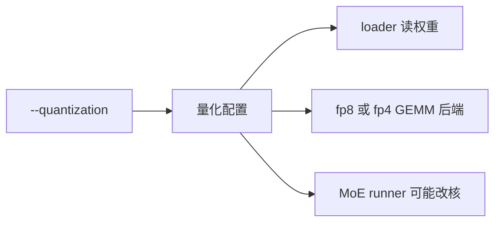
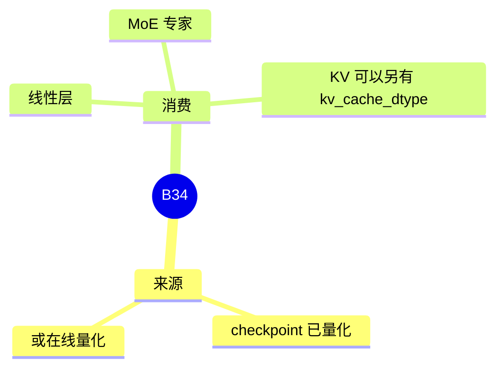

# 量化

对应 B34。树是 `297e54fd105e974cdf401e5b4d20253a22c16f90`。**源码路径推断，未实测**。

## 场景与硬件

权重以低精度存放，或在加载时做在线量化，用来换显存和带宽。`--quantization` 的取值是 `QUANTIZATION_CHOICES`。`choices.py` 的注释写明：Some of the choices here do NOT support online quantization。哪些支持在线量化，文件里标了 TODO，本页不猜测。

名单：`awq`，`fp8`，`mxfp8`，`gptq`，`gptq_marlin`，`awq_marlin`，`bitsandbytes`，`gguf`，`modelopt`，`modelopt_fp8`，`modelopt_fp4`，`nvfp4_online`，`modelopt_mixed`，`petit_nvfp4`，`w8a8_int8`，`w8a8_fp8`，`moe_wna16`，`w4afp8`，`mxfp4`，`auto-round`，`auto-round-int8`，`compressed-tensors`，`modelslim`，`mxfp_w4a8`，`quark`，`quark_int4fp8_moe`，`quark_mxfp4`，`mlx_q4`，`mlx_q8`，`unquant`，`humming`。

硬件随方法变化。例如 MiniMax NVFP4 的投机只在 Blackwell 上放行，那是模型 override，不是这份名单的全局门。`mlx_q4` / `mlx_q8` 对应 MLX 路径。`humming` 同时出现在 MoE runner 的 choices 里，量化方法和 GEMM runner 仍是两个字段。

## 在框架中的位置

KV 的 `kv_cache_dtype`（HiSparse 要求 bf16 或 fp8_e4m3）不是 `--quantization`。权重量化和 KV 量化分两个字段。

## 原理

Loader 按方法解包缩放系数和打包格式。前向选择能吃这种布局的 GEMM。在线量化在加载时把高精度权重量化进服务，checkpoint 量化则直接读已经量化的张量。注释里的 TODO 表示名单长于真正实现了在线路径的子集。

## 过程

1. CLI 或 checkpoint 配置给出方法名。
2. 加载器按方法读权重。
3. 层和 MoE runner 按方法选核。稠密 GEMM 的后端是 B90，可以再覆盖 fp8 / fp4 的核。

## 调用栈

| 函数 | 做什么 | 角色 |
| --- | --- | --- |
| `QUANTIZATION_CHOICES` | 合法名字 | 校验 |
| loader | 按方法解权重 | 启动 |
| 层的量化线性 | 用对应核做 GEMM | 计算 |
| 模型 override | 某方法在某 GPU 上再拒绝投机或 PP | 模型专用门 |

## 待核

在线量化的子集以 `choices.py` 的 TODO 未完成。展开某个方法时打开它的量化模块，不从名字推断 GPU 代。

返回 [本目录 README](README.md)。
