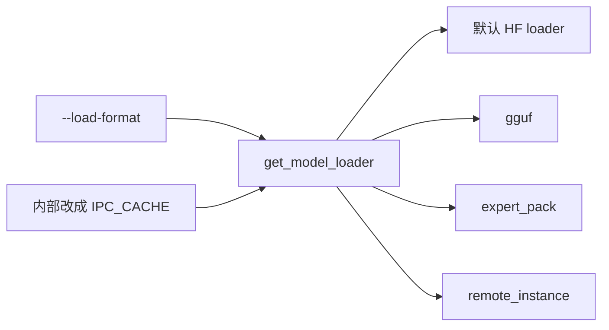
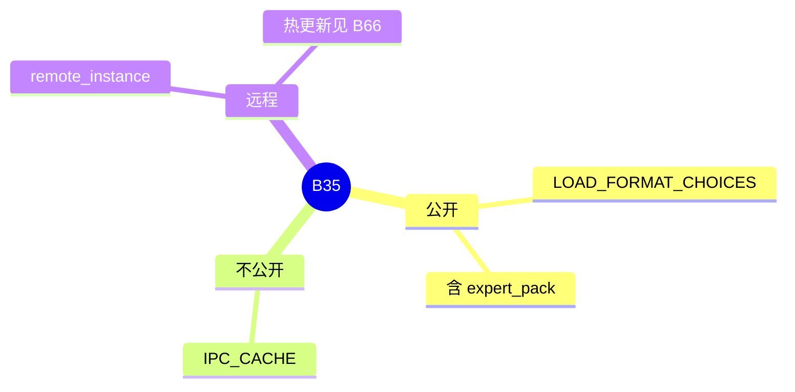

# 权重格式

对应 B35。树是 `297e54fd105e974cdf401e5b4d20253a22c16f90`。**源码路径推断，未实测**。

## 场景与硬件

同一份模型可以是 HF safetensors、GGUF、分片、或从另一实例 IPC 过来。`--load-format` 选择 loader。专家包是其中一种，范围和文件锁在 [09-Expert-pack](../04-MoE与DeepEP/09-Expert-pack.md)。

`LoadFormat` 枚举含 `IPC_CACHE`。`choices.py` 写明：`LoadFormat.IPC_CACHE` intentionally has no public `--load-format` choice。它由 `load_model_utils` 在运行中把格式改成 `ipc_cache`，并记住原来的格式当磁盘回退。`loader.py` 在 `load_format == IPC_CACHE` 时走对应分支。用户不能在 CLI 里直接写这个名字。

多模态特征的 CUDA IPC 传输是另一件事（`SGLANG_USE_CUDA_IPC_TRANSPORT`），不是这个 load format。

## 在框架中的位置

## 原理

`get_model_loader` 按格式返回 loader 类。格式决定张量名、分片方式和是否先做本地准备。`remote_instance` 从另一进程拉权重，和 [06-权重热更新](../09-其它/06-权重热更新.md) 的 HTTP 更新同属「权重不从本地 checkpoint 冷启动」这一类，入口不同。

## 过程

1. S2 把 `load_format` 收成名字（F85）。
2. `get_model_loader` 选类。
3. 若后续走 IPC 缓存，`load_model_utils` 把格式改成 `IPC_CACHE` 并保留磁盘回退。
4. loader 把权重放进模块。

## 调用栈

| 函数 | 做什么 | 角色 |
| --- | --- | --- |
| `LOAD_FORMAT_CHOICES` | 公开名字。expert_pack 的注释限定两份 GGUF | 校验 |
| `get_model_loader` | 名字到 loader | 工厂 |
| `LoadFormat.IPC_CACHE` | 内部格式，无 CLI | 缓存加载 |
| expert pack loader | 见 B47 | 一种格式 |

## 待核

公开 choices 的完整列表以 `choices.py` 的 `LOAD_FORMAT_CHOICES` 为准。本页点名了 expert_pack、remote_instance 和被故意藏起来的 IPC_CACHE，没有把每个字符串再抄一遍。

返回 [本目录 README](README.md)。
