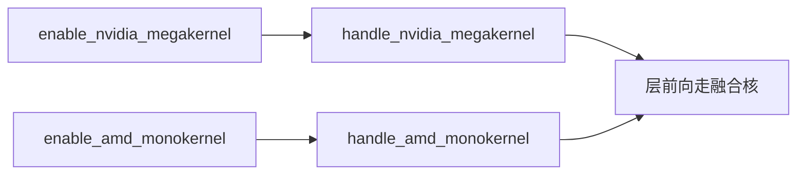
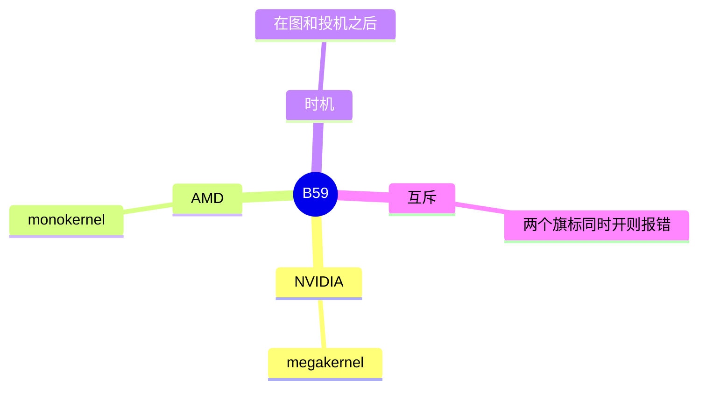

# Megakernel 与 Monokernel

对应 B59。树是 `297e54fd105e974cdf401e5b4d20253a22c16f90`。**源码路径推断，未实测**。

## 场景与硬件

把一层里的多步收成一个大核，减少 launch。NVIDIA 用 `--enable-nvidia-megakernel`，AMD 用 `--enable-amd-monokernel`。两个都开时，流水线注释说一次报齐。它们互斥。

校验放在图、attention 和投机定稿之后（F87），因为融合核要知道最终的后端和有没有草稿。

## 在框架中的位置

## 原理

融合核替换的是一层内部的算子序列，不替换调度，也不替换 all-to-all。它和 B93 的 FlashInfer allreduce 融合、B92 的 Aiter 融合不是同一个旗标。那些融合的是通信加 norm，这里是层内计算。

## 过程

1. 前面的 hook 把 attention、图、投机定稿。
2. `handle_nvidia_megakernel` 或 `handle_amd_monokernel` 检查平台和互斥。
3. 层前向改走对应大核。

## 调用栈

| 函数 | 做什么 | 角色 |
| --- | --- | --- |
| `handle_nvidia_megakernel` | NVIDIA 旗标与平台 | 解析，靠后 |
| `handle_amd_monokernel` | AMD 旗标 | 解析 |
| pipeline 对两个旗标的检查 | 同时开则一起报 | 互斥 |

## 待核

每个旗标还要求哪些 attention 后端，以对应 handle 函数的断言为准。本页确认了名字、互斥和在流水线中的位置。

返回 [本目录 README](README.md)。
