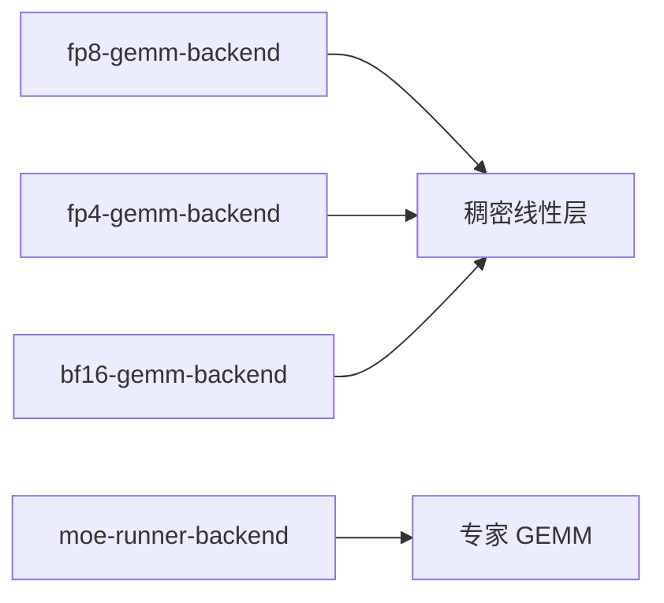
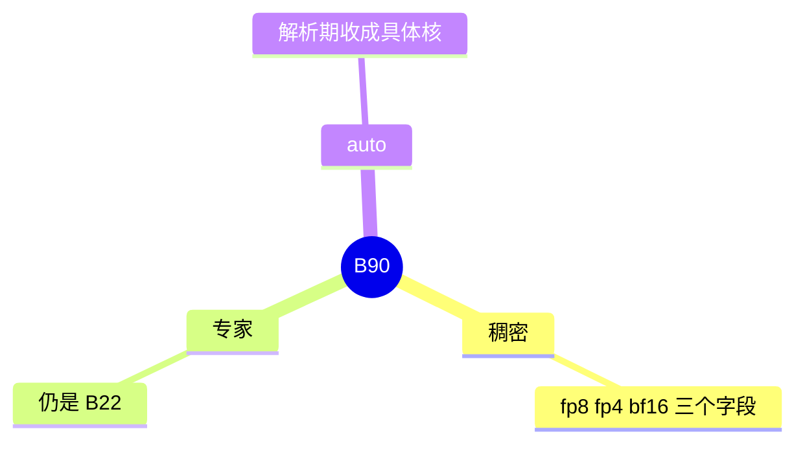

# 稠密 GEMM runner

对应 B90。树是 `297e54fd105e974cdf401e5b4d20253a22c16f90`。**源码路径推断，未实测**。

## 场景与硬件

注意力和 MLP 里的稠密矩阵乘，与 MoE 专家的 runner（B22）分开选。三个旗标：

| 旗标 | choices |
| --- | --- |
| `--fp8-gemm-backend` | `auto`，`deep_gemm`，`flashinfer_trtllm`，`flashinfer_cutlass`，`flashinfer_deepgemm`，`flashinfer_cutedsl`，`cutlass`，`triton`，`aiter` |
| `--fp4-gemm-backend` | `auto`，`flashinfer_cudnn`，`flashinfer_cutedsl`，`flashinfer_cutlass`，`flashinfer_trtllm`，`marlin` |
| `--bf16-gemm-backend` | `auto`，`cutedsl`，`gemv`，`torch` |

FP8 / FP4 的名单以 `choices.py` 为准。help 里按 GPU 代际推荐哪一个，本页不逐项抄，避免把推荐写成硬门。源码里真正的 `ValueError` 以各核的启动检查为准。

## 在框架中的位置

## 原理

量化方法（B34）决定权重布局。稠密 GEMM 后端决定用哪个核去乘这块布局。MoE 可以同时使用另一套核，例如专家走 `deep_gemm`、稠密 MLP 走 `cutlass`。`auto` 在解析期按平台收成具体值，不是每个 token 再选。

## 过程

1. 三个字段进入 resolution。
2. 线性层按 dtype 取对应后端。
3. MoE 层忽略这三个字段，读 `--moe-runner-backend`。

## 调用栈

| 函数 | 做什么 | 角色 |
| --- | --- | --- |
| `FP8_GEMM_RUNNER_BACKEND_CHOICES` 等 | 合法名字 | 校验 |
| 线性层的 GEMM 选择 | 按 dtype 取后端 | 计算 |
| `MoeRunner` | 不读这三个字段 | 边界 |

## 待核

`auto` 在每一代 GPU 上收成哪一个名字，以 override 或 GEMM 工厂为准。本页不把 help 里的推荐抄成事实。

返回 [本目录 README](README.md)。
