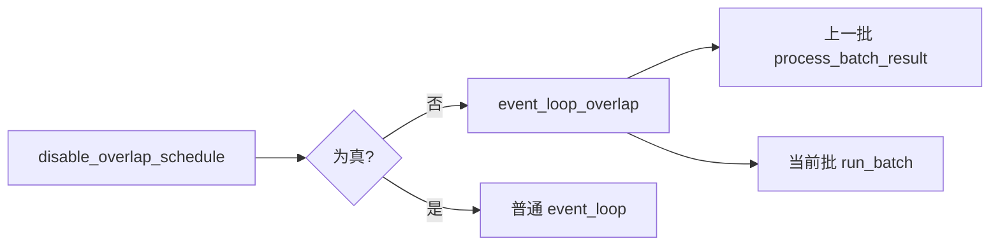
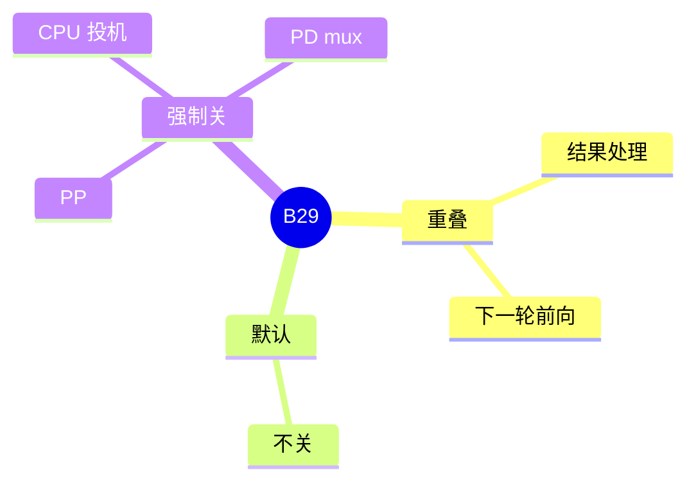

# Overlap schedule

对应 B29。树是 `297e54fd105e974cdf401e5b4d20253a22c16f90`。**源码路径推断，未实测**。

事件循环怎么选这条路径，见 [01-事件循环](../../02-流程/03-调度与推理/01-事件循环.md)（F154）。本页写开关和谁强制关掉它。

## 场景与硬件

CPU 上组下一批 batch 的时间，和 GPU 上当前批的前向重叠。默认开着：`disable_overlap_schedule` 默认 false。显式 `--disable-overlap-schedule` 关掉，改走普通循环。

会被强制关掉的情况：

| 条件 | 位置 |
| --- | --- |
| `pp_size>1` | `_pipeline_parallel_overlap_disable`，F196。`check_pipeline_parallel_compat` 再断言 |
| 投机且设备是 CPU | `_disable_overlap_schedule_for_cpu` |
| MPS，非 MLX | 流水线里关掉（F61） |
| PD mux | 模式要求 overlap 关掉，见 PDmux 页 |

没有「必须某代 GPU」的断言。重叠的是 CPU 调度和 GPU 前向，GPU 仍要能异步。

## 在框架中的位置

## 原理

`Scheduler.event_loop_overlap` 把上一批的 `process_batch_result` 和当前批的 `run_batch` 错开。结果处理里有 checkpoint、detokenize 投递和语法。这些 CPU 工作藏在下一轮 GPU 前向后面。PP 的级间传递不能假设「本级的结果处理可以和本级的下一轮前向重叠」，所以解析期就关。投机在 overlap 下用 `on_publish` 做 fence，见投机框架页。关掉 overlap 时同一套 V2 schema 同步跑。

## 过程

1. 解析期可能把旗标改成 true。
2. `dispatch_event_loop` 选 `event_loop_overlap` 或普通循环。
3. Overlap 循环在前向返回后不立刻处理结果，等下一次迭代再处理，同时发出下一批。

## 调用栈

| 函数 | 做什么 | 角色 |
| --- | --- | --- |
| `_pipeline_parallel_overlap_disable` | PP 时置位关闭 | 强制 |
| `_disable_overlap_schedule_for_cpu` | CPU 投机 | 强制 |
| `dispatch_event_loop` | 选循环 | 调度入口 |
| `event_loop_overlap` | 错开结果处理和前向 | 运行 |

## 待核

和 `num_continuous_decode_steps` 大于 1 时，重叠的是「一步」还是「连续多步」，清单标了待核。本页没有在 `event_loop_overlap` 里跟完这个计数器。

返回 [本目录 README](README.md)。
