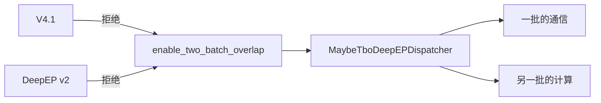
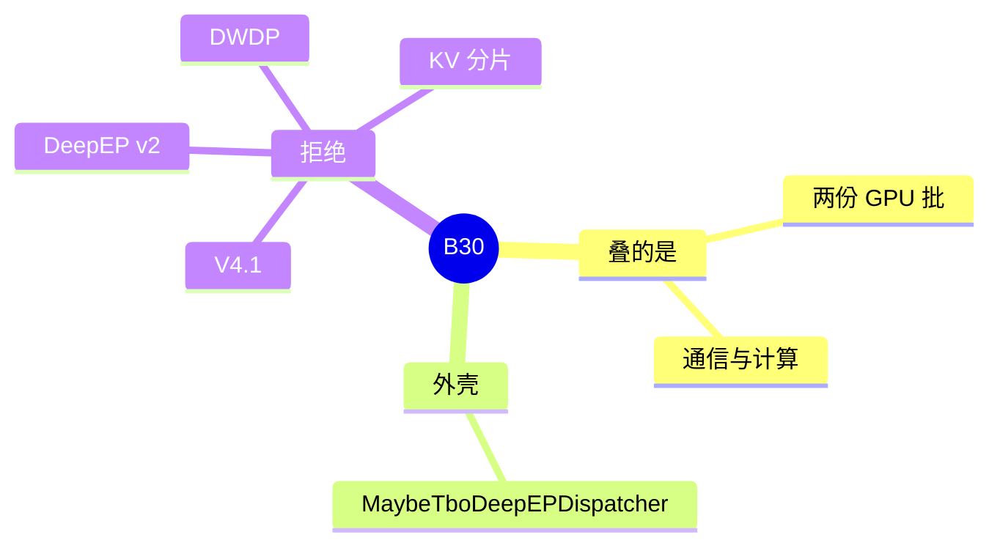

# Two-batch overlap

对应 B30。树是 `297e54fd105e974cdf401e5b4d20253a22c16f90`。**源码路径推断，未实测**。

## 场景与硬件

Overlap schedule 重叠的是 CPU 和 GPU。Two-batch overlap 再把两份 GPU 批的通信和计算叠起来，主要挂在 MoE all-to-all 上。开关 `--enable-two-batch-overlap`，实现在 `batch_overlap/two_batch_overlap.py` 和 `MaybeTboDeepEPDispatcher`。Attention 侧有 `layers/attention/tbo_backend.py`。

DeepSeek V4.1 在 `validate_deepseek_v41_features` 里拒绝：DeepSeek-V4.1 does not support two-batch overlap yet。DeepEP v2 拒绝 TBO 和 SBO：has not implemented the TBO/SBO overlap hooks yet。DWDP、UNO 的树模式、KV 分片也拒绝。统一内存的 hook 拒绝 TBO。

没有单独的 SM 断言写在旗标上。能重叠的前提是 dispatcher 实现了 TBO 的两段 dispatch / combine。

## 在框架中的位置

## 原理

DeepEP 的 normal / low latency impl 把 dispatch 和 combine 拆成 a/b 两段。TBO 用这个缝把批 A 的通信和批 B 的 GEMM 叠上。没有这两段 hook 的后端（v2、以及未实现的路径）在解析期拒绝，避免运行时走到空钩子。

SBO（single-batch overlap）和 TBO 一起出现在 v2 的错误字符串里。本页的旗标是 TBO。SBO 的字段若存在，以 `enable_single_batch_overlap` 为准，不把它写成第二个用户特性名。

## 过程

1. 旗标打开。
2. 各互斥 hook 检查 V4.1、DeepEP v2、DWDP、分片、统一内存。
3. `create_moe_dispatcher` 包上 `MaybeTboDeepEPDispatcher`。
4. 前向按两段钩子交错两批。

## 调用栈

| 函数 | 做什么 | 角色 |
| --- | --- | --- |
| `handle_a2a_moe` | v2 拒绝 TBO/SBO | 门 |
| `validate_deepseek_v41_features` | V4.1 拒绝 | 门 |
| `MaybeTboDeepEPDispatcher` | 两段通信包一层重叠 | 运行 |
| `tbo_backend` | attention 侧的重叠后端 | 计算 |

## 待核

attention 的 `tbo_backend` 与 MoE dispatcher 是否必须同时启用，本页只确认两者都存在。未实测重叠是否真的隐藏了 all-to-all。

返回 [本目录 README](README.md)。
