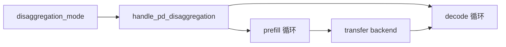
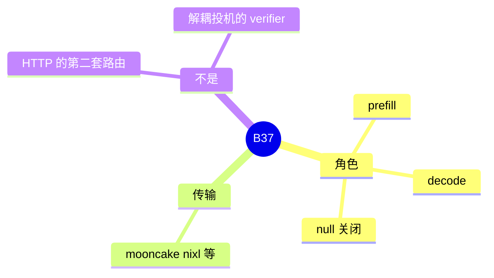

# PD 分离

对应 B37。树是 `297e54fd105e974cdf401e5b4d20253a22c16f90`。**源码路径推断，未实测**。

事件循环和 KV 到达之后的 `PREBUILT` 在 [07-PD分离](../../02-流程/03-调度与推理/07-PD分离.md)（F179–F188、F203）。并行轴是 D13、D14。本页写特性开关和传输后端，不重写那条循环。

## 场景与硬件

Prefill 和 decode 分进程。Prefill 算提示词 KV，经传输后端把页送给 decode。Decode 不再把提示词当 extend 重算。开关 `--disaggregation-mode`（`prefill` 或 `decode`；`null` 表示不分离）和 `--disaggregation-transfer-backend`。

这不是第二种 HTTP 调度器。请求仍从 tokenizer 进来，角色只改变 scheduler 的队列：prefill 进 bootstrap 队列，decode 进 prealloc 队列（F146）。

传输后端的名字和 HiCache、MoE 里的 mooncake / nixl 同库不同字段。KV 分片只允许 prefill 角色。Decode 侧 radix 与 HiSparse 互斥。`buffer_only` 的 HiCache 禁止 decode。统一内存只允许一份传输后端集合。

## 在框架中的位置

## 原理

`handle_pd_disaggregation` 规范化模式和传输后端，包括把某些 mooncake 名字收成 `mooncake_tcp`。Prefill 进程在 bootstrap 完成后才做本地 prefill。Decode 在 KV 到齐后以 `ForwardMode.PREBUILT` 进入 running，用对端送来的最后一个输出 token 作为下一步 decode 的输入。`process_prebuilt` 对每条请求 `checkpoint_kv_cache`。

解耦投机的 verifier / drafter 是另一对进程。Mooncake PD 路径拒绝 `decoupled_spec_role != null`。

## 过程

1. 两个进程用不同的 `disaggregation_mode` 启动，传输后端一致。
2. Hook 做规范化，并拒绝和 HiSparse、角色切换、host-receive 冲突的组合。
3. Prefill 算完 KV，发送端按页或按条带写出。
4. Decode `PREBUILT` 接上，之后本地 `DECODE`。

## 调用栈

| 函数 | 做什么 | 角色 |
| --- | --- | --- |
| `handle_pd_disaggregation` | 模式和传输后端 | 解析 |
| prefill 的 `event_loop_*_disagg_*` | bootstrap 后 prefill | 调度，细节在流程篇 |
| decode 的 prealloc 队列 | 等 KV | 调度 |
| `process_prebuilt` | checkpoint，取最后一个输出 token | F203 |
| `CommonKVSender` | 发送下标 | 传输 |

## 待核

每种传输后端的握手字段在流程篇和分布式篇。本页不抄协议字节。`mooncake` 与 `mooncake_tcp` 的改写条件以 hook 为准。

返回 [本目录 README](README.md)。
